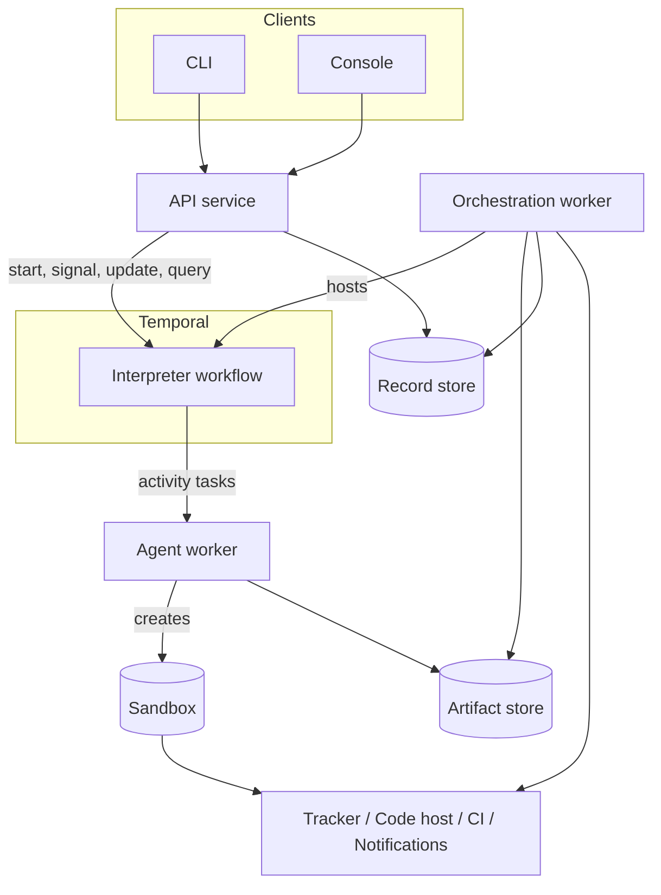
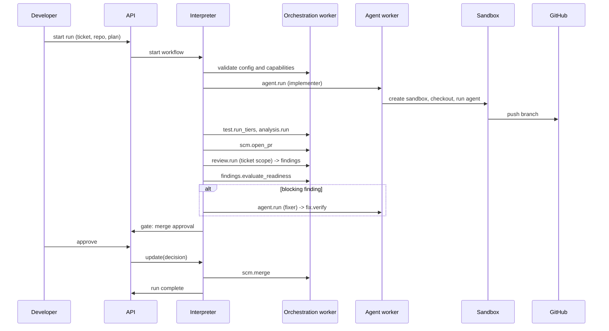

# Architecture, first pass

Status: first pass, for discussion. Date: 2026-10-25. Supersedes nothing; `brief.md` is the input.

Application name: **Feature Flow** (`feature-flow` in code, configuration, paths and package names). This repository is `feature-flow-poc`, a proof of concept that may evolve into the finished product or be rewritten.

---

## 1. Shape of the system

### 1.1 Components

| Component | Runs as | Responsibility | Stateful |
|---|---|---|---|
| API service | Long-lived service | Start, steer, decide on, abort and query runs. Authentication and authorisation. Writes the audit record. Owns the Temporal client for control operations | No (uses record store) |
| Orchestration worker | Long-lived service, N replicas | Hosts the interpreter workflow and *light* activities (tracker metadata, PR state reads, artifact metadata, notifications, validation) | No |
| Agent worker | Long-lived service, N replicas, possibly per-capability pools | Hosts agent step activities. Creates and disposes sandboxes via the sandbox provider. Streams heartbeats | No (sandbox is ephemeral) |
| Artifact store | External | Content-addressed, immutable blobs: plans, specs, diffs, transcripts, logs, reports | Yes |
| Record store | External | Queryable records: findings ledger, decisions, steering log, run index, run timeline | Yes |
| Temporal | External | Durable execution | Yes |
| Console, CLI | Client | Talk to the API only | No |

The API service and the workers share the provider and policy libraries. They do not share process state.

### 1.2 Task queues

All queues are prefixed with `feature-flow`.

| Queue | Workers | Notes |
|---|---|---|
| `feature-flow-orchestration` | Orchestration | Default. May be suffixed per tenant |
| `feature-flow-agent` | Agent, general pool | Default sandbox capability set |
| `feature-flow-agent:<capability>` | Agent, specialised pool | Capability routing, see S1. Examples: `feature-flow-agent:os-windows`, `feature-flow-agent:docker`, `feature-flow-agent:gpu` |

A step declares the capabilities it needs. The interpreter picks the queue from the capability set. This is how Windows-only repositories, Docker-dependent test tiers and network-restricted environments are handled without special cases in the interpreter.

### 1.3 Component diagram



---

## 2. Core data model

| Entity | Where it lives | Notes |
|---|---|---|
| Run | Temporal workflow state (compact) + record store (index) | One workflow execution. Has a scope: ticket, epic or delivery |
| Plan | Workflow state (current revision) + artifact store (every revision) | Data. Append-only revision history |
| Step run | Workflow state (compact) + record store | One execution of one step: status, attempts, outcome, artifact refs |
| Artifact | Artifact store | Content-addressed by hash. Referenced by URI, never inlined |
| Finding | Record store (full) + workflow state (compact summary) | Fingerprinted, scoped, triaged once |
| Decision | Record store | Human gate request and response, with actor and time |
| Steering record | Record store | Audited mutation of a running run |
| Timeline event | Record store | Append-only. Feeds console, audit and notifications |

Two rules follow from this and should be treated as invariants:

1. **Workflow state holds references and small summaries only.** No transcripts, no diffs, no code, no secrets, no full finding bodies.
2. **Anything a human or a report needs to query lives in the record store**, not in Temporal history.

---

## 3. The interpreter

### 3.1 The loop

One workflow type for every run. Differences between a ticket run, an epic run and a delivery run come from the plan, not from code.

```
state = { planRevision, cursor, stepRuns[], findingsSummary[], attemptBudgets, pendingDecision? }

loop:
  step    = plan.next(cursor, state)                 # pure
  if none: complete(run)

  if step.gate and not policy.autoApprove(step, state):   # pure
      decision = await decision(step)                # durable wait, no timeout
      state    = applyDecision(state, decision)      # pure

  result  = await execute(step)                      # activity or child workflow
  state   = applyResult(state, result)               # pure
  cursor  = plan.route(step, result.outcome, state)  # pure

  if historyBudgetExceeded(state): continueAsNew(state)
```

Everything outside `await` is a pure function of the plan and the state. That is the determinism boundary.

### 3.2 Three execution forms for a step

| Form | Where it runs | Used for | Examples |
|---|---|---|---|
| Local | Inside the workflow, pure | Decisions that need no I/O | `plan.validate`, `policy.evaluate`, `findings.evaluate_readiness` |
| Activity | Orchestration or agent worker | Everything that touches the outside world | `scm.open_pr`, `agent.run`, `test.run_tiers` |
| Child workflow | Own workflow execution | Steps with their own durable lifecycle | `run.child`, `delivery.deploy`, possibly `human.session` |

### 3.3 Plan as data

Sketch only. The workflow definition language is a later brief; the engine consumes this shape.

```yaml
revision: 7
steps:
  - id: implement
    kind: agent.run
    scope: ticket
    protected: true
    inputs:
      role: implementer
      task_ref: artifact://plan/task-12.md
      write_access: repository
    requires: { capabilities: [sandbox, agent_runtime] }
    limits: { attempts: 3, start_to_close: 4h, heartbeat: 30s }
    routes:
      completed: verify
      blocked: replan
      attempts_exhausted: human.gate.escalate
```

A step is: `id`, `kind`, `scope`, `inputs` (artifact references), `requires` (capabilities), `limits`, `routes` (outcome to next step id or directive), `protected` (cannot be removed by a re-plan), optional `gate`.

### 3.4 Re-planning and steering share one path

Both produce a **plan patch**. Both go through the same pure `applyPatch` function, which validates:

- schema and step kinds are known;
- required capabilities are present in the configured providers;
- protected steps are not removed or weakened;
- routes point at steps that exist;
- attempt budgets stay within policy ceilings.

| Source | Transport | Audit |
|---|---|---|
| Re-plan agent step | Activity returns a patch | Recorded as a step run with its artifact |
| Human steering | Temporal update via the API | Steering record with actor, reason, diff |

A child run can return outcome `replan_parent` with a patch. The parent applies it through the same function. This is how discovery inside a ticket changes the epic.

### 3.5 Temporal constraints

| Constraint | Approach |
|---|---|
| History size | References only. Compact findings summary in state, capped (see DP5). Continue-as-new at a measured threshold |
| Long runs | Continue-as-new between steps, never mid-step |
| Replay safety | Interpreter version marker plus patched/deprecated markers for behaviour changes. Plan schema versioned separately from interpreter version |
| Determinism | No I/O, no clock, no randomness, no dictionary-order dependence in workflow code. Enforced by replay tests in CI (S8) |
| Temporal unavailable | Workers retry connection and resume. The API reports platform status distinctly from run status. Runs are never failed because the platform is down |
| Payload codec | Pluggable from the start. Encryption is a configuration choice, not a code change |

**Known hazard:** a decision or steering update that arrives while the workflow is continuing-as-new can be lost. Mitigation: continue-as-new only at a safe point (between steps, no pending decision), and the API retries when it finds no open gate. See R3.

---

## 4. Providers

### 4.1 Interface pattern

Every provider implements a descriptor and a health check, and every method returns a classified result.

```csharp
public interface IProvider {
    ProviderDescriptor Describe();          // name, version, capabilities, config schema
    Task<CheckResult> CheckAsync(CancellationToken ct);   // startup and run-start validation
}

public readonly record struct ProviderError(
    ErrorClass Class,        // Infrastructure | Work
    string Reason,           // stable code, e.g. "rate_limited", "not_found", "conflict"
    TimeSpan? RetryAfter,
    string? RemoteId);
```

### 4.2 Capability declaration

Capabilities are typed records, not strings, so a step can ask a precise question.

| Provider | Example capabilities |
|---|---|
| Code host | `PullRequest`, `ReviewComments`, `CheckStatus`, `MergeMethods[merge, squash, rebase]`, `AiReviewRequest`, `BranchProtection` |
| CI | `Trigger`, `WaitForRun`, `ReadLogs`, `Artifacts` |
| Sandbox | `Os[linux, windows]`, `Docker`, `NetworkPolicy`, `PersistentAcrossSteps` |
| Agent runtime | `StructuredOutput`, `Streaming`, `ToolAllowlist`, `MaxContextTokens` |
| Review | `Scopes[ticket, epic, delivery]`, `StructuredFindings`, `Fingerprints` |
| Tracker | `Issues`, `Epics`, `Transitions`, `Links`, `Comments` |
| Artifact store | `ContentAddressed`, `SignedUrls`, `RetentionPolicy` |
| Notifications | `Channels`, `Interactive` (can the human answer in-channel) |

A step checks capabilities before use and fails with a named missing capability. It never assumes success. Capability negotiation also runs at run start so a run fails in the first minute, not at step 40 (S10).

### 4.3 Error classification

| Class | Meaning | Engine behaviour |
|---|---|---|
| Infrastructure | Remote system or network failed, the work did not happen | Retry with backoff. Does not consume a work attempt |
| Work | The work happened and produced an outcome | No retry. Route by outcome |

The provider classifies, because it knows its system. The step may override, because it knows the intent: an agent that ran out of time is a work outcome (`timeout`), not an infrastructure failure.

| Reason | Default class | Notes |
|---|---|---|
| `timeout`, `unreachable`, `server_error`, `rate_limited` | Infrastructure | Honour `Retry-After` |
| `unauthenticated`, `forbidden` | Infrastructure, non-retryable after a short budget | Almost always a configuration fault. Fail the run with a clear message |
| `not_found`, `conflict`, `validation_failed`, `rejected` | Work | Route by outcome |
| `partial` | Work | Step decides; usually means reconcile then retry once |

### 4.4 Provider catalogue

Temporal platform, worker platform, sandbox, tracker, code host, CI, agent runtime, review, artifact store, record store, secrets, notifications. Each with a contract test suite (S5) so a new provider can prove conformance without the engine changing.

---

## 5. Configuration

### 5.1 Layers

| Layer | Where | May set | May not set |
|---|---|---|---|
| Installation | Deployment config | Temporal connection, worker platform, provider selection and credentials references, retention, codec, defaults | Anything repository-specific |
| Organisation / team | Config service or file | Policy floors, provider bindings, notification routing, budgets, who may approve and steer | Repository build and test detail |
| Repository | In the repository, `.feature-flow/manifest.yaml` | Test tiers and commands, setup, static analysis, sandbox base, CI mapping, branch and merge conventions | Policy floors, credentials |
| Run | API at start | Scope, target repositories, plan overrides, attempt budgets within ceiling, dry-run | Policy floors, provider selection |

Precedence: **most specific layer wins, except a small set of safety floors that no lower layer may relax.** See DP6.

### 5.2 Policy model

One model, one evaluation function, used by gates, merges and steering.

| Policy object | Contents |
|---|---|
| `approval` | Scope (ticket, epic, delivery into default branch), required approvers by role, minimum count, whether an agent counts |
| `merge` | Target branch pattern, allowed methods, required checks, whether auto-merge is permitted |
| `findings` | Merge bar per D8: no unresolved blocking finding, and every finding fixed or declined with a recorded reason |
| `attempts` | Per step kind and per run ceilings; steering may grant more within a hard ceiling |
| `steering` | Who may amend a step, override content, grant attempts, abort |

Default: a merge into a repository's default branch requires a human. This is a floor.

### 5.3 Example profiles

| | Solo developer | Small company | Enterprise |
|---|---|---|---|
| Temporal | `start-dev` or one container | Compose, Helm, or Temporal Cloud | Temporal Cloud, one namespace per environment |
| Workers | Local Docker | Kubernetes (EKS/AKS) | Organisation Kubernetes, several pools by capability |
| Sandbox | Local Docker | Kubernetes pod | Kubernetes pod, plus CI delegation for Docker-dependent and Windows-only tiers |
| Tracker | GitHub Issues | Jira | Jira |
| Code host | GitHub | GitHub | GitHub (GitHub App identity) |
| CI | GitHub Actions | GitHub Actions | GitHub Actions and TeamCity |
| Stores | Local filesystem + SQLite | S3/Blob + Postgres | Organisation-managed object store and database |
| Secrets | Env or file | Cloud secret manager | Internal platform, short-lived, OIDC planned |

Same code in all three. Only configuration differs (D4).

---

## 6. Data flow

### 6.1 One ticket run



### 6.2 Epic with a mid-run re-plan

1. Epic run starts. Plan step `run.child` starts a ticket run as a child workflow, one per ticket, on the same interpreter with a ticket-scoped plan.
2. A ticket's implementation step discovers a needed change in a second repository. Its outcome is `blocked` with a re-plan request artifact.
3. The ticket run routes to `plan.replan`. The activity returns a plan patch. The interpreter validates and applies it. The ticket run continues; it does not restart.
4. The ticket run completes with outcome `replan_parent` and a patch for the epic: add a ticket for the second repository, add an epic-level review step.
5. The epic run applies the patch through the same `applyPatch`. Already-completed steps are untouched. Protected steps are intact.
6. The epic run starts the new child run, then runs `review.run` at epic scope over the aggregate diff, then `delivery.*` across repositories in declared order.

---

## 7. Engine step catalogue (first grouping)

Grouped by family. Full contracts are the next deliverable; this is the shape.

| Family | Steps |
|---|---|
| Agent | `agent.run` (role, task, tools, write access, limits) |
| Human | `human.gate`, `human.session`, `policy.auto_approve` |
| Composition | `run.child`, `run.wait` |
| Planning | `plan.replan`, `plan.validate` |
| Source control | `scm.create_branch`, `scm.merge_base_forward`, `scm.open_pr`, `scm.update_pr`, `scm.merge` |
| CI | `ci.wait_checks` (handles checks that register late), `ci.trigger`, `ci.read_results` |
| Testing | `test.run_tiers`, `test.run_composition` (several repositories as services) |
| Analysis | `analysis.run` (fail on new issues, analyser from the repository manifest) |
| Review | `review.run` (any scope, any provider) |
| Findings | `findings.triage`, `findings.post_declines`, `findings.evaluate_readiness` |
| Fix verification | `fix.verify` (regression test required, re-check against the original finding on the full diff) |
| Waiting | `wait.for_state` (PR, check, tracker issue) |
| Artifacts | `artifact.bundle`, `artifact.validate`, `artifact.import`, `artifact.publish` |
| Delivery | `delivery.deploy_order`, `delivery.gate`, `delivery.report` |
| Tracker | `tracker.create`, `tracker.update`, `tracker.transition`, `tracker.link` |

Steering is not a step. It is a control-plane capability that produces a plan patch or an attempt grant.

Every step contract states: inputs, required capabilities, outcomes, idempotency strategy, timeouts and heartbeat, error classification overrides, artifacts in and out, scope, and audit events.

### 7.1 Idempotency

Every step gets a deterministic idempotency key: `hash(runId, stepId, stableInputs)`. Two mechanisms:

1. **Marker-based discovery.** The engine writes a stable, hidden marker into every remote object it creates: a branch name suffix, a PR body comment, a commit trailer. On retry the step searches for the marker and adopts the existing object instead of creating a duplicate.
2. **Provider-side dedupe** where the remote system supports an idempotency key.

### 7.2 Findings

Fingerprint on: rule or check id, repository, file path, enclosing symbol, and a normalised snippet hash. **Never on line numbers.** A declined finding reopens only when the code its fingerprint points at changes. Full finding bodies live in the record store; the workflow state carries a capped summary (id, fingerprint, severity, scope, status, blocking flag).

---

## 8. Deliberately not designed yet

- The workflow definition language: syntax, routing rules, re-plan patch format. The engine assumes the plan is data.
- Workflow content: templates, agent task prompts, skills, check definitions.
- Console UI beyond the API it needs.
- Deployment internals. The engine triggers and gates deploys; it does not implement them (A13).

---

## 9. Principal risks

| # | Risk | First mitigation |
|---|---|---|
| R1 | History growth on a 27-hour, hundreds-of-steps run | References only, capped findings summary, measured continue-as-new threshold, replay tests |
| R2 | Non-determinism leaks into the interpreter | Pure-function discipline, replay test suite in CI, code review rule |
| R3 | Decision or steering lost during continue-as-new | Continue-as-new only at safe points; API retries when no gate is open |
| R4 | LLM gates unstable across passes | Structured, fingerprinted findings carried between passes; verdict is not re-derived from scratch |
| R5 | Sandbox does not match CI | Repository manifest declares tiers; CI delegation is a first-class path, not a fallback |
| R6 | Credential exposure in sandboxes or payloads | Short-lived, least-privilege, per-step credentials; secrets by reference; encrypted payload codec available |
| R7 | Re-plan agent removes or weakens protected steps | Protected flag enforced in the single `applyPatch` path |
| R8 | Runs stall on human latency | Unbounded durable waits with reminders, never activity timeouts; "stuck run" notification |
| R9 | Organisation fork drifts from upstream | All organisation behaviour in configuration and providers; contract tests make drift visible |
| R10 | Concurrent tickets in one repository conflict | Integration branch plus `scm.merge_base_forward`; serialised merge step per repository (see Q11) |
