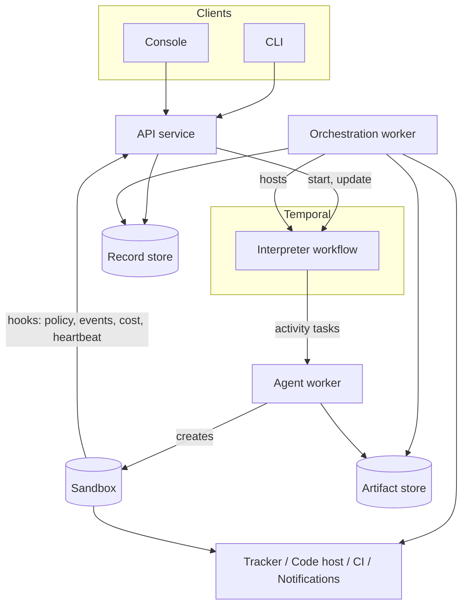
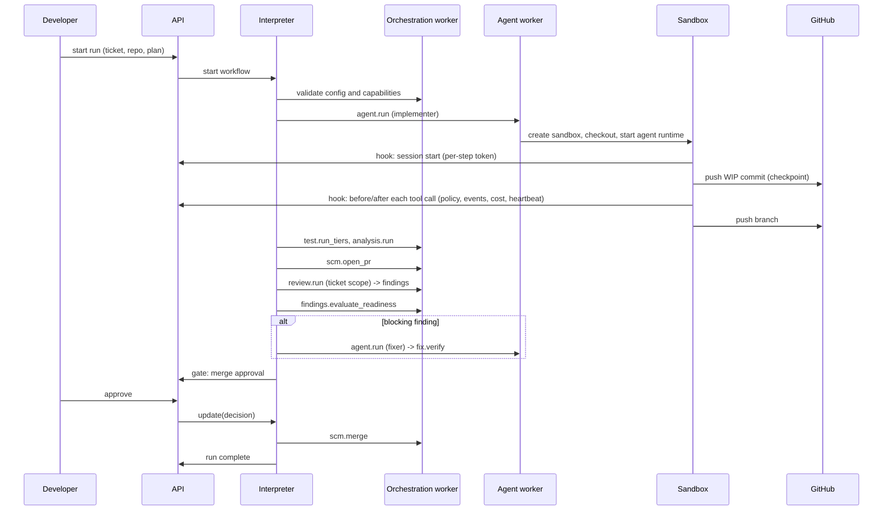

# Architecture, first pass

Status: revised for reviews 01 to 04. Date: 2026-10-25, updated 2026-10-26. Supersedes nothing; `brief.md` is the input.

Application name: **Feature Flow** (`feature-flow` in code, configuration, paths and package names). This repository is `feature-flow-poc`, a proof of concept that may evolve into the finished product or be rewritten.

Decisions applied from `docs/reviews/review-01.md`: implementation language is
**.NET**; the agent loop runs **in the sandbox with engine hooks** (section 1.4);
agent steps are **resumable** (section 3.6); the plan shape supports **parallel
branches and joins** (section 3.3); the storage model, control plane, identity
and provider packaging are settled (sections 2, 4.5, 5.4).

Decisions applied from `docs/reviews/review-03.md`: the repository file is a root
`feature-flow.yaml` (section 5.1.1); execution targets replace "sandbox spec"
(section 5.1.1); Windows support is deferred with hooks in version 1 (section
4.7); the concurrency model is an epic integration branch with per-ticket
branches (section 6.3); attempt budgets follow one counting rule (section 3.7);
delivery has no compensating action (section 7.3); and **engine mechanism versus
workflow policy** is a standing principle (section 1.5).

Decisions applied from `docs/reviews/review-04.md`: observability is
OpenTelemetry with a provider decorator (section 4.8); interactive sessions are
an engine mechanism with a pluggable session surface (section 7.4); and
`feature-flow.yaml` is read per step, never copied into the plan (section 5.1.2).

---

## 1. Shape of the system

### 1.1 Components

| Component | Runs as | Responsibility | Stateful |
|---|---|---|---|
| API service | Long-lived service | Start, steer, decide on, abort and query runs. Authentication and authorisation. Writes the audit record. Owns the Temporal client for control operations. Serves the **hook endpoint** that agent runtimes in sandboxes call back to (section 1.4) | No (uses record store) |
| Orchestration worker | Long-lived service, N replicas | Hosts the interpreter workflow and *light* activities (tracker metadata, PR state reads, artifact metadata, notifications, validation) | No |
| Agent worker | Long-lived service, N replicas, possibly per-capability pools | Hosts agent step activities. Creates and disposes sandboxes via the sandbox provider. Starts the agent runtime inside the sandbox and supervises it. Streams heartbeats | No (sandbox is ephemeral) |
| Artifact store | External | Content-addressed, immutable blobs: plans, specs, diffs, transcripts, logs, reports | Yes |
| Record store | External | Queryable records: findings ledger, decisions, steering log, run index, run timeline | Yes |
| Temporal | External | Durable execution | Yes |
| Console, CLI | Client | Talk to the API only | No |

The API service and the workers share the provider and policy libraries. They do not share process state.

### 1.2 Task queues

All queues are prefixed with `feature-flow`.

| Queue | Workers | Notes |
|---|---|---|
| `feature-flow-orchestration` | Orchestration | Default. May be suffixed per tenant |
| `feature-flow-agent` | Agent, general pool | Default sandbox capability set |
| `feature-flow-agent:<capability>` | Agent, specialised pool | Capability routing, see S1. Examples: `feature-flow-agent:os-windows`, `feature-flow-agent:docker`, `feature-flow-agent:gpu` |

A step declares the capabilities it needs. The interpreter picks the queue from the capability set. This is how Windows-only repositories, Docker-dependent test tiers and network-restricted environments are handled without special cases in the interpreter.

### 1.3 Component diagram



Reads do not go through Temporal queries. The console and API read from the
record store (section 5.4).

### 1.4 Pattern: agent in sandbox with engine hooks

Decided (product owner, 2026-10-26). This is the answer to "where does the agent
loop run", and it is settled before the language question because it makes the
engine language largely independent of agent SDK languages.

The agent runtime (for example Claude Code, GitHub Copilot CLI) runs **inside the
sandbox** with its own tools, unchanged. The agent worker starts it and supervises
it. The runtime's hooks — before and after each tool call, session start and end —
call an engine endpoint for:

- **Policy checks on each tool call.** Deny writes for read-only roles, deny
  pushes to protected branches, deny changes to `.git/config` and similar.
- **Structured events**, which become timeline events in the record store.
- **Token and cost accounting** per step (section 5.5).
- **Heartbeats**, so a stalled agent is detected without polling the sandbox.

Supporting rules:

- **Resumability.** Work-in-progress commits are pushed to the branch, and the
  runtime's own session resume is used, with the session reference stored in the
  artifact store. See section 3.6.
- **Model credentials** are short-lived and scoped to the step, preferably
  through a model gateway so no long-lived key enters the sandbox.
- **Hook support is a declared capability** of the agent runtime provider. A
  runtime without hooks gets coarser control (process-level only) and the engine
  records that in the run.

Rejected alternative: running the agent loop in the agent worker with each tool
call executed remotely in the sandbox. Rejected, not deferred, because it
requires building and maintaining an agent harness (context management,
compaction, edit tools, sub-agents, MCP, prompt caching) when vendor harnesses
are better and improve monthly; because hundreds of tool calls per step as
Temporal activities means thousands of history events per step; and because of
network latency on every tool call. Commit-level checkpoints plus session resume
are expected to be enough; measure before revisiting.

### 1.5 Principle: engine mechanism vs workflow policy

Added for review 03. When a design question arises, first decide which side it
belongs to.

The **engine** provides mechanisms: steps, routing, gates, providers, policy
evaluation and safety floors. **Workflow content**, defined by the library,
decides what agents do and how delivery is approached: planning rules, feature
flagging, deploy ordering, contract compatibility, review checklists.

**Safety floors are the exception.** The engine enforces them because no workflow
may relax them (DP6).

Example: shipping dark behind feature flags is not an engine concern. It depends
on whether the adopter has feature flagging — some require every significant
change to be flagged. If workflows later need to create or check flags, add an
optional feature-flag provider. Not in version 1.

---

## 2. Core data model

| Entity | Where it lives | Notes |
|---|---|---|
| Run | Temporal workflow state (compact) + record store (index) | One workflow execution. Has a scope: ticket, epic or delivery |
| Plan | Workflow state (current revision) + artifact store (every revision) | Data. Append-only revision history |
| Step run | Workflow state (compact) + record store | One execution of one step: status, attempts, outcome, artifact refs |
| Artifact | Artifact store | Content-addressed by hash. Referenced by URI, never inlined |
| Finding | Record store (full) + workflow state (compact summary) | Fingerprinted, scoped, triaged once |
| Decision | Record store | Human gate request and response, with actor and time |
| Steering record | Record store | Audited mutation of a running run |
| Timeline event | Record store | Append-only. Feeds console, audit and notifications |

Two rules follow from this and should be treated as invariants:

1. **Workflow state holds references and small summaries only.** No transcripts, no diffs, no code, no secrets, no full finding bodies.
2. **Anything a human or a report needs to query lives in the record store**, not in Temporal history.

### 2.1 Storage model (decided)

Decided (product owner, 2026-10-26). Answers Q2, Q3, Q10 and Q13.

| Store | Contents | Technology by profile | Model |
|---|---|---|---|
| Temporal history | Working state only: references and small summaries | Temporal | Transient; deleted after namespace retention |
| Artifact store | Specs, plans and every plan revision, diffs, transcripts, logs, reports | Local filesystem (solo); S3 or Azure Blob | Immutable, content-addressed. A new version is a new hash plus a named pointer in the record store |
| Record store | Runs, step runs, findings ledger, decisions, steering log, timeline events, cost per step | SQLite (solo); Postgres | Relational, queried through the API. Timeline append-only. The long-term audit record |

**Git is not a store.** Publishing artifacts to a repository for human review is
an engine step (`artifact.publish`). There is no requirement to browse run state
through Git; the console and API replace it.

### 2.2 Tenancy and disaster recovery

Decided (review 04, Q15 and Q18).

**Tenancy.** One organisation per installation (A10 holds). Teams are scoped by
the policy model and roles. An `org_id` is added to record store keys from the
first version — cheap now, expensive later. No other multi-tenant features.

**Disaster recovery.** No custom mechanism:

- Record store: standard database backups with point-in-time restore.
- Artifact store: cloud versioning and replication; content addressing makes
  integrity checks simple.
- Temporal unavailable: already handled (section 3.5).
- A **reconcile job** rebuilds the run index in the record store from Temporal for
  in-flight runs.
- Recovery point and recovery time are documented per profile.

---

## 3. The interpreter

### 3.1 The loop

One workflow type for every run. Differences between a ticket run, an epic run and a delivery run come from the plan, not from code.

```
state = { planRevision, cursors[], stepRuns[], findingsSummary[], attemptBudgets, pendingDecision? }

loop:
  ready   = plan.ready(cursors, state)               # pure: steps whose joins are satisfied
  if none and no step in flight: complete(run)

  for each step in ready:                            # concurrent, see 3.3
    if step.gate and not policy.autoApprove(step, state):   # pure
        decision = await decision(step)              # durable wait, no timeout
        state    = applyDecision(state, decision)    # pure

  results = await all(execute(step) for step in ready)   # activities or child workflows
  state   = applyResults(state, results)             # pure
  cursors = plan.route(ready, results, state)        # pure: advance, open or satisfy joins

  if historyBudgetExceeded(state): continueAsNew(state)
```

Everything outside `await` is a pure function of the plan and the state. That is the determinism boundary.

Concurrency is bounded by the plan, not by the interpreter: `plan.ready` returns
only the steps whose dependencies are satisfied and whose concurrency limit
allows. A11 (several tickets of one epic running concurrently) is expressed as
parallel branches in the plan, not as special-cased interpreter behaviour.

### 3.2 Three execution forms for a step

| Form | Where it runs | Used for | Examples |
|---|---|---|---|
| Local | Inside the workflow, pure | Decisions that need no I/O | `plan.validate`, `policy.evaluate`, `findings.evaluate_readiness` |
| Activity | Orchestration or agent worker | Everything that touches the outside world | `scm.open_pr`, `agent.run`, `test.run_tiers` |
| Child workflow | Own workflow execution | Steps with their own durable lifecycle | `run.child`, `delivery.deploy`, possibly `human.session` |

### 3.3 Plan as data

Sketch only. The workflow definition language is a later brief; the engine consumes this shape.

```yaml
revision: 7
steps:
  - id: implement
    kind: agent.run
    scope: ticket
    protected: true
    inputs:
      role: implementer
      task_ref: artifact://plan/task-12.md
      write_access: repository
    requires: { capabilities: [sandbox, agent_runtime] }
    limits: { attempts: 3, start_to_close: 4h, heartbeat: 30s }
    routes:
      completed: verify
      blocked: replan
      attempts_exhausted: human.gate.escalate

  - id: tickets
    kind: parallel
    branches: [ticket-a, ticket-b, ticket-c]
    max_concurrency: 2
    join: all                       # all | any | n
    routes:
      completed: epic_review
      any_failed: human.gate.escalate

  - id: epic_review
    kind: review.run
    scope: epic
    inputs: { diff: aggregate }
```

A step is: `id`, `kind`, `scope`, `inputs` (artifact references), `requires` (capabilities), `limits`, `routes` (outcome to next step id or directive), `protected` (cannot be removed by a re-plan), optional `gate`.

### 3.3.1 Parallel branches and joins

Added for review 01 (F5). A11 says several tickets of one epic may run
concurrently, so the plan shape needs fan-out and join.

- A `parallel` step names its branches and a `join` policy: `all`, `any`, or a
  count `n`. Branches are themselves steps or sub-plans, so a branch may be a
  `run.child` for a ticket.
- `max_concurrency` bounds how many branches are in flight. It is a plan value,
  so a re-plan can tighten it, and it is what keeps concurrency in one repository
  a configuration question rather than an interpreter one. Confirmed by review 03;
  see section 6.3 for the branch and merge model.
- Join semantics: the join is satisfied when the policy is met. `all` waits for
  every branch; `any` completes when the first branch reaches a terminal
  outcome and cancels the rest; `n` completes when `n` branches succeed.
- A branch outcome routes like any other outcome. `any_failed` is the aggregate
  route when a branch fails and the join policy is not satisfied.
- `applyPatch` (section 3.4) validates branches the same way it validates steps:
  known kinds, present capabilities, protected steps intact, routes resolving to
  steps that exist. A re-plan may add branches to a `parallel` step that has not
  started, and may not remove a protected branch.
- Workflow state carries one cursor per in-flight branch, hence `cursors[]` in
  section 3.1. Continue-as-new still happens only between steps, never mid-step.

### 3.4 Re-planning and steering share one path

Both produce a **plan patch**. Both go through the same pure `applyPatch` function, which validates:

- schema and step kinds are known;
- required capabilities are present in the configured providers;
- protected steps are not removed or weakened;
- routes point at steps that exist;
- attempt budgets stay within policy ceilings.

| Source | Transport | Audit |
|---|---|---|
| Re-plan agent step | Activity returns a patch | Recorded as a step run with its artifact |
| Human steering | Temporal update via the API | Steering record with actor, reason, diff |

A child run can return outcome `replan_parent` with a patch. The parent applies it through the same function. This is how discovery inside a ticket changes the epic.

### 3.5 Temporal constraints

| Constraint | Approach |
|---|---|
| History size | References only. Compact findings summary in state, capped (see DP5). Continue-as-new at a measured threshold |
| Long runs | Continue-as-new between steps, never mid-step |
| Replay safety | Interpreter version marker plus patched/deprecated markers for behaviour changes. Plan schema versioned separately from interpreter version |
| Determinism | No I/O, no clock, no randomness, no dictionary-order dependence in workflow code. Enforced by replay tests in CI (S8) |
| Temporal unavailable | Workers retry connection and resume. The API reports platform status distinctly from run status. Runs are never failed because the platform is down |
| Payload codec | Pluggable from the start. Encryption is a configuration choice, not a code change |

**Known hazard:** a decision or steering update that arrives while the workflow is continuing-as-new can be lost. Mitigation: continue-as-new only at a safe point (between steps, no pending decision), and the API retries when it finds no open gate. See R3.

### 3.6 Resumable agent steps

Added for review 01 (F4). A long agent step — an hour or more — that loses its
worker or its sandbox must continue, not restart. Interruptions were the
prototype's main operational pain.

Three mechanisms, in order of preference:

1. **Work-in-progress commits pushed to the branch.** The agent commits and
   pushes as it goes, so completed work survives any failure. This is the primary
   checkpoint and it needs no engine state.
2. **Session resume.** The agent runtime's own session reference is stored in the
   artifact store. A retry resumes the session rather than starting a new one.
   Under pattern C (section 1.4) the runtime is already inside the sandbox, so
   this is the runtime's native resume.
3. **Sandbox re-attachment.** The sandbox outlives a worker crash. A retry
   re-attaches to it by idempotency key (section 7.1) instead of creating a new
   one. This is a sandbox provider capability, `PersistentAcrossSteps`, and the
   step degrades gracefully when it is absent: it creates a new sandbox and
   resumes from the pushed commits and the session reference.

Consequences for the step contract:

- `agent.run` declares a resume strategy and records, per attempt, the commit it
  resumed from and the session reference it used.
- Heartbeats carry progress (last commit, session id), so a stalled agent is
  distinguishable from a slow one.

**Graceful worker shutdown is an implementation requirement** (review 12 B2).
Spike 1 measured 87.4s from a worker kill to the step making progress again, and
almost all of it was the heartbeat timeout plus worker restart — not the resume
itself, which is a re-attach by handle and is cheap. A worker shutting down
deliberately must therefore finish its current heartbeat, release its slots, and
let the platform reassign the activity immediately, rather than waiting to be
detected as dead. Crash recovery and planned shutdown are different paths, and
only the first should cost a timeout.

### 3.7 Attempt budgets

Decided (review 03, Q12). This replaces the provisional rule written for review 01
(F4), which said resumes never count. The complete rule set:

| Rule | Detail |
|---|---|
| One counting rule | Every entry into a step counts against that step's allowance, whatever routed there: retry, route back, redirect. No second rule set |
| Infrastructure failures are free | Classified infrastructure failures retry with backoff and do not count (section 4.3) |
| Resumes are free only with progress | **Progress = a new commit pushed to the branch, or the agent session has grown since the previous attempt.** The agent runtime provider reports session size or a turn count. After **3 consecutive resumes with no progress**, the next one counts as a restart. `start_to_close` remains the outer bound |
| Two limits | A per-step allowance (default by step kind, overridable in the plan) and a per-run ceiling |
| Exhaustion | Outcome `attempts_exhausted`, routed by the plan to a re-plan or a human gate. Never a silent failure |
| Steering grants | Extra attempts up to a hard ceiling, which is a safety floor; beyond it needs the admin role. Always audited |
| Review and fix loops | Governed by the findings ledger, not a raw count. The loop ends when no blocking finding is unresolved (D8). A finding that reappears after being fixed twice escalates instead of looping. A declined finding never restarts the loop |

---

## 4. Providers

### 4.1 Interface pattern

Every provider implements a descriptor and a health check, and every method returns a classified result. **No provider method waits on human or external time** — waiting is an engine mechanism, using durable timers, polling or inbound events. See `docs/04-provider-interfaces.md` section 1.3.

```csharp
public interface IProvider {
    ProviderDescriptor Describe();          // name, version, capabilities, requires, config schema
    Task<ProviderResult<CheckResult>> CheckAsync(CancellationToken ct);   // startup and run-start validation
}

public readonly record struct ProviderError(
    ErrorClass Class,        // Infrastructure | Work
    string Reason,           // stable code, e.g. "rate_limited", "not_found", "conflict"
    TimeSpan? RetryAfter,
    string? RemoteId);
```

### 4.2 Capability declaration

Capabilities are typed records, not strings, so a step can ask a precise question.

| Provider | Example capabilities |
|---|---|
| Code host | `PullRequest`, `ReviewComments`, `CheckStatus`, `MergeMethods[merge, squash, rebase]`, `BranchProtection`, `MergeQueue` (optional; only some repositories have it enabled, section 6.3), `InboundEvents` |
| CI | `Trigger`, `ReadLogs`, `Artifacts`, `InboundEvents` |
| Sandbox | `Os[linux, windows]`, `Docker`, `NetworkPolicy`, `PersistentAcrossSteps`, `StreamingOutput` |
| Agent runtime | `StructuredOutput`, `Streaming`, `ToolAllowlist`, `MaxContextTokens`, `Hooks` (can the runtime call back to the engine per tool call, section 1.4), `SessionResume` |
| Review | `Scopes[ticket, epic, delivery]`, `StructuredFindings`, `Fingerprints` |
| Tracker | `Issues`, `Epics`, `Transitions`, `Links`, `Comments` |
| Artifact store | `ContentAddressed`, `SignedUrls`, `RetentionPolicy` |
| Notifications | `Channels`, `Interactive` (can the human answer in-channel) |

A step checks capabilities before use and fails with a named missing capability. It never assumes success. Capability negotiation also runs at run start so a run fails in the first minute, not at step 40 (S10).

### 4.3 Error classification

| Class | Meaning | Engine behaviour |
|---|---|---|
| Infrastructure | Remote system or network failed, the work did not happen | Retry with backoff. Does not consume a work attempt |
| Work | The work happened and produced an outcome | No retry. Route by outcome |

The provider classifies, because it knows its system. The step may override, because it knows the intent: an agent that ran out of time is a work outcome (`timeout`), not an infrastructure failure.

| Reason | Default class | Notes |
|---|---|---|
| `timeout`, `unreachable`, `server_error`, `rate_limited` | Infrastructure | Honour `Retry-After` |
| `unauthenticated`, `forbidden` | Infrastructure, non-retryable after a short budget | Almost always a configuration fault. Fail the run with a clear message |
| `not_found`, `conflict`, `validation_failed`, `rejected` | Work | Route by outcome |
| `partial` | Work | Step decides; usually means reconcile then retry once |

### 4.4 Provider catalogue

Temporal platform, worker platform, sandbox, tracker, code host, CI, agent runtime, review, artifact store, record store, secrets, notifications, credential broker, session surface. Each with a contract test suite (S5) so a new provider can prove conformance without the engine changing.

**Interface definitions: `docs/04-provider-interfaces.md`** gives each provider its
capability record and method signatures. **`docs/05-provider-contracts.md`** gives
the per-method contracts: idempotency, error codes, timeouts, heartbeats and
semantics.

### 4.5 Provider packaging (decided)

Decided (product owner, 2026-10-26). Answers Q6.

- **Version 1: providers are in-process .NET packages (NuGet).** A host project
  references the providers it ships; configuration selects them by name.
- **Provider interfaces must be transport-neutral.** Async, plain serialisable
  data objects, no third-party SDK types in signatures, cancellation and
  classified errors on every call. This keeps a generic **remote provider**
  adapter possible later — one that implements any interface by calling an
  out-of-process provider over gRPC or HTTP — for providers in other languages or
  needing isolation. Do not build the adapter in version 1.
- **Organisation customisation uses a distribution repository, not a fork.** A
  separate repository holds the organisation's own providers and a small host
  project that builds its worker and API images, plus its configuration. A fork
  is needed only for core changes, which should be rare. The packages and host
  are designed so this works: published packages, documented host composition.

### 4.6 Credential broker

Added for review 01 (Q5). Given an actor (engine, agent step), a target system
and a scope, the broker returns a short-lived credential. GitHub App tokens,
service accounts, personal tokens and future mechanisms (for example OIDC
workload identity) are implementations.

- **No provider reads credentials directly from configuration.** All go through
  the broker. This is what keeps identity choices from leaking into provider
  interfaces.
- Code host, tracker, CI and chat providers remain fully swappable.

| Actor | Identity |
|---|---|
| Engine against the code host | A GitHub App, or the equivalent bot identity on other hosts |
| Agents in the sandbox | A token minted per step from the app identity: one repository, minimum permissions (contents write), about one hour; refreshable through the hook endpoint |
| Engine against the tracker | A service account; every action records "on behalf of" the run's requester or approver |
| Agents against the tracker | None. Tracker writes only through engine steps |
| Solo profile | The developer's own token for both engine and agents |

Merges into a default branch: the app cannot approve its own PR. Where branch
protection requires a code host review, the human approves on the code host and
the engine waits for it; otherwise the human approves in the console or chat and
the app merges. The audit record shows the bot as actor and the human as
approver.

### 4.7 Windows support: deferred, with hooks in version 1

Decided (review 03, Q9). Windows-only repositories are required later, not in
version 1. Version 1 includes the hooks so support needs no engine change:

- `Os[linux, windows]` sandbox capability; `feature-flow.yaml` can declare
  `os: windows`.
- Routing to `feature-flow-agent:os-windows` queues (S1).
- A run that needs Windows and has no provider fails at run-start capability
  negotiation (S3) with a clear message.
- CI delegation of test tiers works for Windows repositories (section 5.1.1,
  execution targets).

Roadmap:

| Phase | Approach | Notes |
|---|---|---|
| W0 | Spike: agent runtimes and hooks on Windows | Decides whether pattern C holds on Windows. Under pattern C the runtime runs inside the sandbox, so a Windows sandbox needs a Windows runtime with hook support |
| W1 | Windows VM sandbox provider: ephemeral or pooled cloud VMs from an image, agent worker on the VM | Primary approach. CI delegation as fallback for tiers the host cannot run |
| W2 | Windows containers on Windows node pools | Only if density or isolation needs it and the toolchain fits |

Research before W1: image size and start time, and licensing of Windows Server
and build tools in VMs and containers.

### 4.8 Observability contract

Decided (review 04, Q17).

| Area | Decision |
|---|---|
| Standard | OpenTelemetry for traces, metrics and logs, with a configurable exporter (OTLP to any backend). No custom observability interface |
| Traces | One trace per run; spans per step, activity and provider call, with run id, step id and error class as attributes. Use the Temporal .NET SDK's OpenTelemetry support |
| Provider contract | The engine wraps every provider call in a decorator, so providers get spans, timeouts and error classification without extra code. Providers only add attributes |
| Standard metrics | Step duration, attempts, infrastructure retries, schedule-to-start latency per task queue (shows missing or stuck workers), tokens and cost, findings by severity, human wait time, sandbox start time |
| Stuck runs | Detect by heartbeat age and by the progress rule in section 3.7; send a "run stuck" notification (S13) |
| Logs | Secrets scrubbed at the logging layer. Agent transcripts are artifacts, not logs |

---

## 5. Configuration

**Schema, precedence, safety floors and three worked profiles:
`docs/07-configuration.md`.** This section holds the decisions; that document turns
them into a schema.

### 5.1 Layers

| Layer | Where | May set | May not set |
|---|---|---|---|
| Installation | Deployment config | Temporal connection, worker platform, provider selection and credentials references, retention, codec, defaults | Anything repository-specific |
| Organisation / team | Config service or file | Policy floors, provider bindings, notification routing, budgets, who may approve and steer | Repository build and test detail |
| Repository | In the repository, root `feature-flow.yaml` | Test tiers and commands, setup, static analysis, environment requirements, CI mapping, branch and merge conventions | Policy floors, credentials |
| Run | API at start | Scope, target repositories, plan overrides, attempt budgets within ceiling, dry-run | Policy floors, provider selection |

Precedence: **most specific layer wins, except a small set of safety floors that no lower layer may relax.** See DP6.

The floors, numbered so they can be referenced:

| # | Floor | Meaning |
|---|---|---|
| F1 | Human approval for default-branch merges | No layer may set auto-merge for a repository's default branch |
| F2 | Secrets by reference | No layer may inline a secret value |
| F3 | Protected steps | A protected step cannot be removed or weakened by a re-plan or by steering |
| F4 | Attempt ceilings | A run sets budgets within the ceiling; steering may grant up to a hard ceiling; beyond that needs the admin role |

### 5.1.1 `feature-flow.yaml` and execution targets

Decided (review 03, Q7). The repository file is **root-level `feature-flow.yaml`**,
not `.feature-flow/manifest.yaml`. It describes how automations work with the
repository — test tiers and how to run them, setup commands, static analysis, CI
mapping, branch conventions, and environment requirements — and it applies to
every execution target, not only sandboxes.

- The environment is either **defined inline** (image, toolchain, setup) or
  **referenced** from an existing `devcontainer.json`. Repositories without a
  devcontainer need only the one file.
- Other files (Dockerfiles, compose files for integration services) are
  referenced by relative path from `feature-flow.yaml`.
- **`.feature-flow/` is reserved** for possible later use (for example
  repository-specific review checklists or workflow content overrides). It is not
  used in version 1.

Terminology:

| Term | Meaning |
|---|---|
| `feature-flow.yaml` | The repository file, as written |
| Resolved manifest | `feature-flow.yaml` after merging the referenced `devcontainer.json` and defaults. Produced by the engine; providers never parse either source file |
| Execution target | Where a tier runs: sandbox, local, or CI. A provider receives the resolved manifest and runs the tiers for its target |

### 5.1.2 The manifest is read per step, never copied into the plan

Decided (review 04, Q19). The prototype went stale by copying repository settings
into the plan at run start.

- Each step reads `feature-flow.yaml` from its branch when it starts.
- Each step records the hash of the resolved manifest it used.
- If a change removes a capability the run needs, capability negotiation runs
  again before the next step.
- Agent edits to `feature-flow.yaml` are flagged at review. Whether they need
  approval is workflow policy, not an engine concern (section 1.5).

### 5.2 Policy model

One model, one evaluation function, used by gates, merges and steering.

| Policy object | Contents |
|---|---|
| `approval` | Scope (ticket, epic, delivery into default branch), required approvers by role, minimum count, whether an agent counts |
| `merge` | Target branch pattern, allowed methods, required checks, whether auto-merge is permitted |
| `findings` | Merge bar per D8: no unresolved blocking finding, and every finding fixed or declined with a recorded reason |
| `attempts` | Per step kind and per run ceilings; steering may grant more within a hard ceiling. Counting follows section 3.7 |
| `steering` | Who may amend a step, override content, grant attempts, abort |
| `cost` | Not in version 1. When added: per-run and per-step budgets, with the action configurable (warn, gate, abort). Exceeding one always stops at a gate, never a hard stop |

Default: a merge into a repository's default branch requires a human. This is a floor.

### 5.3 Example profiles

| | Solo developer | Small company | Enterprise |
|---|---|---|---|
| Temporal | `start-dev` or one container | Compose, Helm, or Temporal Cloud | Temporal Cloud, one namespace per environment |
| Workers | Local Docker | Kubernetes (EKS/AKS) | Organisation Kubernetes, several pools by capability |
| Sandbox | Local Docker | Kubernetes pod | Kubernetes pod, plus CI delegation for Docker-dependent and Windows-only tiers |
| Docker-dependent tiers | Privileged pod (solo only) | sysbox where supported, else CI delegation | CI delegation |
| Tracker | GitHub Issues | Jira | Jira |
| Code host | GitHub | GitHub | GitHub (GitHub App identity) |
| CI | GitHub Actions | GitHub Actions | GitHub Actions and TeamCity |
| Stores | Local filesystem + SQLite | S3/Blob + Postgres | Organisation-managed object store and database |
| Secrets | Env or file | Cloud secret manager | Internal platform, short-lived, OIDC planned |
| Observability | OTLP to a local collector | OTLP to the organisation's backend | OTLP to the organisation's backend |

Same code in all three. Only configuration differs (D4).

### 5.4 Control plane: decisions, steering and API authorisation (decided)

Decided (product owner, 2026-10-26). Answers Q4.

Transport:

- Decisions and steering use Temporal **Updates**, not Signals. Each carries the
  gate id and plan revision it applies to; the update validator rejects stale or
  invalid requests (no open gate, plan revision changed). The API retries against
  the current run after continue-as-new, which mitigates R3.
- **Reads do not use Temporal queries.** The console and API read from the record
  store.

Authentication:

| Caller | Method |
|---|---|
| Humans (console, CLI) | OIDC against the organisation's identity provider; a local token in the solo profile |
| Automation | Service-account API tokens |
| Agent hooks from the sandbox (pattern C) | Short-lived token issued per step, scoped to that run and step's hook endpoint |

Authorisation:

- Roles from the policy model (viewer, approver, steerer, admin), mapped to
  identity-provider groups, scoped by team or repository.
- **Only the API authorises and writes the audit record.** The workflow trusts the
  API (DP8). Only the API and workers can reach the Temporal namespace.

Chat integration (Slack first; Microsoft Teams later through the same interface):

- Notifications and approvals from chat are wanted for some decisions. A chat
  action calls the API like any other client. The chat user is mapped to an
  identity-provider identity (for example by verified email). The policy model
  states which decisions may be made from chat; for example, ticket-level gates
  yes, merge into a default branch only in the console. The notifications
  provider's `Interactive` capability declares support.
- **Chat must be a pluggable provider.** Slack first, with others (Microsoft
  Teams, WhatsApp, Discord, and so on) swappable later through the same
  notifications/chat interface. No Slack-specific types outside the Slack
  provider.

### 5.5 Cost accounting

Added for review 01 (F6), which moved Q16 from "Later" to "Should settle". The
prototype ran for 27 hours with no record of token or compute cost. Review 03
decided the enforcement half: policy-driven, not in version 1.

- **From the first version, every step records tokens, model and compute time.**
  This is a record-store row per step run, not workflow state. The data cannot be
  recovered retroactively, so recording cannot wait for budgets.
- Under pattern C the hook endpoint is where token and cost events arrive from
  the agent runtime, so per-step accounting is available without parsing
  transcripts.
- Model credentials go through a model gateway where possible, so the gateway is
  a second source of truth for cost.
- **When budgets arrive:** exceeding one always stops at a gate, never a hard
  stop. The running total lives in workflow state, updated only from activity
  results — never from a clock or a query.

---

## 6. Data flow

### 6.1 One ticket run



The agent runtime runs inside the sandbox (pattern C, section 1.4). Its hooks
call the API, which is why the sandbox talks to the API and not only to GitHub.

### 6.2 Epic with a mid-run re-plan

1. Epic run starts. Plan step `run.child` starts a ticket run as a child workflow, one per ticket, on the same interpreter with a ticket-scoped plan.
2. A ticket's implementation step discovers a needed change in a second repository. Its outcome is `blocked` with a re-plan request artifact.
3. The ticket run routes to `plan.replan`. The activity returns a plan patch. The interpreter validates and applies it. The ticket run continues; it does not restart.
4. The ticket run completes with outcome `replan_parent` and a patch for the epic: add a ticket for the second repository, add an epic-level review step.
5. The epic run applies the patch through the same `applyPatch`. Already-completed steps are untouched. Protected steps are intact.
6. The epic run starts the new child run, then runs `review.run` at epic scope over the aggregate diff, then `delivery.*` across repositories in declared order.

### 6.3 Concurrency in one repository

Decided (review 03, Q11). Per-ticket branches plus `scm.merge_base_forward` plus
a serialised merge step. `max_concurrency` on the `parallel` step (section 3.3.1)
is confirmed.

- There is one **epic integration branch** per repository. It is the base of every
  ticket branch in the epic, and the source of the delivery PR into the default
  branch.
- Each ticket works on its **own ticket branch**. A ticket branch merges into the
  integration branch only after its own checks, review and findings bar pass.
  Tickets do not share a working branch, so a failing ticket blocks no one.
- Merges into the integration branch are **serialised per repository by a merge
  lock**. Before merging: `scm.merge_base_forward` into the ticket branch; rerun
  checks only if that merge changed the ticket branch; then merge.
- A merge conflict routes to an agent step that resolves it, not to a human first.
- The planner declares the code areas each ticket expects to touch; the scheduler
  prefers not to run tickets with overlapping areas at the same time. This is a
  preference, not a rule, and how the planner does it is workflow content
  (section 1.5).
- Epic-level review runs on the aggregate diff of the integration branch (DP10),
  which keeps attribution simple.

Code host merge queues (GitHub merge queue, GitLab merge trains):

- Optional `MergeQueue` capability on the code host provider. Only some
  repositories have it enabled.
- When the target branch requires a queue, the merge step enqueues the PR and
  waits for the result, because a direct merge is refused. This matters most for
  delivery merges into a default branch.
- The engine's merge lock remains the default for integration branches.
- CI providers must report results for queue builds (for example the GitHub
  Actions `merge_group` event).

---

## 7. Engine step catalogue (first grouping)

Grouped by family. **Full contracts: `docs/06-step-catalogue.md`.** This section
holds the grouping and the invariants; that document holds each step's contract.

| Family | Steps |
|---|---|
| Agent | `agent.run` (role, task, tools, write access, limits, resume strategy) |
| Human | `human.gate`, `human.session`, `policy.auto_approve` |
| Composition | `run.child`, `run.wait`, `parallel` (fan-out and join, section 3.3.1) |
| Planning | `plan.replan`, `plan.validate` |
| Source control | `scm.create_branch`, `scm.merge_base_forward`, `scm.open_pr`, `scm.update_pr`, `scm.merge` |
| CI | `ci.wait_checks` (handles checks that register late), `ci.trigger`, `ci.read_results` |
| Testing | `test.run_tiers`, `test.run_composition` (several repositories as services) |
| Analysis | `analysis.run` (fail on new issues, analyser from `feature-flow.yaml`) |
| Review | `review.run` (any scope, any provider) |
| Findings | `findings.triage`, `findings.post_declines`, `findings.evaluate_readiness` |
| Fix verification | `fix.verify` (regression test required, re-check against the original finding on the full diff) |
| Waiting | `wait.for_state` (PR, check, tracker issue) |
| Artifacts | `artifact.bundle`, `artifact.validate`, `artifact.import`, `artifact.publish` |
| Delivery | `delivery.deploy_order`, `delivery.deploy`, `delivery.gate`, `delivery.report` |
| Human sessions | `human.session` (section 7.4) |
| Tracker | `tracker.create`, `tracker.update`, `tracker.transition`, `tracker.link` |

Steering is not a step. It is a control-plane capability that produces a plan patch or an attempt grant.

Every step contract states: inputs, required capabilities, outcomes, idempotency strategy, timeouts and heartbeat, error classification overrides, artifacts in and out, scope, audit events, and — for agent steps — the resume strategy (section 3.6). See `docs/06-step-catalogue.md`.

### 7.1 Idempotency

Every step gets a deterministic idempotency key: `hash(runId, stepId, stableInputs)`. Two mechanisms:

1. **Marker-based discovery.** The engine writes a stable, hidden marker into every remote object it creates: a branch name suffix, a PR body comment, a commit trailer. On retry the step searches for the marker and adopts the existing object instead of creating a duplicate.
2. **Provider-side dedupe** where the remote system supports an idempotency key.

### 7.2 Findings

Fingerprint on: rule or check id, repository, file path, enclosing symbol, and a normalised snippet hash. **Never on line numbers.** A declined finding reopens only when the code its fingerprint points at changes. Full finding bodies live in the record store; the workflow state carries a capped summary (id, fingerprint, severity, scope, status, blocking flag).

### 7.3 Partial delivery across repositories

Decided (review 03, Q14). One idempotent child workflow per repository (DP3), and
a **delivery ledger in the record store**, read through an activity so workflow
code stays deterministic.

- **No compensating action.** A7 holds: the engine triggers and gates deploys; it
  does not perform or roll them back.
- On failure the run stops at a delivery gate with status `partial` and three
  choices: **retry**, **fix forward** (route to a fix step or re-plan for the
  failing repository), or **revert** (a human decision; the engine opens revert
  PRs).
- Delivery order comes from plan data.
- Aborting a run does not close its PRs or delete its branches unless explicitly
  asked.

### 7.4 Interactive human sessions

Decided (review 04, Q20). An interactive session is an **engine mechanism**:
prepare a workspace (branch, drafts, context, prompt), wait for a submission,
validate it, continue. Where the human works is a pluggable **session surface**.

| Surface | Status |
|---|---|
| A. Hand-off to the human's own agent tool (VS Code with Copilot, Claude Code, Copilot CLI) on their own machine | **Version 1 (MVP)** |
| B. Review rounds on a PR in the planning repository | Later, optional |
| C. Chat in the console with the agent in a sandbox | Later, optional |
| D. Short clarification questions in a chat platform thread | Later, optional |

Why A is the MVP: the human works in an unsandboxed agent with full access to
their environment — other repositories, discovery, enterprise systems (wikis,
observability, ticketing). That is what design and specification work needs, and a
sandbox cannot provide it.

Requirements for A:

- A CLI, and an MCP server for the human's agent, to fetch the session workspace,
  run checks, and submit. Authenticated as the human (OIDC, section 5.4).
- **Hooks and policy do not apply in the human's environment.** The trust boundary
  is the submission: the engine validates what is submitted, and the human is the
  accountable actor in the audit record.
- **Pre-submit checks.** The session can run the same checks that later steps will
  apply (for example the plan or verification-requirement review) on demand,
  before submitting. In the prototype a spec session took 8 rounds mostly because
  agent-drafted verification requirements were accepted without detailed review
  and then failed the later plan review. Running that review inside the session
  removes those round trips. This is the same principle as code review: **no check
  appears for the first time after the work is submitted.**
  - Engine side: expose any validator or review check as an on-demand action for a
    session, with the same structured findings as the gated step.
  - Workflow side: which checks a session should run before submitting is library
    content (section 1.5).

---

## 8. Deliberately not designed yet

- The workflow definition language: syntax, routing rules, re-plan patch format. The engine assumes the plan is data.
- Workflow content: templates, agent task prompts, skills, check definitions.
- Console UI beyond the API it needs.
- Deployment internals. The engine triggers and gates deploys; it does not implement them (A7).
- The remote provider adapter (section 4.5). Interfaces are designed so it stays possible; it is not built in version 1.
- Cost budgets and enforcement. Recording per-step cost is in scope from the first version (section 5.5); budgets are Q16, decided as policy-driven and not in version 1.
- Windows sandboxes (section 4.7). Hooks are in version 1; the provider is not.
- Session surfaces B, C and D (section 7.4). Only surface A is in version 1.
- A feature-flag provider. Not an engine concern in version 1 (section 1.5).
- A deployment provider. Version 1 delivery is merging the delivery PR, then optionally waiting on a deployment status the code host or CI reports (review 06, S2).

---

## 9. Principal risks

**Spike plan and the full register with mitigations: `docs/08-risks-and-spikes.md`.**
That document also records which spike tests which risk, and the measurement that
closes brief Q6.

| # | Risk | First mitigation |
|---|---|---|
| R1 | History growth on a 27-hour, hundreds-of-steps run | References only, capped findings summary, measured continue-as-new threshold, replay tests |
| R2 | Non-determinism leaks into the interpreter | Pure-function discipline, replay test suite in CI, code review rule |
| R3 | Decision or steering lost during continue-as-new | Continue-as-new only at safe points; API retries when no gate is open |
| R4 | LLM gates unstable across passes | Structured, fingerprinted findings carried between passes; verdict is not re-derived from scratch |
| R5 | Sandbox does not match CI | `feature-flow.yaml` declares tiers; CI delegation is the default for Docker-dependent tiers (section 5.1.1) |
| R6 | Credential exposure in sandboxes or payloads | Short-lived, least-privilege, per-step credentials; secrets by reference; encrypted payload codec available |
| R7 | Re-plan agent removes or weakens protected steps | Protected flag enforced in the single `applyPatch` path |
| R8 | Runs stall on human latency | Unbounded durable waits with reminders, never activity timeouts; "stuck run" notification |
| R9 | Organisation fork drifts from upstream | All organisation behaviour in configuration and providers; contract tests make drift visible. A distribution repository, not a fork, is the default customisation path (section 4.5) |
| R10 | Concurrent tickets in one repository conflict | Epic integration branch plus per-ticket branches; `scm.merge_base_forward`; merge lock per **target branch** as a Temporal-native mutex; `max_concurrency` on the `parallel` step (section 6.3) |
| R11 | A long agent step loses its worker or sandbox and restarts from scratch | Resumable agent steps: WIP commits pushed to the branch, session reference in the artifact store, sandbox re-attachment by idempotency key (section 3.6) |
| R12 | Non-determinism in .NET workflow code is not caught at runtime | Replay tests in CI mandatory from the first workflow (S8); workflow-code review rule: no `Task.Run`, no wall clock, no unordered collections, no I/O |
| R13 | A run's cost is unknown after the fact | Tokens, model and compute time recorded per step from the first version (section 5.5) |
| R14 | Pattern C does not hold on Windows: the agent runtime may not run there with hook support | Spike W0 before committing to a Windows sandbox (section 4.7) |
| R15 | A resumed agent step makes no progress and never exhausts its budget | Progress rule: a resume is free only with a new commit or session growth; after 3 consecutive resumes with no progress the next counts as a restart (section 3.7) |
| R16 | Repository settings go stale mid-run because they were copied into the plan | Each step reads `feature-flow.yaml` from its branch when it starts and records the hash of the resolved manifest (section 5.1.2) |
| R17 | A check appears for the first time after work is submitted, causing review round trips | Pre-submit checks in interactive sessions: any validator is exposed as an on-demand action (section 7.4) |
| R18 | A long sandbox command is lost when the worker crashes, even though the sandbox survives | Commands are started and polled, not awaited: `StartCommandAsync` returns a handle and `AttachCommandAsync` re-attaches to a running command (review 06, C1) |
| R19 | An unreachable hook endpoint denies every tool call, so the agent flails or gives up with a wrong outcome | Unreachable is distinguished from denied: the hook client retries and holds the tool call for a bounded time, then the session stops in a resumable state classified as infrastructure (review 06, C2) |
| R20 | Polling inflates history: one short activity per poll adds hundreds of events for a single long step | Poll **inside one long-running activity** that loops and heartbeats. History cost is one activity per step; after a worker crash the activity retry re-attaches by handle (review 08, K1) |
