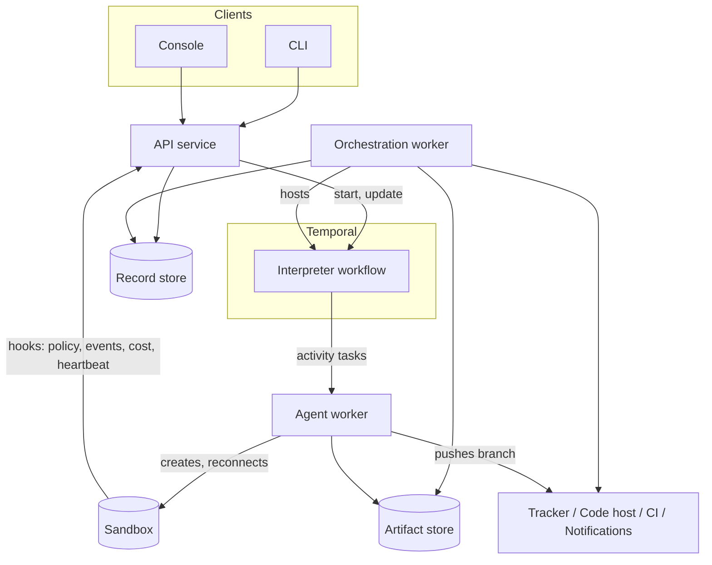
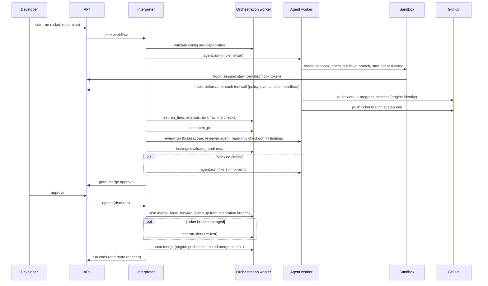

# Architecture, first pass

Status: current design. Written 2026-10-25; updated 2026-10-31 with the results
of Spikes 1 to 3 (`docs/15`, `docs/16`, `docs/18`), the code review design
(`docs/19`) and the merge design (`docs/20`). `brief.md` is the input. How each
decision was reached is recorded in `docs/reviews/`.

Application name: **Feature Flow** (`feature-flow` in code, configuration, paths
and package names). This repository is `feature-flow-poc`, a proof of concept
that may evolve into the finished product or be rewritten.

Implementation language: **.NET**.

**Design requirements** (DR1 to DR13) are listed in full in `docs/08` section
1.3 (design requirements from the spikes). Each is explained where this document
uses it.

| Topic | Detail in |
|---|---|
| Provider interfaces | `docs/04-provider-interfaces.md` |
| Provider contracts | `docs/05-provider-contracts.md` |
| Step contracts | `docs/06-step-catalogue.md` |
| Configuration schema | `docs/07-configuration.md` |
| Risks and spikes | `docs/08-risks-and-spikes.md` |
| Workflow language | `docs/09-workflow-language.md` |

---

## 1. Shape of the system

### 1.1 Components

| Component | Runs as | Responsibility | Stateful |
|---|---|---|---|
| API service | Long-lived service | Start, steer, decide on, abort and query runs. Authentication and authorisation. Writes the audit record. Owns the Temporal client for control operations. Serves the **hook endpoint** that agent runtimes in sandboxes call (section 1.4) | No (uses the record store) |
| Orchestration worker | Long-lived service, N replicas | Hosts the interpreter workflow and *light* activities: tracker metadata, PR state reads, artifact metadata, notifications, validation | No |
| Agent worker | Long-lived service, N replicas, possibly one pool per capability | Hosts agent step activities. Creates sandboxes through the sandbox provider, starts the agent runtime in the sandbox, supervises it and streams heartbeats. Pushes the agent's commits (agents hold no push credential, section 4.6) | No. The agent's working state is in the sandbox, which is separate from the worker and outlives a worker restart (section 3.6) |
| Sandbox | Created per agent step by the sandbox provider | Runs the agent runtime and its tools against a checkout of the branch | Yes, for the life of the step |
| Artifact store | External | Content-addressed, immutable blobs: plans, specs, diffs, transcripts, logs, reports | Yes |
| Record store | External | Queryable records: findings ledger, decisions, steering log, run index, run timeline | Yes |
| Temporal | External | Durable execution | Yes |
| Console, CLI | Client | Talk to the API only | No |

The API service and the workers share the provider and policy libraries. They
do not share process state.

The API and workers run on Windows, macOS or Linux containers (DR5: development
on Windows or macOS; runtime on Windows, macOS or Linux containers; Docker is
used only for packaging and sandboxes).

### 1.2 Task queues

All queues are prefixed with `feature-flow`.

| Queue | Workers | Notes |
|---|---|---|
| `feature-flow-orchestration` | Orchestration | Default. May be suffixed per tenant |
| `feature-flow-agent` | Agent, general pool | Default sandbox capability set |
| `feature-flow-agent:<capability>` | Agent, specialised pool | Examples: `feature-flow-agent:os-windows`, `feature-flow-agent:docker`, `feature-flow-agent:gpu` |

A step declares the capabilities it needs, and the interpreter picks the queue
from that set (decision S1: route agent steps to task queues by capability).
This handles Windows-only repositories, Docker-dependent test tiers and
network-restricted environments without special cases in the interpreter.

**Pool sizing.** A worker needs at least one activity slot per concurrent long
step, plus headroom. Spike 1 confirmed this: with 10 slots, steps began to wait
somewhere between 10 and 16 concurrent steps, and peak occupancy never exceeded
9 (`docs/15` section 6.3, worker slot capacity). Only two repetitions were run,
so no sizing rule beyond this is written yet.

### 1.3 Component diagram



Reads do not go through Temporal queries. The console and API read from the
record store (section 5.4).

### 1.4 Pattern: agent in sandbox with engine hooks

Decided. Other documents call this **pattern C**.

The agent runtime (for example Claude Code or GitHub Copilot CLI) runs **inside
the sandbox** with its own tools, unchanged. The sandbox is separate from the
agent worker: the worker starts the runtime and supervises it, but a worker
restart does not stop it (section 3.6). The runtime's hooks (session start,
before and after each tool call, stop) call the engine's hook endpoint for:

- **Policy checks on each tool call.** Deny writes for read-only roles, deny
  `git push`, deny changes to `.git/config` and similar.
- **Structured events**, which become timeline events in the record store.
- **Token and cost accounting** per step (section 5.5).
- **Heartbeats**, so a stalled agent is detected without polling the sandbox.

Supporting rules:

| Rule | Detail |
|---|---|
| No push credential | Agents never hold a credential that can push. The agent commits in the sandbox; the engine pushes the ticket branch at work-in-progress points and at the end of each step (DR13, section 4.6) |
| Resumability | The sandbox outlives a worker restart; the runtime's own session is reloaded on resume; if the sandbox is lost, the step restarts from the last pushed commit (section 3.6) |
| Model credentials | Never enter the agent's environment (DR1). Version 1 uses a proxy that adds the key, or per-run keys with a spend limit and expiry (section 4.6) |
| Hooks are a declared capability | The agent runtime provider declares `Hooks`. A runtime without working hooks gets coarser control (sandbox-enforced write access, a post-step diff check, cost from the runtime's own usage output; `docs/08` section 2.5, the no-hooks fallback), and the engine records that in the run |

What the spikes measured for the two candidate runtimes (`docs/16` sections 4
and 12):

| Runtime | Hooks | Models |
|---|---|---|
| Claude Code | All four hooks (session start, before and after each tool call, stop) fired on Windows and macOS. A command outside the allowlist was denied before it ran | Anthropic API only, with a first-party Anthropic subscription or key. Cannot use an OpenAI-compatible model router |
| GitHub Copilot CLI | Session start and stop fired. The before- and after-tool-call hooks did not fire with a third-party model; untested with a first-party model | Works through an OpenAI-compatible router |

So per-tool-call policy (deny before execution) is evidenced for Claude Code
only. On Copilot CLI with a third-party model the no-hooks fallback applies.

Rejected alternative: running the agent loop in the agent worker, with each tool
call executed remotely in the sandbox. Rejected, not deferred, because:

- it means building and maintaining an agent harness (context management,
  compaction, edit tools, sub-agents, MCP, prompt caching) when vendor harnesses
  are better and improve monthly;
- hundreds of tool calls per step as Temporal activities means thousands of
  history events per step;
- every tool call pays network latency.

### 1.5 Principle: engine mechanism vs workflow policy

When a design question arises, first decide which side it belongs to.

| Side | Provides |
|---|---|
| **Engine** | Mechanisms: steps, routing, gates, providers, policy evaluation and safety floors |
| **Workflow content** (the library, `docs/11`) | What agents do and how delivery is approached: planning rules, feature flagging, deploy ordering, contract compatibility, review checklists |

**Safety floors are the exception.** The engine enforces them because no
workflow may relax them (decision DP6: the most specific configuration layer
wins, except a short list of floors; section 5.1).

Example: shipping dark behind feature flags is not an engine concern. Whether
it is required depends on the adopter; some require every significant change to
be flagged. If workflows later need to create or check flags, add an optional
feature-flag provider. Not in version 1.

---

## 2. Core data model

| Entity | Where it lives | Notes |
|---|---|---|
| Run | Temporal workflow state (compact) + record store (index) | One workflow execution. Has a scope: ticket, epic or delivery |
| Plan | Workflow state (current revision) + artifact store (every revision) | Data. Append-only revision history |
| Step run | Workflow state (compact) + record store | One execution of one step: status, attempts, outcome, artifact references |
| Artifact | Artifact store | Content-addressed by hash. Referenced by URI, never inlined |
| Finding | Record store (full) + workflow state (compact summary) | Fingerprinted, scoped, triaged once (section 7.2) |
| Decision | Record store | Human gate request and response, with actor and time |
| Steering record | Record store | Audited change to a running run |
| Timeline event | Record store | Append-only. Feeds the console, audit and notifications |

Two invariants:

1. **Workflow state holds references and small summaries only.** No
   transcripts, diffs, code, secrets or full finding bodies. A step's `outputs`
   are capped at 16 entries of 256 bytes each (`docs/09` section 8.3, variable
   namespaces); Spike 2 measured at most 5 entries and 71 bytes, so the cap is
   kept.
2. **Anything a human or a report needs to query lives in the record store**,
   not in Temporal history.

### 2.1 Storage model (decided)

| Store | Contents | Technology by profile | Model |
|---|---|---|---|
| Temporal history | Working state only: references and small summaries | Temporal | Transient; deleted after namespace retention |
| Artifact store | Specs, plans and every plan revision, diffs, transcripts, logs, reports | Local filesystem (solo); S3 or Azure Blob | Immutable, content-addressed. A new version is a new hash plus a named pointer in the record store |
| Record store | Runs, step runs, findings ledger, decisions, steering log, timeline events, cost per step | SQLite (solo); Postgres | Relational, queried through the API. Timeline append-only. The long-term audit record |

**Git is not a store.** Publishing artifacts to a repository for human review is
an engine step (`artifact.publish`). Run state is browsed through the console
and API, not through Git.

### 2.2 Tenancy and disaster recovery

**Tenancy.** One organisation per installation (assumption A10 holds: a run is
single-tenant). Teams are scoped by the policy model and roles. An `org_id` is
in record store keys from the first version: cheap now, expensive later. No
other multi-tenant features.

**Disaster recovery.** No custom mechanism:

- Record store: standard database backups with point-in-time restore.
- Artifact store: cloud versioning and replication; content addressing makes
  integrity checks simple.
- Temporal unavailable: handled by the workers (section 3.5).
- A **reconcile job** rebuilds the run index in the record store from Temporal
  for in-flight runs.
- Recovery point and recovery time are documented per profile.

---

## 3. The interpreter

### 3.1 The loop

One workflow type for every run. A ticket run, an epic run and a delivery run
differ only in their plan, not in code.

```
state = { planRevision, cursors[], stepRuns[], findingsSummary[], attemptBudgets, inFlight[], pendingDecision? }

loop:
  ready = plan.ready(cursors, state)          # pure: steps whose joins are satisfied and that fit a free concurrency slot
  if ready is empty and inFlight is empty:
      endRun(state)                           # see "How a run ends" below

  for each step in ready:
    if step.gate and not policy.autoApprove(step, state):   # pure
        decision = await decision(step)       # durable wait, no timeout
        state    = applyDecision(state, decision)           # pure
    inFlight.add(start(step))                 # activity or child workflow; attempt ceiling checked first (section 3.7)

  result  = await first(inFlight)             # the first step to finish, not the whole batch
  state   = applyResult(state, result)        # pure
  cursors = plan.route(result, state)         # pure: advance, open or satisfy joins

  if historyBudgetExceeded(state) and inFlight is empty and no pendingDecision:
      continueAsNew(state)                    # section 3.5
```

Everything outside `await` is a pure function of the plan and the state. That
is the determinism boundary.

| Rule | Detail |
|---|---|
| Start a step when a slot frees (DR7) | The loop waits for the **first** in-flight step to finish, then starts whatever is now ready. Spike 1's loop waited for a whole batch, so a third ticket could not start until both running tickets finished (`docs/18` section 4, what Spike 3 changed) |
| Interpreter changes are versioned (DR7) | Any change to interpreter behaviour is wrapped in a Temporal patch marker (`Workflow.Patched`) so recorded histories still replay. Spike 3's dispatch change is one: with the patch removed, a Spike 1 history fails replay |
| Loops re-run a step (DR12) | Routing to a step that already has an outcome clears that outcome and runs the step again. This is how test, fix, retest loops work. Without it a looping route found nothing ready and the run ended early (`docs/16` section 12, the Claude Code proof) |
| Every execution counts (DR10) | Each start, including re-entry by a loop, is checked against the step's attempt allowance and the run's ceiling (section 3.7) |
| Concurrency is bounded by the plan | `plan.ready` returns only steps whose dependencies are satisfied and whose concurrency limit allows. Several tickets of one epic running at once (assumption A11) is expressed as parallel branches in the plan (section 3.3.1), not as special interpreter behaviour |

**How a run ends.** A run ends when a step routes to a terminal directive
`{ end: <status> }` (`docs/09` section 6.2, terminal directives), and the run
takes that status. A run that stops because nothing is ready and nothing is in
flight, without reaching an `end:` route, **never reports `completed`** (DR6).
The Claude Code proof found a fix loop that dead-ended and reported `completed`
with no PR; Spike 3 reported such runs as `incomplete`.

### 3.2 Three execution forms for a step

| Form | Where it runs | Used for | Examples |
|---|---|---|---|
| Local | Inside the workflow, pure | Decisions that need no I/O | `plan.validate`, `policy.evaluate`, `findings.evaluate_readiness` |
| Activity | Orchestration or agent worker | Everything that touches the outside world | `scm.open_pr`, `agent.run`, `test.run_tiers` |
| Child workflow | Own workflow execution | Steps with their own durable lifecycle | `run.child`, `delivery.deploy`, possibly `human.session` |

Child workflows are used only where a step has its own durable lifecycle
(decision DP3); everything else is an activity, because child workflows add
history and operational cost.

### 3.3 Plan as data

A sketch of the shape the engine consumes. The workflow language itself is
`docs/09` (workflow language) and `docs/10` (its schema).

```yaml
revision: 7
steps:
  - id: implement
    kind: agent.run
    scope: ticket
    protected: true
    inputs:
      role: implementer
      task_ref: artifact://plan/task-12.md
      write_access: repository
    requires: { capabilities: [sandbox, agent_runtime] }
    limits: { attempts: 3, start_to_close: 4h, heartbeat: 30s }
    routes:
      completed: verify
      blocked: replan
      attempts_exhausted: human.gate.escalate

  - id: tickets
    kind: parallel
    branches: [ticket-a, ticket-b, ticket-c]
    max_concurrency: 2
    join: all                       # all | any | n
    routes:
      completed: epic_review
      any_failed: human.gate.escalate

  - id: epic_review
    kind: review.run
    scope: epic
    inputs: { diff: aggregate }
```

A step has:

| Field | Meaning |
|---|---|
| `id`, `kind`, `scope` | Identity, step kind, and ticket, epic or delivery scope |
| `inputs` | Artifact references |
| `requires` | Capabilities the step needs |
| `limits` | Attempts, timeouts, heartbeat |
| `routes` | Outcome to next step id or terminal directive |
| `protected` | Cannot be removed or weakened by a re-plan or steering |
| `gate` | Optional human gate before the step |

### 3.3.1 Parallel branches and joins

Several tickets of one epic may run at once (assumption A11), so the plan shape
supports fan-out and join.

- A `parallel` step names its branches and a `join` policy: `all`, `any`, or a
  count `n`. A branch is a step or a sub-plan, so a branch may be a `run.child`
  for a ticket.
- `max_concurrency` bounds how many branches are in flight. It is a plan value,
  so a re-plan can tighten it, and it keeps concurrency in one repository a
  configuration question rather than an interpreter one. The branch and merge
  model is section 6.3.
- A new branch starts as soon as a running one finishes and frees a slot
  (DR7, section 3.1). Spike 3 measured this: the third ticket started 27 ms
  after the first one finished.
- Join semantics:

  | Join | Satisfied when |
  |---|---|
  | `all` | Every branch has reached a terminal outcome |
  | `any` | The first branch reaches a terminal outcome; the rest are cancelled |
  | `n` | `n` branches succeed |

- A branch outcome routes like any other outcome. `any_failed` is the aggregate
  route when a branch fails and the join policy is not satisfied.
- `applyPatch` (section 3.4) validates branches as it validates steps: known
  kinds, present capabilities, protected steps intact, routes that resolve. A
  re-plan may add branches to a `parallel` step that has not started, and may
  not remove a protected branch.
- Workflow state carries one cursor per in-flight branch (`cursors[]` in section
  3.1). Continue-as-new happens only between steps, never mid-step.

### 3.4 Re-planning and steering share one path

Both produce a **plan patch**. Both go through the same pure `applyPatch`
function (decision S2: one validation and audit path), which checks that:

- the schema and step kinds are known;
- required capabilities are present in the configured providers;
- protected steps are not removed or weakened;
- routes point at steps that exist;
- attempt budgets stay within policy ceilings.

| Source | Transport | Audit |
|---|---|---|
| Re-plan agent step | Activity returns a patch | Recorded as a step run with its artifact |
| Human steering | Temporal update through the API | Steering record with actor, reason, diff |

A child run can return outcome `replan_parent` with a patch. The parent applies
it through the same function. This is how discovery inside a ticket changes the
epic.

### 3.5 Temporal constraints

| Constraint | Approach |
|---|---|
| History size | References only. Compact findings summary in state, capped (decision DP5: when over the cap, keep only blocking findings in state and reference the rest). Continue-as-new at a measured threshold, below |
| Long runs | Continue-as-new between steps, never mid-step |
| Replay safety | Interpreter version marker plus Temporal patch markers (`Workflow.Patched`) for behaviour changes (DR7). Plan schema versioned separately from the interpreter (decision S14) |
| Determinism | No I/O, no clock, no randomness, no dictionary-order dependence in workflow code. Enforced by replay tests in CI (decision S8: recorded histories replayed against a changed interpreter) |
| Temporal unavailable | Workers retry the connection and resume. The API reports platform status separately from run status. Runs are never failed because the platform is down |
| Payload codec | Pluggable from the start. Encryption is a configuration choice, not a code change |

**Continue-as-new threshold** (measured by Spike 1, `docs/15` section 6.1):

| Measure | Value |
|---|---|
| History events per step | 6.28 |
| Carried state | About 500 bytes per plan step, stable across continue-as-new |
| Threshold | **Events or bytes, whichever comes first.** Starting value 5,120 events (about 815 steps), half of Temporal's 10,240-event warning |
| Large plans | The 2 MB payload limit binds before the event limit at about 4,000 plan steps. Split such plans rather than raising the threshold |

**Known hazard (risk R3):** a decision or steering update that arrives while the
workflow is continuing-as-new can be lost. Mitigation: continue-as-new only at a
safe point (between steps, no pending decision); an update validator rejects
updates once continue-as-new is requested, and the API retries against the new
run. Spike 1 forced 11 continue-as-new points under a stream of updates and lost
none.

### 3.6 Resumable agent steps

A long agent step, an hour or more, that loses its worker or its sandbox must
continue, not restart. Interruptions were the prototype's main operational pain.

**Where the work lives.** The agent runs in its own sandbox, separate from the
agent worker. A worker restart, including every deploy, therefore costs nothing:
the new worker reconnects to the running sandbox by the step's idempotency key
(section 7.1) and carries on.

**Resume after a crash** (DR9, decided 2026-10-31):

| What survived | What happens |
|---|---|
| The sandbox | Reconnect. Uncommitted files are kept. The agent's conversation is reloaded from the session reference stored in the artifact store |
| Nothing: the sandbox is lost | A new sandbox; the step restarts from the last pushed commit |

Rules:

- **Resume must not depend on the crashed worker's memory.** Everything resume
  needs (sandbox handle, session reference, last pushed commit) is in durable
  state. Spike 3 broke this rule: the Claude Code provider's resume needed an
  in-memory capability check that a fresh worker had not run, so the agent
  started a new session and redid its work (`docs/18` section 2, injection I1).
- **Pushed commits are what survive a lost sandbox.** The agent commits in the
  sandbox; the engine pushes the ticket branch at work-in-progress points and at
  the end of the step (DR13, section 4.6).
- **No snapshots of uncommitted work.** Revisit only if real runs show sandbox
  loss is common.
- Sandbox survival across a worker restart is a sandbox provider capability,
  `PersistentAcrossSteps`. Without it, a worker loss is treated as a lost
  sandbox.

The step contract therefore requires:

- `agent.run` records, per attempt, the commit it resumed from and the session
  reference it used.
- Heartbeats carry progress (last commit, session id), so a stalled agent is
  distinguishable from a slow one.

**Graceful worker shutdown is an implementation requirement.** Spike 1 measured
87.4 s from a worker kill to the step making progress again (`docs/15` section
6.4). Almost all of it was detecting the crash (the 30-second heartbeat timeout
plus worker restart and backoff), not the resume itself, which is a cheap
reconnect. A worker shutting down deliberately must finish its current
heartbeat, release its slots and let the platform reassign the activity at
once. Only a crash should cost a timeout.

### 3.7 Attempt budgets

Decided. The complete rule set:

| Rule | Detail |
|---|---|
| One counting rule | Every entry into a step counts against that step's allowance, whatever routed there: retry, route back, redirect |
| Enforced on every execution (DR10) | The allowance and the run ceiling are checked each time a step starts, including when a loop re-enters it. Spike 3 found the gap: without it, a loop with no agent ran its fix step 213 times in 15 s |
| Infrastructure failures are free | Classified infrastructure failures retry with backoff and do not count (section 4.3) |
| Resumes are free only with progress | **Progress = a new commit pushed to the branch, or the agent session has grown since the previous attempt.** The agent runtime provider reports session size or a turn count. After **3 consecutive resumes with no progress**, the next one counts as a restart. `start_to_close` remains the outer bound. Spike 1 confirmed infrastructure never consumed an attempt |
| Two limits | A per-step allowance (default by step kind, overridable in the plan) and a per-run ceiling |
| Exhaustion | Outcome `attempts_exhausted`, routed by the plan to a re-plan or a human gate. Never a silent failure |
| Steering grants | Extra attempts up to a hard ceiling, which is safety floor F4 (attempt ceilings, section 5.1); beyond it needs the admin role. Always audited |
| Review and fix loops | Governed by the findings ledger (section 7.2), not a raw count. The loop ends when no blocking finding is unresolved (decision D8, the merge bar). A finding that reappears after being fixed twice escalates instead of looping. A declined finding never restarts the loop |

---

## 4. Providers

### 4.1 Interface pattern

Every provider implements a descriptor and a health check, and every method
returns a classified result. **No provider method waits on human or external
time.** Waiting is an engine mechanism, using durable timers, polling or
inbound events (`docs/04` section 1.3, no provider method waits).

```csharp
public interface IProvider {
    ProviderDescriptor Describe();          // name, version, capabilities, requires, config schema
    Task<ProviderResult<CheckResult>> CheckAsync(CancellationToken ct);   // startup and run-start validation
}

public readonly record struct ProviderError(
    ErrorClass Class,        // Infrastructure | Work
    string Reason,           // stable code, e.g. "rate_limited", "not_found", "conflict"
    TimeSpan? RetryAfter,
    string? RemoteId);
```

### 4.2 Capability declaration

Capabilities are typed records, not strings, so a step can ask a precise
question.

| Provider | Example capabilities |
|---|---|
| Code host | `PullRequest`, `ReviewComments`, `CheckStatus`, `MergeMethods[merge, squash, rebase]`, `BranchProtection`, `MergeQueue` (optional; only some repositories have it enabled, section 6.3), `InboundEvents` |
| CI | `Trigger`, `ReadLogs`, `Artifacts`, `InboundEvents` |
| Sandbox | `Os[linux, windows]`, `Docker`, `NetworkPolicy`, `PersistentAcrossSteps` (the sandbox outlives a worker restart, section 3.6), `StreamingOutput` |
| Agent runtime | `StructuredOutput`, `Streaming`, `ToolAllowlist`, `MaxContextTokens`, `Hooks` (the runtime calls the engine per tool call, section 1.4), `SessionResume` |
| Review | `Scopes[ticket, epic, delivery]`, `StructuredFindings`, `Fingerprints` |
| Tracker | `Issues`, `Epics`, `Transitions`, `Links`, `Comments` |
| Artifact store | `ContentAddressed`, `SignedUrls`, `RetentionPolicy` |
| Notifications | `Channels`, `Interactive` (the human can answer in the channel) |

A step checks capabilities before use and fails with a named missing
capability; it never assumes success. Capability negotiation also runs at run
start (decision S3), so a run fails in the first minute, not at step 40.
Configuration is validated at startup and again at run start (decision S10).

### 4.3 Error classification

| Class | Meaning | Engine behaviour |
|---|---|---|
| Infrastructure | The remote system or network failed; the work did not happen | Retry with backoff. Does not consume a work attempt |
| Work | The work happened and produced an outcome | No retry. Route by outcome |

The provider classifies, because it knows its system. The step may override,
because it knows the intent: an agent that ran out of time is a work outcome
(`timeout`), not an infrastructure failure.

| Reason | Default class | Notes |
|---|---|---|
| `timeout`, `unreachable`, `server_error`, `rate_limited` | Infrastructure | Honour `Retry-After` |
| `unauthenticated`, `forbidden` | Infrastructure, non-retryable after a short budget (decision S9) | Almost always a configuration fault. Fail the run with a clear message |
| `not_found`, `conflict`, `validation_failed`, `rejected` | Work | Route by outcome |
| `partial` | Work | The step decides; usually reconcile, then retry once |

**Every documented success response maps to an outcome (DR8),** including empty
ones such as GitHub's 204 for a merge that had nothing to do. A success response
the provider does not recognise is a **Work** error, not Infrastructure, so it
cannot be retried forever. Spike 3 found the 204 misread as `server_error`,
which would have retried indefinitely.

### 4.4 Provider catalogue

Temporal platform, worker platform, sandbox, tracker, code host, CI, agent
runtime, review, artifact store, record store, secrets, notifications,
credential broker, session surface. Each has a contract test suite shipped with
the engine (decision S5), so a new provider can prove conformance without the
engine changing.

| Document | Holds |
|---|---|
| `docs/04-provider-interfaces.md` | Each provider's capability record and method signatures |
| `docs/05-provider-contracts.md` | Per-method contracts: idempotency, error codes, timeouts, heartbeats and semantics |

### 4.5 Provider packaging (decided)

- **Version 1: providers are in-process .NET packages (NuGet).** A host project
  references the providers it ships; configuration selects them by name.
- **Provider interfaces are transport-neutral.** Async, plain serialisable data
  objects, no third-party SDK types in signatures, cancellation and classified
  errors on every call. This keeps a generic **remote provider** adapter
  possible later: one that implements any interface by calling an
  out-of-process provider over gRPC or HTTP, for providers in other languages or
  needing isolation. Not built in version 1.
- **Organisation customisation uses a distribution repository, not a fork.** A
  separate repository holds the organisation's own providers, a small host
  project that builds its worker and API images, and its configuration. A fork
  is needed only for core changes, which should be rare. The packages are
  published and host composition is documented so this works.

### 4.6 Credential broker

Given an actor (the engine, an agent step), a target system and a scope, the
broker returns a short-lived credential. GitHub App tokens, service accounts,
personal tokens and later mechanisms (for example OIDC workload identity) are
implementations.

- **No provider reads credentials directly from configuration.** All go through
  the broker, which keeps identity choices out of provider interfaces.
- Code host, tracker, CI and chat providers remain fully swappable.
- The broker refuses a request wider than allowed rather than silently
  narrowing it. Spike 2 evidenced this: a 60-minute token scoped to one
  repository was issued, and requests for wider access, another repository or a
  longer lifetime were refused (`docs/16` section 2).

| Actor | Identity |
|---|---|
| Engine against the code host | A GitHub App, or the equivalent bot identity on other hosts. The only identity that pushes ticket branches and performs merges |
| Agents in the sandbox | **No credential that can push** (DR13). The agent commits in the sandbox; the engine pushes for it. GitHub cannot limit a token to particular branches, so withholding the credential is the only reliable control |
| Engine against the tracker | A service account; every action records "on behalf of" the run's requester or approver |
| Agents against the tracker | None. Tracker writes go only through engine steps |
| Solo profile | The developer's own token, used by the engine. Agents still hold no push credential |

**Who may update protected branches.** Code host rules on the default branch and
on integration branches allow only the engine's identity to update them, as a
backstop to the engine's own checks (`docs/20`, the merge design). The engine
performs every merge itself as a workflow step (section 6.3).

**Merges into a default branch** (floor F1: a human must approve any merge into
a repository's default branch):

- The engine enforces F1 at merge time, reading the base and default branch
  from the code host, not from configuration (DR2).
- Code host protection on the default branch backs it up. That protection is
  configured by an identity the engine does not hold; the engine only checks
  the protection exists (DR3).
- The app cannot approve its own PR. Where branch protection requires a code
  host review, the human approves on the code host and the engine waits for
  it; otherwise the human approves in the console or chat and the engine
  merges. The audit record shows the bot as actor and the human as approver.

**Model credentials never enter the agent's environment** (DR1). Spike 2 passed
the model router key to the agent as an environment variable with all tools
allowed, so any tool the agent ran could read it. Version 1 uses one of:

| Option | Residual risk |
|---|---|
| A **local proxy** that adds the key to outbound model requests, so the agent holds no secret | The agent can still call the proxy |
| **Per-run keys** issued by the model router with a spend limit and an expiry | The key is in the environment for the life of the step |

Whichever is chosen, the choice and its residual risk are recorded, not assumed.

### 4.7 Windows support: deferred, with hooks in version 1

This section is about **repositories that need Windows to build or test**. The
engine itself (API and workers) runs on Windows, macOS or Linux containers from
version 1 (DR5, section 1.1).

Windows-only repositories are required later, not in version 1. Version 1
includes the hooks so support needs no engine change:

- An `Os[linux, windows]` sandbox capability; `feature-flow.yaml` can declare
  `os: windows`.
- Routing to `feature-flow-agent:os-windows` queues (decision S1, capability
  routing).
- A run that needs Windows and has no provider for it fails at run-start
  capability negotiation (decision S3) with a clear message.
- CI delegation of test tiers works for Windows repositories (section 5.1.1,
  execution targets).

Under pattern C (section 1.4) the agent runtime runs inside the sandbox, so a
Windows sandbox needs a Windows agent runtime with working hooks. What is known:

| Question | Status |
|---|---|
| Does Claude Code run on Windows with hooks? | **Yes.** All four hooks fired on Windows in Spike 2 (`docs/16` section 4) |
| Does Copilot CLI? | Its before- and after-tool-call hooks did not fire with a third-party model. Untested with a first-party model |
| Does session resume work on Windows? | Not measured |
| Image size, start time, licensing of Windows Server and build tools in VMs and containers | Not researched |

Without working hooks, the no-hooks fallback applies (`docs/08` section 2.5):
sandbox-enforced write access, a post-step diff check, and cost from the
runtime's usage output. Agents hold no push credential on any platform (DR13).

Roadmap:

| Phase | Approach | Notes |
|---|---|---|
| W0 | Spike: agent runtimes and hooks on Windows | Partly answered by Spike 2 for Claude Code (table above). Session resume on Windows is still open |
| W1 | Windows VM sandbox provider: ephemeral or pooled cloud VMs from an image | Primary approach. CI delegation as fallback for tiers the host cannot run |
| W2 | Windows containers on Windows node pools | Only if density or isolation needs it and the toolchain fits |

### 4.8 Observability contract

| Area | Decision |
|---|---|
| Standard | OpenTelemetry for traces, metrics and logs, with a configurable exporter (OTLP to any backend). No custom observability interface |
| Traces | One trace per run; spans per step, activity and provider call, with run id, step id and error class as attributes. Uses the Temporal .NET SDK's OpenTelemetry support |
| Provider contract | The engine wraps every provider call in a decorator, so providers get spans, timeouts and error classification without extra code. Providers only add attributes |
| Standard metrics | Step duration, attempts, infrastructure retries, schedule-to-start latency per task queue (shows missing or stuck workers), tokens and cost, findings by severity, human wait time, sandbox start time |
| Stuck runs | Detected by heartbeat age and by the progress rule in section 3.7; a "run stuck" notification is sent (decision S13) |
| Logs | Secrets scrubbed at the logging layer. Agent transcripts are artifacts, not logs |

---

## 5. Configuration

This section holds the decisions. The schema, precedence, safety floors and
three worked profiles are in `docs/07-configuration.md`.

### 5.1 Layers

| Layer | Where | May set | May not set |
|---|---|---|---|
| Installation | Deployment config | Temporal connection, worker platform, provider selection and credential references, retention, codec, defaults | Anything repository-specific |
| Organisation / team | Config service or file | Policy floors, provider bindings, notification routing, budgets, who may approve and steer | Repository build and test detail |
| Repository | In the repository, root `feature-flow.yaml` | Test tiers and commands, setup, static analysis, environment requirements, CI mapping, branch and merge conventions | Policy floors, credentials |
| Run | API at start | Scope, target repositories, plan overrides, attempt budgets within the ceiling, dry run | Policy floors, provider selection |

Precedence: **the most specific layer wins, except a short list of safety floors
that no lower layer may relax** (decision DP6).

| # | Floor | Meaning |
|---|---|---|
| F1 | Human approval for default-branch merges | No layer may set auto-merge for a repository's default branch. Enforced by the engine at merge time and backed by code host protection (DR2, DR3; section 4.6) |
| F2 | Secrets by reference | No layer may inline a secret value |
| F3 | Protected steps | A protected step cannot be removed or weakened by a re-plan or by steering |
| F4 | Attempt ceilings | A run sets budgets within the ceiling; steering may grant up to a hard ceiling; beyond that needs the admin role |

### 5.1.1 `feature-flow.yaml` and execution targets

The repository file is a **root-level `feature-flow.yaml`**. It describes how
automations work with the repository (test tiers and how to run them, setup
commands, static analysis, CI mapping, branch conventions, environment
requirements) and it applies to every execution target, not only sandboxes.

- The environment is either **defined inline** (image, toolchain, setup) or
  **referenced** from an existing `devcontainer.json`. Repositories without a
  devcontainer need only the one file.
- Other files (Dockerfiles, compose files for integration services) are
  referenced by relative path from `feature-flow.yaml`.
- **`.feature-flow/` is reserved** for possible later use (for example
  repository-specific review checklists or workflow content overrides). Not
  used in version 1.

| Term | Meaning |
|---|---|
| `feature-flow.yaml` | The repository file, as written |
| Resolved manifest | `feature-flow.yaml` after merging the referenced `devcontainer.json` and defaults. Produced by the engine; providers never parse either source file |
| Execution target | Where a tier runs: sandbox, local, or CI. A provider receives the resolved manifest and runs the tiers for its target |

CI delegation is a first-class path, not a fallback (decision S12). Spike 2
ran a Docker-dependent tier by dispatching the CI workflow the manifest names;
the step returned in 22.7 s without waiting, and polling observed the result
(`docs/16` section 2).

### 5.1.2 The manifest is read per step, never copied into the plan

The prototype went stale by copying repository settings into the plan at run
start.

- Each step reads `feature-flow.yaml` from its branch when it starts.
- Each step records the hash of the resolved manifest it used.
- If a change removes a capability the run needs, capability negotiation runs
  again before the next step.
- Agent edits to `feature-flow.yaml` are flagged at review. Whether they need
  approval is workflow policy, not an engine concern (section 1.5).

### 5.2 Policy model

One model, one evaluation function, used by gates, merges and steering.

| Policy object | Contents |
|---|---|
| `approval` | Scope (ticket, epic, delivery into the default branch), required approvers by role, minimum count, whether an agent counts |
| `merge` | Target branch pattern, allowed methods, required checks, whether auto-merge is permitted |
| `findings` | The merge bar (decision D8): no unresolved blocking finding, and every finding fixed or declined with a recorded reason |
| `attempts` | Per step kind and per run ceilings; steering may grant more within a hard ceiling. Counting follows section 3.7 |
| `steering` | Who may amend a step, override content, grant attempts, abort |
| `cost` | Not in version 1. When added: per-run and per-step budgets, with the action configurable (warn, gate, abort). Exceeding one always stops at a gate, never a hard stop |

Default: a merge into a repository's default branch requires a human. This is
floor F1.

### 5.3 Example profiles

| | Solo developer | Small company | Enterprise |
|---|---|---|---|
| Temporal | `start-dev` or one container | Compose, Helm, or Temporal Cloud | Temporal Cloud, one namespace per environment |
| Workers | Local processes or local containers | Kubernetes (EKS/AKS) | Organisation Kubernetes, several pools by capability |
| Sandbox | Local Docker | Kubernetes pod | Kubernetes pod, plus CI delegation for Docker-dependent and Windows-only tiers |
| Docker-dependent tiers | Privileged pod (solo only) | sysbox where supported, else CI delegation | CI delegation |
| Tracker | GitHub Issues | Jira | Jira |
| Code host | GitHub | GitHub | GitHub (GitHub App identity) |
| CI | GitHub Actions | GitHub Actions | GitHub Actions and TeamCity |
| Stores | Local filesystem + SQLite | S3/Blob + Postgres | Organisation-managed object store and database |
| Secrets | Env or file | Cloud secret manager | Internal platform, short-lived, OIDC planned |
| Observability | OTLP to a local collector | OTLP to the organisation's backend | OTLP to the organisation's backend |

Same code in all three; only configuration differs (decision D4). In every
profile the API and workers may run on Windows, macOS or Linux containers, and
Docker is used only for packaging and sandboxes (DR5).

### 5.4 Control plane: decisions, steering and API authorisation (decided)

**Transport:**

- Decisions and steering use Temporal **Updates**, not Signals. Each carries the
  gate id and plan revision it applies to; the update validator rejects stale
  or invalid requests (no open gate, plan revision changed). The API retries
  against the current run after continue-as-new, which mitigates risk R3 (an
  update lost during continue-as-new, section 3.5).
- **Reads do not use Temporal queries.** The console and API read from the
  record store.

**Authentication:**

| Caller | Method |
|---|---|
| Humans (console, CLI) | OIDC against the organisation's identity provider; a local token in the solo profile |
| Automation | Service-account API tokens |
| Agent hooks from the sandbox (pattern C, section 1.4) | Short-lived token issued per step, scoped to that run and step's hook endpoint |

**Authorisation:**

- Roles from the policy model (viewer, approver, steerer, admin), mapped to
  identity-provider groups, scoped by team or repository.
- **Only the API authorises and writes the audit record.** The workflow trusts
  the API (decision DP8). Only the API and workers can reach the Temporal
  namespace.
- **A decision's actor kind and roles come from the API's authenticated
  identity, never from the request body.** A caller may not assert that it is a
  human or that it holds the approver role; the API derives both from the
  authenticated session and writes them into the decision record. This makes
  floor F1 enforceable: the merge step checks the actor kind the API recorded,
  so a harness or policy actor cannot satisfy a human approval.

**Chat integration** (Slack first; Microsoft Teams later through the same
interface):

- Some decisions may be made from chat. A chat action calls the API like any
  other client. The chat user is mapped to an identity-provider identity (for
  example by verified email). The policy model states which decisions may be
  made from chat: for example ticket-level gates yes, merge into a default
  branch only in the console. The notifications provider's `Interactive`
  capability declares support.
- **Chat is a pluggable provider.** Slack first; others (Microsoft Teams,
  WhatsApp, Discord) swappable later through the same notifications interface.
  No Slack-specific types outside the Slack provider.

### 5.5 Cost accounting

The prototype ran for 27 hours with no record of token or compute cost.
Recording is in version 1; enforcement (budgets) is policy-driven and not in
version 1.

- **Every step records tokens, model and compute time from the first
  version.** This is a record-store row per step run, not workflow state. The
  data cannot be recovered later, so recording cannot wait for budgets. Spike 2
  and the Claude Code proof recorded it per step (`docs/16` sections 2 and 12).
- Under pattern C (section 1.4) token and cost events arrive at the hook
  endpoint, so per-step accounting needs no transcript parsing. A runtime
  without working hooks reports cost from its own usage output.
- Where a model proxy or gateway adds the model key (DR1, section 4.6), it is a
  second source of truth for cost.
- **When budgets arrive:** exceeding one always stops at a gate, never a hard
  stop. The running total lives in workflow state, updated only from activity
  results, never from a clock or a query.

---

## 6. Data flow

### 6.1 One ticket run



Notes:

- The agent runtime runs inside the sandbox (pattern C, section 1.4). Its hooks
  call the API, which is why the sandbox talks to the API. It does not push to
  GitHub: the agent worker pushes with the engine's identity (DR13).
- The reviewer is an agent on a read-only checkout, given the machine check
  results (section 7.5).
- If the integration branch moved after catch-up, the merge push is refused and
  the ticket catches up again (section 6.3).

### 6.2 Epic with a mid-run re-plan

1. The epic run starts. Plan step `run.child` starts one ticket run per ticket
   as a child workflow, on the same interpreter with a ticket-scoped plan.
2. A ticket's implementation step discovers a needed change in a second
   repository. Its outcome is `blocked`, with a re-plan request artifact.
3. The ticket run routes to `plan.replan`. The activity returns a plan patch;
   the interpreter validates and applies it. The ticket run continues; it does
   not restart.
4. The ticket run completes with outcome `replan_parent` and a patch for the
   epic: add a ticket for the second repository, add an epic-level review step.
5. The epic run applies the patch through the same `applyPatch` (section 3.4).
   Already-completed steps are untouched. Protected steps are intact.
6. The epic run starts the new child run. When the tickets have merged, it runs
   the epic review (`review.run` at epic scope: the integration branch against
   `main`, with the children's findings ledgers as prior findings, DR11; section
   7.2), then `delivery.*` across repositories in declared order.

### 6.3 Concurrency in one repository

Decided 2026-10-31 (`docs/20`, the merge design). **There is no merge lock.**
Tickets merge into the integration branch the way a team of developers does.

**Branches:**

- One **epic integration branch** per repository. It is the base of every
  ticket branch in the epic and the source of the delivery PR into the default
  branch.
- Each ticket works on its **own ticket branch**. It merges into the
  integration branch only after its own checks, review and findings bar pass.
  Tickets do not share a working branch, so a failing ticket blocks no one.
- `max_concurrency` on the `parallel` step (section 3.3.1) bounds how many
  tickets run at once.

**Merging a ticket:**

| Step | What happens |
|---|---|
| 1. Catch up | `scm.merge_base_forward` merges the latest integration branch into the ticket branch. In its inputs `branch` is the integration branch (merged from) and `into` is the ticket branch (merged into). It reports `branch_changed` |
| 2. Re-test | Only if `branch_changed` is true |
| 3. Merge | The engine builds the merge commit from exactly what was tested and pushes it to the integration branch. Git refuses a push onto a branch that has moved since it was fetched, so if another ticket merged first, the push is refused and the ticket goes back to step 1 |
| Escalate | After about 3 refusals in a row, the ticket escalates to a human, so a slow ticket cannot be starved by faster siblings |

Consequences:

- **Nothing untested can land.** A merge succeeds only if the integration branch
  is exactly what the ticket was last tested against.
- The merge needs no branch protection settings and no extra permissions. Code
  host rules allowing only the engine's identity to update integration branches
  are a backstop (section 4.6).
- The cost compared with a lock: a ticket that loses a race re-runs its tests,
  one CI run. With two or three tickets at once, races are rare.
- A merge conflict routes to an agent step that resolves it, not to a human
  first. Spike 3 evidenced this with a real conflict.
- The planner declares the code areas each ticket expects to touch, and the
  scheduler prefers not to run tickets with overlapping areas at the same time.
  This is a preference, not a rule; how the planner does it is workflow content
  (section 1.5).
- The epic review covers the whole integration branch against `main` (decision
  DP10: an aggregate review, not a roll-up of ticket findings), which keeps
  attribution simple (section 7.5).

**Code host merge queues** (GitHub merge queue, GitLab merge trains):

- An optional `MergeQueue` capability on the code host provider. Only some
  repositories have it enabled.
- When the target branch requires a queue, the merge step enqueues the PR and
  waits for the result, because a direct merge is refused. This matters most
  for delivery merges into a default branch.
- If contention on integration branches ever becomes real, a merge queue is the
  managed answer.
- CI providers must report results for queue builds (for example the GitHub
  Actions `merge_group` event).

---

## 7. Engine step catalogue (first grouping)

Grouped by family. This section holds the grouping and the invariants; each
step's full contract is in `docs/06-step-catalogue.md`.

| Family | Steps |
|---|---|
| Agent | `agent.run` (role, task, tools, write access, limits, resume strategy) |
| Human | `human.gate`, `human.session` (section 7.4), `policy.auto_approve` |
| Composition | `run.child`, `run.wait`, `parallel` (fan-out and join, section 3.3.1) |
| Planning | `plan.replan`, `plan.validate` |
| Source control | `scm.create_branch`, `scm.merge_base_forward` (catch-up, section 6.3), `scm.open_pr`, `scm.update_pr`, `scm.merge` |
| CI | `ci.wait_checks` (handles checks that register late), `ci.trigger`, `ci.read_results` |
| Testing | `test.run_tiers`, `test.run_composition` (several repositories as services) |
| Analysis | `analysis.run` (fail on new issues, analyser from `feature-flow.yaml`) |
| Review | `review.run` (any scope; the reviewer is an agent on a read-only checkout, section 7.5) |
| Findings | `findings.triage`, `findings.post_declines`, `findings.evaluate_readiness` |
| Fix verification | `fix.verify` (regression test required, re-check against the original finding on the full diff) |
| Waiting | `wait.for_state` (PR, check, tracker issue) |
| Artifacts | `artifact.bundle`, `artifact.validate`, `artifact.import`, `artifact.publish` |
| Delivery | `delivery.deploy_order`, `delivery.deploy`, `delivery.gate`, `delivery.report` |
| Tracker | `tracker.create`, `tracker.update`, `tracker.transition`, `tracker.link` |

Steering is not a step. It is a control-plane capability that produces a plan
patch or an attempt grant (section 3.4).

Every step contract states: inputs, required capabilities, outcomes,
idempotency strategy, timeouts and heartbeat, error classification overrides,
artifacts in and out, scope, audit events, and, for agent steps, the resume
strategy (section 3.6).

### 7.1 Idempotency

Every step gets a deterministic idempotency key: `hash(runId, stepId,
stableInputs)` (decision S4). Two mechanisms:

1. **Marker-based discovery.** The engine writes a stable, hidden marker into
   every remote object it creates: a branch name suffix, a PR body comment, a
   commit trailer. On retry the step searches for the marker and adopts the
   existing object instead of creating a duplicate.
2. **Provider-side dedupe** where the remote system supports an idempotency key.

### 7.2 Findings

**Fingerprint** (decision S6): rule or check id, repository, file path,
enclosing symbol, and a normalised snippet hash. **Never line numbers.** Full
finding bodies live in the record store; workflow state carries a capped summary
(id, fingerprint, severity, scope, status, blocking flag).

**The findings ledger** is the record of every finding and its status. Version 1
positions (accepted 2026-10-30; `docs/17` section 6.5):

| # | Position |
|---|---|
| L1 | **The ledger is the source of truth; a review pass is evidence.** No single pass decides a finding's status |
| L2 | **"Fixed" is sticky, enforced by the engine.** When `fix.verify` passes, the ledger records the location (path, enclosing symbol) and that symbol's code hash after the fix. A later finding there is recorded as a re-raise, not acted on, while the hash is unchanged |
| L3 | **New findings on unchanged input are kept.** No agreement voting between passes in version 1: noise costs a triage, but a suppressed defect costs a wrong outcome |
| L4 | **At epic scope, prior findings include the child tickets' ledgers** (DR11), so epic findings are matched against ticket findings by L2's rule |

"Declined" is sticky in the same way: a declined finding reopens only when the
code its fingerprint points at changes (`docs/06` section 9.1, findings triage).

Why the ledger carries this weight (DR4: review verdicts are unstable with a
real model): Spike 2 ran a real reviewer four times on unchanged input and got
different findings, including a re-raise of a fixed finding. The ledger
positions above and the review design (section 7.5) are the version 1 answer.

### 7.3 Partial delivery across repositories

One idempotent child workflow per repository (decision DP3: child workflows for
steps with their own durable lifecycle), and a **delivery ledger in the record
store**, read through an activity so workflow code stays deterministic.

- **No compensating action.** Assumption A7 holds: the engine triggers and gates
  deploys; it does not perform or roll them back.
- On failure the run stops at a delivery gate with status `partial` and three
  choices: **retry**, **fix forward** (route to a fix step or re-plan for the
  failing repository), or **revert** (a human decision; the engine opens revert
  PRs).
- Delivery order comes from plan data.
- Aborting a run does not close its PRs or delete its branches unless explicitly
  asked.

### 7.4 Interactive human sessions

An interactive session is an **engine mechanism**: prepare a workspace (branch,
drafts, context, prompt), wait for a submission, validate it, continue. Where
the human works is a pluggable **session surface**.

| Surface | Status |
|---|---|
| A. Hand-off to the human's own agent tool (VS Code with Copilot, Claude Code, Copilot CLI) on their own machine | **Version 1** |
| B. Review rounds on a PR in the planning repository | Later, optional |
| C. Chat in the console with the agent in a sandbox | Later, optional |
| D. Short clarification questions in a chat platform thread | Later, optional |

Why A first: the human works in an unsandboxed agent with full access to their
environment (other repositories, wikis, observability, ticketing). Design and
specification work needs that, and a sandbox cannot provide it.

Requirements for A:

- A CLI, and an MCP server for the human's agent, to fetch the session
  workspace, run checks and submit. Authenticated as the human (OIDC, section
  5.4).
- **Hooks and policy do not apply in the human's environment.** The trust
  boundary is the submission: the engine validates what is submitted, and the
  human is the accountable actor in the audit record.
- **The session cannot merge.** It may offer a "merge when ready" tool, but that
  tool only asks the engine to run the merge step (section 6.3).
- **Pre-submit checks.** The session can run, on demand and before submitting,
  the same checks later steps will apply (for example the plan review or the
  code review). **No check appears for the first time after the work is
  submitted.** In the prototype a spec session took 8 rounds, mostly because
  agent-drafted verification requirements failed a later plan review that
  could have run inside the session.
  - Engine side: any validator or review check is exposed as an on-demand
    action for a session, returning the same structured findings as the gated
    step.
  - Workflow side: which checks a session runs before submitting is library
    content (section 1.5).
- **Pre-submit parity.** A pre-submit review counts as the gated review only if
  it uses the same brief, the same tools, the same model and the same commit.
  Identical input text no longer proves parity, because the reviewer explores
  the repository (section 7.5). Spike 3 evidenced parity at spike level, close
  to by construction (`docs/18` section 5).

### 7.5 Code review

Decided 2026-10-31 (`docs/19`, the code review design). Review is the main
control between an agent's work and the final merge.

| # | Rule |
|---|---|
| 1 | **Machines check first:** build, tests, linters, analysers, formatting, and test coverage of the changed lines. The reviewer is given the results |
| 2 | **The reviewer is an agent on a read-only checkout** of the branch. It is told the branch, the base and the changed files. It reads the diff itself, opens any file, and may build and run tests. Nothing else is pre-loaded, so there is no prompt size limit |
| 3 | **It reviews against a specification:** the ticket's acceptance criteria, the epic's contract, the repository's conventions |
| 4 | **Separate review angles,** each a focused pass: correctness, design and structure, tests, security, conformance to the specification |
| 5 | **Bug findings carry evidence:** a throwaway failing test where possible. Demonstrated findings block; reasoned ones are labelled and ranked lower |
| 6 | **A different, ideally stronger, model reviews** than the one that authored the work |
| 7 | **The engine checks coverage** from the hook record of files the reviewer read. A review that never opened a changed file is re-run, not accepted |

Two levels, both with repository access:

| Level | Reviews | Given |
|---|---|---|
| Ticket review | The ticket branch against the integration branch | The ticket and the epic's contract |
| Epic review | The integration branch against `main` | The children's findings ledgers as prior findings (DR11, section 7.2) |

Rule 7 depends on before-tool-call hooks, so it is available only on runtimes
where they fire (section 1.4).

Not decided yet: which angles run at ticket level and which only at epic level;
whether a reviewer may run the full test suite or only targeted tests; how a
reasoned (undemonstrated) finding is triaged.

---

## 8. Deliberately not designed yet

- Workflow content: templates, agent task prompts, skills, check definitions.
  The workflow language itself is designed in `docs/09` and `docs/10`; this
  document assumes only that the plan is data.
- Console UI beyond the API it needs.
- Deployment internals. The engine triggers and gates deploys; it does not
  implement them (assumption A7).
- The remote provider adapter (section 4.5). Interfaces keep it possible; it is
  not built in version 1.
- Cost budgets and enforcement. Recording per-step cost is in version 1 (section
  5.5); budgets are policy-driven and not in version 1.
- Windows sandboxes (section 4.7). Hooks are in version 1; the provider is not.
- Session surfaces B, C and D (section 7.4). Only surface A is in version 1.
- A feature-flag provider. Not an engine concern in version 1 (section 1.5).
- A deployment provider. Version 1 delivery is merging the delivery PR, then
  optionally waiting on a deployment status the code host or CI reports.
- The open points of the code review design (section 7.5, last paragraph).

---

## 9. Principal risks

The full register, which spike tests which risk, and the results are in
`docs/08-risks-and-spikes.md` section 1 (risk register). This is the summary
with each risk's current mitigation.

| # | Risk | Mitigation |
|---|---|---|
| R1 | History growth on a 27-hour, hundreds-of-steps run | References only, capped findings summary, replay tests. Continue-as-new at 5,120 events or the payload byte limit, whichever comes first, measured by Spike 1 (section 3.5) |
| R2 | Non-determinism leaks into the interpreter | Pure-function discipline, replay test suite in CI, code review rule |
| R3 | Decision or steering lost during continue-as-new | Continue-as-new only at safe points; API retries when no gate is open. Spike 1 lost none (section 3.5) |
| R4 | LLM gates unstable across passes | Measured: they are (DR4). The findings ledger is the source of truth, "fixed" and "declined" are sticky, and bug findings carry evidence (sections 7.2 and 7.5) |
| R5 | Sandbox does not match CI | `feature-flow.yaml` declares tiers; CI delegation is the default for Docker-dependent tiers, evidenced by Spike 2 (section 5.1.1) |
| R6 | Credential exposure in sandboxes or payloads | Short-lived, least-privilege credentials; agents hold no push credential (DR13) and no model key (DR1); secrets by reference; encrypted payload codec available (section 4.6) |
| R7 | Re-plan agent removes or weakens protected steps | Protected flag enforced in the single `applyPatch` path (section 3.4) |
| R8 | Runs stall on human latency | Unbounded durable waits with reminders, never activity timeouts; "stuck run" notification |
| R9 | Organisation fork drifts from upstream | All organisation behaviour in configuration and providers; contract tests make drift visible. A distribution repository, not a fork, is the default customisation path (section 4.5) |
| R10 | Concurrent tickets in one repository conflict | Epic integration branch plus per-ticket branches; catch up, re-test if changed, then merge by a push Git refuses if the integration branch moved; escalate after about 3 refusals; no merge lock; `max_concurrency` on the `parallel` step (section 6.3) |
| R11 | A long agent step loses its worker or sandbox and restarts from scratch | The sandbox is separate from the worker and survives worker restarts; resume reloads the conversation and does not depend on worker memory; a lost sandbox restarts from the last pushed commit (section 3.6) |
| R12 | Non-determinism in .NET workflow code is not caught at runtime | Replay tests in CI from the first workflow (decision S8); workflow-code review rule: no `Task.Run`, no wall clock, no unordered collections, no I/O |
| R13 | A run's cost is unknown after the fact | Tokens, model and compute time recorded per step from the first version (section 5.5) |
| R14 | Pattern C does not hold on Windows: the agent runtime may not run there with hook support | Claude Code's hooks fired on Windows (Spike 2). Session resume on Windows not measured; Spike W0 (agent runtimes on Windows) completes the answer before a Windows sandbox provider is built (section 4.7) |
| R15 | A resumed agent step makes no progress and never exhausts its budget | Progress rule: a resume is free only with a new commit or session growth; after 3 consecutive resumes with no progress the next counts as a restart (section 3.7) |
| R16 | Repository settings go stale mid-run because they were copied into the plan | Each step reads `feature-flow.yaml` from its branch when it starts and records the hash of the resolved manifest (section 5.1.2) |
| R17 | A check appears for the first time after work is submitted, causing review round trips | Pre-submit checks in interactive sessions, with parity defined as same brief, tools, model and commit (section 7.4) |
| R18 | A long sandbox command is lost when the worker crashes, even though the sandbox survives | Commands are started and polled, not awaited: `StartCommandAsync` returns a handle and `AttachCommandAsync` re-attaches to a running command |
| R19 | An unreachable hook endpoint denies every tool call, so the agent flails or gives up with a wrong outcome | Unreachable is distinguished from denied: the hook client retries and holds the tool call for a bounded time, then the session stops in a resumable state classified as infrastructure |
| R20 | Polling inflates history: one short activity per poll adds hundreds of events for a single long step | Poll **inside one long-running activity** that loops and heartbeats. Spike 1 measured one activity and 11 events for a 60-second polled step (`docs/15` section 6.2) |
