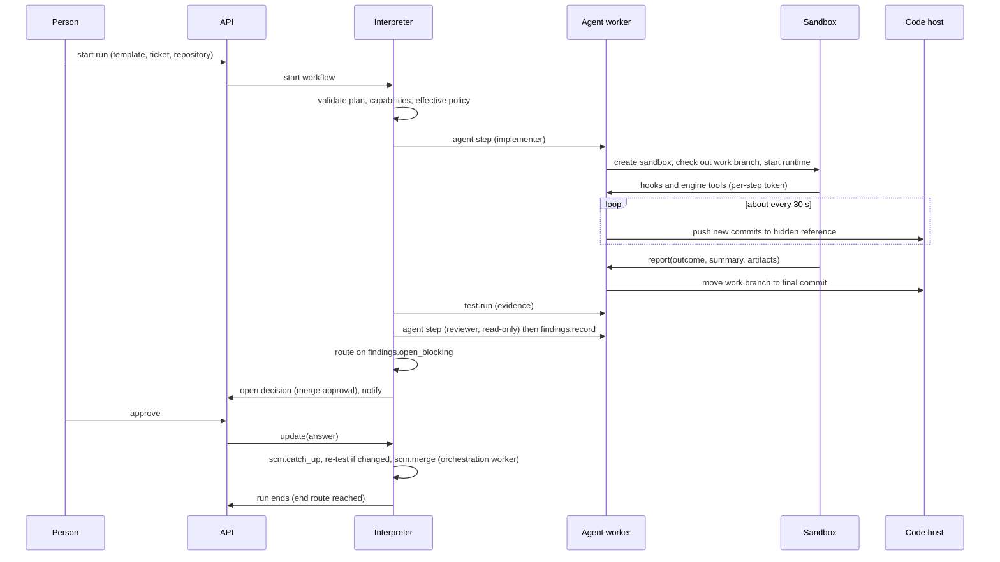

# Engine architecture

Status: draft, 2026-10-31.

This document owns the engine's components and how they run: the interpreter
on Temporal, workers, sandboxes, the agent pattern, stores, the control plane
and observability. Most of it is carried over from the first design
(`archive/docs/01`), which the three spikes evidenced; where it changes, the
section says so. Measurements are cited from the spike results
(`archive/docs/15`, `16`, `18`), not repeated.

Implementation language: .NET (`archive/docs/03` Q1).

---

## 1. Components

| Component | Runs as | Responsibility | State |
|---|---|---|---|
| API service | Long-lived service | Start, query, steer and abort runs; answer decisions; authenticate and authorise; write the audit record; the inbound gateway for webhooks and chat | None of its own (uses the record store) |
| Orchestration worker | Long-lived, N replicas | Hosts the interpreter workflow and light activities: provider calls that need no sandbox, validation, version control operations on the engine's own clones (section 6) | A cache of repository clones, rebuildable |
| Agent worker | Long-lived, N replicas, one pool per sandbox capability | Hosts agent step and test activities: creates and re-attaches sandboxes, starts and supervises agent runtimes, detects and pushes commits. **Serves the hook endpoint and the engine MCP server** for agents (RW17) | None. A sandbox outlives a worker restart |
| Sandbox | Created per step by the sandbox provider | Runs the agent runtime and its tools, or test commands, against a checkout | For the life of the step |
| Artifact store | External | Immutable, content-addressed blobs | Yes |
| Record store | External | Queryable records: runs, steps, decisions, overrides, findings ledger, evidence index, timeline, cost | Yes |
| Temporal | External | Durable execution | Yes |
| Console, CLI | Clients | Use the API only | No |

The API and workers share the provider, policy and validation libraries. They
share no process state.

### 1.1 Task queues

| Queue | Served by |
|---|---|
| `feature-flow-orchestration` | Orchestration workers |
| `feature-flow-agent` | Agent workers, default sandbox capabilities |
| `feature-flow-agent:<capability>` | Agent workers whose sandboxes offer a capability, for example `os_windows`, `docker`, `gpu` |

A step's queue follows from the capabilities its role (or its action) needs.
Windows-only repositories, Docker-dependent tiers and restricted networks need
no special case in the interpreter. Pool sizing: at least one activity slot per
concurrent long step, plus headroom (`archive/docs/15` section 6.3).

---

## 2. The interpreter

One Temporal workflow type runs every run, at every level. Runs differ only in
their plan.

### 2.1 The loop

```
state = { plan_revision, positions[], step_runs[], findings_summary, attempts, in_flight[], open_decisions[], children[] }

loop:
  ready = plan.ready(positions, state)              # pure
  if nothing ready, in flight, open or running as a child: end_run(state)

  for step in ready:
    if allowance spent: route(step, attempts_exhausted)                     # pure
    elif breakpoint set on step: open_decision(breakpoint)
    elif step is a decision: open_decision(step) or auto_resolve(step)     # pure
    else: in_flight.add(start(step))               # activity, local, or child workflow

  event = await first(in_flight, decisions answered, child signals, patches, overrides)
  state = apply(state, event)                       # pure
  positions = route(event, state)                   # pure

  if history over budget: drain_then_continue_as_new(state)                # section 3
```

Everything outside `await` is a pure function of the plan and state: the
determinism boundary. No I/O, clock, randomness or unordered iteration in
workflow code; recorded histories are replayed in CI against every interpreter
change (`docs/09`).

| Rule | Detail |
|---|---|
| Start on first completion | A ready step starts as soon as a slot frees, not when a batch finishes (`archive/docs/18` section 4) |
| Decisions do not block | An open decision is a durable wait alongside running steps |
| Every execution is checked | The allowance and the run ceiling are checked before every start, including loop re-entry (F4) |
| How a run ends | By an `end` route; otherwise `incomplete` (F9) |
| Versioning | From version 1, every behaviour change is wrapped in a Temporal patch marker so old histories replay. Before version 1 there is no backward compatibility: a change re-records the histories it breaks and adds no marker (LOG 263). The plan schema is versioned separately |

### 2.2 Execution forms

| Form | Used for |
|---|---|
| Local (pure, in workflow code) | Decisions resolved by policy, `plan.expand` over a parameter, route evaluation, applying patches |
| Activity | Everything that touches the outside world |
| Child workflow | `run.child` |

### 2.3 Polling and events

A wait on something actively progressing (CI, a merge queue) polls inside one
long-running, heartbeating activity: Spike 1 measured 11 history events for a
60-second polled step (`archive/docs/15` section 6.2). A wait on something idle
until a person acts (a tracker status, a review approval) reads between delays
(its activity's retry delay), and an inbound event ends the delay early: the wait
reads again at once (LOG 229). In both cases **events wake, reads confirm**:
an event is a hint; a read of the remote system decides.

---

## 3. Continue-as-new

Temporal histories have hard limits, so a long run periodically restarts its
workflow with its state carried over (continue-as-new).

| Measure | Value (Spike 1, `archive/docs/15` section 6.1) |
|---|---|
| History events per step | 6.28 |
| Carried state | About 500 bytes per plan step |
| Threshold | 5,120 events, or the payload byte limit, whichever comes first |
| Plan size limit | Carried state under 1 MB: about 2,000 steps |

**Changed from the first design (review finding 6.1).** The first design
continued-as-new only when nothing was in flight and no decision was open. A
wide epic with long children and a decision open for days might never reach
that point. The new rule:

| In flight | At continue-as-new |
|---|---|
| Activities | **Drain**: stop starting new activities, let in-flight ones finish, then continue-as-new. Activities are at most hours long, and their heartbeats add no history |
| Waits (`ci.checks`, `wait.condition`, a merge's action request) | **Do not block.** A wait may last days, so its activity is cancelled and the step returns to pending at the same execution, using no attempt. The new run starts that execution again with the same identity, so what it recorded (when it began waiting, the head it waits on) still applies, and its `timeout` and `grace` run from its first start (LOG 139, LOG 152) |
| Child runs | **Do not block.** Children are started with a parent-close policy that leaves them running. A child reports its end to the parent's workflow id by signal, which reaches whichever run of the parent is current; the parent then reads the child's result to confirm. A child that ends without signalling (terminated, or failed before it could) is noticed all the same: the run that started it is told by Temporal when it closes, and a later run watches the children it carried over with one activity, which a hand-over interrupts like a wait (LOG 154). The parent reads a child's artifacts from the record store's artifact index (LOG 155) |
| Open decisions | **Do not block.** They are state, carried over. Answers are Temporal Updates addressed by workflow id, which Temporal delivers to the current run. They are **accepted during the drain**: the handler only records the answer, and the hand-over waits for running handlers to finish, so the answer is in the carried state (LOG 58). The validator rejects unknown and conflicting answers only |
| Timers | Re-created from state in the new run |

Spiked in SP1 (`docs/spikes/sp1-results.md`): in 39 hand-overs, 24 with
children running and decisions open, no child's end, answer or activity was
lost. Negative controls showed that signalling a run id instead of the workflow
id, or the default parent-close policy (terminate), loses every child's end.

---

## 4. Agent steps in sandboxes

### 4.1 The pattern

The agent runtime (Claude Code, GitHub Copilot CLI, or another) runs **inside
the sandbox** with its own tools. The agent worker starts and supervises it but
does not relay its tool calls. Building the engine's own agent loop was rejected:
vendor harnesses are better and improve monthly, and hundreds of tool calls as
activities would flood history (`archive/docs/01` section 1.4).

The runtime calls back to the engine:

| Channel | Used for |
|---|---|
| Hooks (session start, before and after each tool call, stop) | Policy on each tool call (deny writes for a read-only role, deny `git push`, deny edits to `.git/config`); events for the timeline; token and cost accounting; liveness |
| The engine MCP server | The agent reporting contract: `report`, `ask_human`, `checkpoint`, `inspect_plan`, `propose_patch`, `run_check` (`docs/04` section 3.3) |

Nothing essential depends on hooks. A runtime without them gets sandbox-enforced
write access, a post-step check of what changed, and cost from its own usage
output; the run records the coarser control. Spike 2 measured: Claude Code fired
all hooks on Windows and macOS; Copilot CLI's tool-call hooks did not fire with
a third-party model (`archive/docs/16` sections 4 and 12). SP3 measured Copilot
CLI with a first-party model: `PreToolUse` fired on every tool call, including
MCP tools (`docs/spikes/sp3-results.md` section 5.3).

### 4.2 Where the hook endpoint and MCP server run (RW17)

**Changed from the first design (review finding 6.7):** served by the agent
worker pool, not the API service, so an API outage does not pause every agent.
Not inside the sandbox, where the agent could reach and alter it.

| Rule | Detail |
|---|---|
| Any replica serves any step | The per-step token is signed and carries the step's policy (run, step, role, write access, allowed tools). A replica evaluates a hook call from the token alone |
| State | Events, cost and questions are written to the record store; nothing is kept in replica memory |
| The client in the sandbox | A local stdio MCP server that serves the engine tools to the runtime and forwards each call to a replica, moving to another replica on any connection error (LOG 59) |
| Questions | The client assigns each question's id. `ask_human` signals the run to open a question decision, idempotently by that id, then waits on the record store for the answer. A worker restart breaks the connection; the client reconnects to another replica, which resumes the same question. Spiked in SP2 (`docs/spikes/sp2-results.md`): answers survived rolling restarts, a full outage and a 20-minute wait |
| Unreachable is not denied | The hook command and the client in the sandbox retry and hold the call for a bounded time, then stop the session in a resumable state, classified as infrastructure. Neither returns an infrastructure error to the agent: SP2 showed an agent given one improvises a result and reports success (LOG 60; risk R19, re-tested in SP2) |

### 4.3 Resume, commits and pushes

| Rule | Detail |
|---|---|
| The sandbox outlives the worker | A new worker re-attaches by the step's idempotency key. A worker deploy costs the agent nothing |
| Resume from durable state only | Sandbox handle, session reference and last pushed commit are in workflow state or the record store |
| Commands are started and polled | A long command survives a worker restart; the new worker re-attaches to it by handle (risk R18) |
| Commit detection | About every 30 seconds, the worker asks the VCS provider whether the working copy moved; if so it fetches the commits (as a bundle copied out of the sandbox), unpacks the bundle into a temporary bare repository on the agent worker, and pushes from it with the engine's identity to the hidden work-in-progress reference. No working tree and no cached clone are needed |
| Branch moves once | On success, the work branch moves to the final commit |
| Sandbox lost | A new sandbox from the hidden reference, with a fresh session |
| Graceful shutdown | A worker stopping deliberately finishes its heartbeat and releases its slots, so only a crash costs a heartbeat timeout. Spike 1 measured 87.4 seconds from a kill to progress, almost all of it detection (`archive/docs/15` section 6.4) |

### 4.4 Windows

The engine itself runs on Windows, macOS or Linux containers. Windows-only
repositories need a Windows sandbox provider, which is not in version 1: a
Windows tier can be delegated to CI, and a run that needs a Windows sandbox
fails at run start with a clear message. A Windows VM sandbox provider is the
planned approach (`archive/docs/01` section 4.7).

---

## 5. Stores

| Store | Holds | Technology by profile |
|---|---|---|
| Temporal state | References and small summaries only: plan revision, positions, step outcomes and outputs, a capped findings summary, attempts. The run's library snapshot is read into history once per history, at run start and after each continue-as-new (LOG 83) | Temporal |
| Artifact store | Every artifact, every plan revision, rendered tasks, transcripts, logs, library content | Local filesystem; S3 or Azure Blob |
| Record store | Runs, step runs, decisions, overrides, the findings ledger, evidence index, the timeline, cost | SQLite; Postgres |

| Rule | Detail |
|---|---|
| Reads | The console and API read the record store, never Temporal queries |
| Payloads | Never transcripts, diffs, code or secrets in workflow state; a pluggable payload codec for organisations that encrypt payloads (`aes_gcm`, LOG 284) |
| Findings summary | Capped in state; over the cap, only blocking findings are kept in state and the rest referenced |
| Git is not a store | Publishing artifacts to a repository for people to read is an action (`artifact.publish`) |
| Tenancy | One organisation per installation; `org_id` in record store keys from the start |
| Recovery | Database backups and object store versioning; a reconcile job rebuilds the run index from Temporal (the hosts' `reconcile` command, run after a restore, LOG 285) |

---

## 6. Engine-side version control

**New (review finding 6.8).** `scm.catch_up` and `scm.merge` need a working
tree that is not an agent's sandbox.

| Rule | Detail |
|---|---|
| Where | Each orchestration worker process keeps its own cache of clones per repository on local disk, in a folder of its own under the configured root, so processes never share a clone and need no lock between them (LOG 147). The remote is the truth; a lost cache is re-cloned |
| How | Each operation fetches, works in a temporary worktree, and pushes with an expected old revision, so the remote refuses it if anything moved. Operations are idempotent: a retry finds the merge already present |
| Credentials | The engine's identity, from the credential broker, for the duration of the operation |
| Large repositories | Partial clones where the VCS provider supports them |

---

## 7. Control plane

| Topic | Design |
|---|---|
| Transport | Decisions, overrides and patches from people arrive as Temporal **Updates**, each carrying the decision or step id and the plan revision it applies to; the update validator rejects stale or invalid requests. Child reports and inbound events arrive as **Signals**, which only wake the run |
| Authentication | People: OIDC against the organisation's identity provider; a local token in the solo profile. Automation: service-account tokens. Agents: the signed per-step token (section 4.2) |
| Authorisation | The API evaluates organisation policy (`docs/05`) and writes the record before sending the update; the workflow trusts the API. Only the API and workers can reach the Temporal namespace |
| Actor | Always from the authenticated identity, never the request body (F8) |
| Chat | A chat client is an API client. Its user is mapped to an identity-provider identity; approval rules say which decision types may be answered from chat |
| Temporal unavailable | Workers retry the connection; the API reports platform status separately from run status; runs are never failed because the platform is down |

---

## 8. Observability and cost

| Area | Design |
|---|---|
| Standard | OpenTelemetry traces, metrics and logs, with a configurable exporter |
| Traces | One trace per run; spans per step, activity and provider call |
| Provider calls | Wrapped by a decorator that adds spans, timeouts (by provider type) and error classification (LOG 303, 304) |
| Metrics | Step duration, attempts, infrastructure retries, schedule-to-start latency per queue, tokens and cost, findings by severity, decision wait time, sandbox start time. Not exported in version 1 (LOG 305) |
| Stuck runs | A periodic check: the record store names runs without progress, Temporal's pending work says why. A provider failing is `stalled`, nothing alive is `stuck`; each shows as an open wait and is notified, then `resumed` (LOG 306, 307) |
| Cost | Tokens, model and compute time recorded per step from version 1, from hooks or the runtime's usage output, and from the model proxy where there is one. Budgets are not in version 1 |
| Logs | Secrets scrubbed at the logging layer; transcripts are artifacts, not logs |

---

## 9. Data flows

### 9.1 One ticket



### 9.2 An epic, with a child's change to its plan

1. The epic's planner writes a ticket list; `plan.expand` adds one `run.child`
   per ticket to a `parallel`.
2. Tickets run, at most `max_concurrency` at once, each on its own branch from
   the epic branch.
3. A ticket's agent finds it needs a change in another repository and proposes
   a patch to the epic: add a ticket. The patch is a signal; the ticket keeps
   running or waits (RW6).
4. The epic applies the patch (or asks a person, if it touches protected
   content); the new ticket starts when a slot frees.
5. When every ticket has ended, the epic reviews its branch against its parent,
   with the tickets' ledgers as prior findings, then traces its requirements and
   merges as its workflow says.

### 9.3 A project delivering to the default branch

The project runs epics as children, the way an epic runs tickets. Its final
merge into `main` is, by default, an action request: a person merges on the
code host and the engine detects it (F1). `delivery.report` then states which
repositories merged.

---

## 10. Open questions

None that block the next documents. Judgement calls made in this document are
in `docs/LOG.md`, entries 31 to 34.
