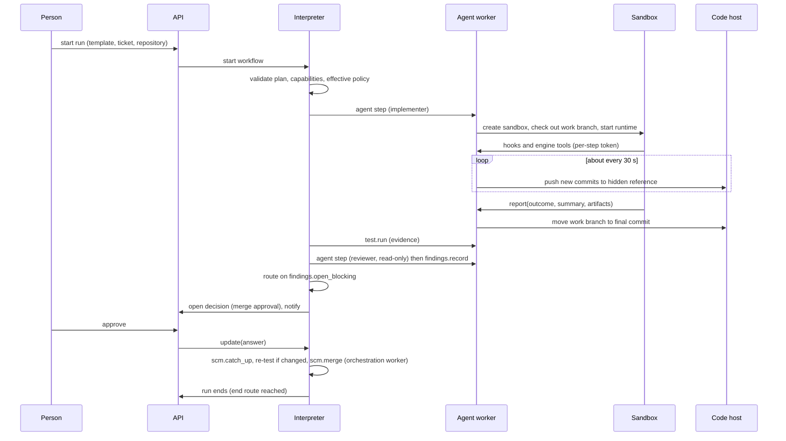

# Engine architecture

Status: draft, 2026-10-31.

This document owns the engine's components and how they run: the interpreter
on Temporal, workers, sandboxes, the agent pattern, stores, the control plane
and observability. Most of it is carried over from the first design
(`archive/docs/01`), which the three spikes evidenced; where it changes, the
section says so. Measurements are cited from the spike results
(`archive/docs/15`, `16`, `18`), not repeated.

Implementation language: .NET (`archive/docs/03` Q1).

---

## 1. Components

| Component | Runs as | Responsibility | State |
|---|---|---|---|
| API service | Long-lived service | Start, query, steer and abort runs; answer decisions; authenticate and authorise; write the audit record; the inbound gateway for webhooks and chat | None of its own (uses the record store) |
| Orchestration worker | Long-lived, N replicas | Hosts the interpreter workflow and every engine action: provider calls, validation, `test.run` in a sandbox of its own, interactive sessions, version control operations on the engine's own clones (section 6) | A cache of repository clones, rebuildable |
| Agent worker | Long-lived, N replicas | Hosts the agent step's activity: creates and re-attaches its sandbox, starts and supervises agent runtimes, detects and pushes commits. **Serves the hook endpoint and the engine MCP server** for agents (RW17) | None. A sandbox outlives a worker restart |
| Sandbox | Created per step by the sandbox provider | Runs the agent runtime and its tools, or test commands, against a checkout | For the life of the step |
| Artifact store | External | Immutable, content-addressed blobs | Yes |
| Record store | External | Queryable records: runs, steps, decisions, overrides, findings ledger, evidence index, timeline, cost | Yes |
| Temporal | External | Durable execution | Yes |
| Console, CLI | Clients | Use the API only | No |

The API and workers share the provider, policy and validation libraries. They
share no process state.

### 1.1 Task queues

| Queue | Served by |
|---|---|
| `temporal.task_queue` (default `feature-flow-orchestration`) | Orchestration workers: the interpreter and every engine action |
| The same name with `-orchestration` replaced by `-agent` (default `feature-flow-agent`) | Agent workers: agent steps |

There is one agent queue (LOG 318); pools by sandbox capability are not in
version 1 (`docs/07` section 2). Pool sizing: at least one activity slot per
concurrent long step, plus headroom (`archive/docs/15` section 6.3).

---

## 2. The interpreter

One Temporal workflow type runs every run, at every level. Runs differ only in
their plan.

### 2.1 The loop

```
state = { plan_revision, positions[], step_runs[], findings counts, attempts, in_flight[], waits[] (open and closed), children[] }

loop:
  ready = plan.ready(positions, state)              # pure
  if nothing ready, in flight, open or running as a child: end_run(state)

  for step in ready:
    if allowance spent: route(step, attempts_exhausted)                     # pure
    elif breakpoint set on step: open_decision(breakpoint)
    elif step is a decision: open_decision(step) or auto_resolve(step)     # pure
    else: in_flight.add(start(step))               # activity, local, or child workflow

  event = await first(in_flight, waits answered or timed out, child signals, patches, overrides)
  state = apply(state, event)                       # pure
  positions = route(event, state)                   # pure

  if history over budget: drain_then_continue_as_new(state)                # section 3
```

Everything outside `await` is a pure function of the plan and state: the
determinism boundary. No I/O, clock, randomness or unordered iteration in
workflow code; recorded histories are replayed in CI against every interpreter
change (`docs/09`).

The pure function is the interpreter's core (`FeatureFlow.Interpreter`, LOG 66),
and the state above is its state: every wait, open and closed; the child runs
its `run.child` steps started and that have not ended; and the artifacts steps
produced since the last record. What a step's activity is given (its inputs,
contract, timeout, an agent step's settings and the artifacts it consumes), what
an engine action knows of the run, what a child starts with and what a session
opens with are functions of the core too. The Temporal workflow (`RunWorkflow`)
is the loop around it: it carries out the core's commands (start a step's
activity, start or cancel a child workflow, arm a timer, open a session), awaits
the first thing to happen, gives it back to the core, and records what changed.
It holds only what is Temporal's (section 3). It reads the core only through a
listed set of the core's members and never touches the core's state: what it
saw happen outside the core (an activity's warning, a session's or a tracker's
result, a hand-over) it gives the core as a timeline note. A person's answers and
overrides are both routed by the core, each by one function that the update's
validator and handler call (`docs/04` section 4, `docs/05` section 5). An
architecture test (`ShellRuleTests`) fails if the shell uses a core
member not on the list, touches the core's state, names an action, recovery or
wait kind, spells out a wait id's prefix or reads a wait id's spelling, or gains
a field no one has said the core cannot hold. It checks names, so it does not
prove the shell holds no routing decision (LOG 382).

| Rule | Detail |
|---|---|
| Start on first completion | A ready step starts as soon as a slot frees, not when a batch finishes (`archive/docs/18` section 4) |
| Decisions do not block | An open decision is a durable wait alongside running steps |
| Every execution is checked | The allowance and the run ceiling are checked before every start, including loop re-entry (F4) |
| How a run ends | By an `end` route; otherwise `incomplete` (F9) |
| Versioning | From version 1, every behaviour change is wrapped in a Temporal patch marker so old histories replay. Before version 1 there is no backward compatibility: a change re-records the histories it breaks and adds no marker (LOG 263). The plan schema is versioned separately |

### 2.2 Execution forms

| Form | Used for |
|---|---|
| Local (pure, in workflow code) | Decisions resolved by policy, `plan.expand` over a parameter, route evaluation, applying patches |
| Activity | Everything that touches the outside world |
| Child workflow | `run.child` |

### 2.3 Polling and events

A wait (`ci.checks`, `wait.condition`, `scm.merge` waiting for its merge) reads once per
activity attempt; while its condition is open, the activity is retried after its
delay, so a wait holds no worker slot, and an inbound event ends the delay early:
the wait reads again at once (LOG 229). In every case **events wake, reads
confirm**: an event is a hint; a read of the remote system decides.

---

## 3. Continue-as-new

Temporal histories have hard limits, so a long run periodically restarts its
workflow with its state carried over (continue-as-new).

| Measure | Value (Spike 1, `archive/docs/15` section 6.1) |
|---|---|
| History events per step | 6.28 |
| Carried state | About 500 bytes per plan step |
| Threshold | 5,120 events, or the payload byte limit, whichever comes first |
| Plan size limit | Carried state under 1 MB: about 2,000 steps |

**Changed from the first design (review finding 6.1).** The first design
continued-as-new only when nothing was in flight and no decision was open. A
wide epic with long children and a decision open for days might never reach
that point. The new rule:

| In flight | At continue-as-new |
|---|---|
| Activities | **Drain**: stop starting new activities, let in-flight ones finish, then continue-as-new. Activities are at most hours long, and their heartbeats add no history |
| Waits (`ci.checks`, `wait.condition`, a merge's action request) | **Do not block.** A wait may last days, so its activity is cancelled and the step returns to pending at the same execution, using no attempt. The new run starts that execution again with the same identity, so what it recorded (when it began waiting, the head it waits on) still applies, and its `timeout` and `grace` run from its first start (LOG 139, LOG 152) |
| Child runs | **Do not block.** Children are started with a parent-close policy that leaves them running; the core holds the running ones, so they are carried with its state. A child reports its end to the parent's workflow id by signal, which reaches whichever run of the parent is current; the parent then reads the child's result to confirm. A child that ends without signalling (terminated, or failed before it could) is noticed all the same: the run that started it is told by Temporal when it closes, and a later run watches the children it carried over with one activity, which a hand-over interrupts like a wait (LOG 154). The parent reads a child's artifacts from the record store's artifact index (LOG 155) |
| Open decisions | **Do not block.** Every wait, open and closed, is the core's state, carried over; a question's timer is armed again from it. Answers are Temporal Updates addressed by workflow id, which Temporal delivers to the current run. They are **accepted during the drain**: the handler only records the answer, and the hand-over waits for running handlers to finish, so the answer is in the carried state (LOG 58). The validator and the handler route an answer with the core's one routing function, so they refuse the same answers (`docs/04` section 4); an override is routed the same way, by the core's override routing (LOG 383) |
| Timers | Re-created from state in the new run |

What is carried has one path: the core's snapshot, which holds everything that
routes (the plan's patches, positions, step records, waits open and closed,
children running, steering), and what is Temporal's: child-ended and
parent-patch signals not yet given to the core, the parent's cancellation, the
timeline's record number, and the hand-over records. Each hand-over record
counts what the drain interrupted, and what started or arrived while it drained
(LOG 365); none of it is carried as state.

Spiked in SP1 (`docs/spikes/sp1-results.md`): in 39 hand-overs, 24 with
children running and decisions open, no child's end, answer or activity was
lost. Negative controls showed that signalling a run id instead of the workflow
id, or the default parent-close policy (terminate), loses every child's end.

---

## 4. Agent steps in sandboxes

### 4.1 The pattern

The agent runtime (Claude Code, GitHub Copilot CLI, or another) runs **inside
the sandbox** with its own tools. The agent worker starts and supervises it but
does not relay its tool calls. Building the engine's own agent loop was rejected:
vendor harnesses are better and improve monthly, and hundreds of tool calls as
activities would flood history (`archive/docs/01` section 1.4).

The workflow gives the agent worker the step's specification as the core
computed it: the rendered task, the role's tools and write access, the consumed
artifacts and the run context the core rendered (`docs/04` section 3.5). The
worker writes the first prompt from it (the library's reporting preamble, where
the step's files are, the run context, then the task) and stores the prompt as
an artifact before the runtime starts.

The runtime calls back to the engine:

| Channel | Used for |
|---|---|
| Hooks (session start, before and after each tool call, stop) | Policy on each tool call (deny writes for a read-only role, deny `git push`, deny edits to `.git/config`); events for the timeline; token and cost accounting; liveness |
| The engine MCP server | The agent reporting contract (`docs/04` section 3.3) |

Nothing essential depends on hooks. A runtime without them gets sandbox-enforced
write access, a post-step check of what changed, and cost from its own usage
output; the run records the coarser control. Spike 2 measured: Claude Code fired
all hooks on Windows and macOS; Copilot CLI's tool-call hooks did not fire with
a third-party model (`archive/docs/16` sections 4 and 12). SP3 measured Copilot
CLI with a first-party model: `PreToolUse` fired on every tool call, including
MCP tools (`docs/spikes/sp3-results.md` section 5.3).

### 4.2 Where the hook endpoint and MCP server run (RW17)

**Changed from the first design (review finding 6.7):** served by the agent
worker pool, not the API service, so an API outage does not pause every agent.
Not inside the sandbox, where the agent could reach and alter it.

| Rule | Detail |
|---|---|
| Any replica serves any step | The per-step token is signed and carries the step's policy (run, step, role, write access, allowed tools) and its agent runtime instance. A replica evaluates a hook call from the token alone: the instance's runtime reads the call as a tool class, the policy decides on classes, and a denial is answered in the runtime's own form, which the hook command applies (LOG 444) |
| State | Events, cost and questions are written to the record store; nothing is kept in replica memory |
| The client in the sandbox | A local stdio MCP server that serves the engine tools to the runtime and forwards each call to a replica, moving to another replica on any connection error (LOG 59) |
| Questions | The client assigns each question's id. `ask_human` signals the run to open a question decision, idempotently by that id, then waits on the record store for the answer. A worker restart breaks the connection; the client reconnects to another replica, which resumes the same question. Spiked in SP2 (`docs/spikes/sp2-results.md`): answers survived rolling restarts, a full outage and a 20-minute wait |
| Unreachable is not denied | The hook command and the client in the sandbox retry and hold the call for a bounded time, then stop the session in a resumable state, classified as infrastructure; the hook command does so in the step's runtime's own way, and blocks the call where it has none (LOG 444). Neither returns an infrastructure error to the agent: SP2 showed an agent given one improvises a result and reports success (LOG 60; risk R19, re-tested in SP2) |

### 4.3 Resume, commits and pushes

| Rule | Detail |
|---|---|
| The sandbox outlives the worker | A new worker re-attaches by the step's idempotency key. A worker deploy costs the agent nothing |
| Resume from durable state only | Sandbox handle, session reference and last pushed commit are in workflow state or the record store |
| Commands are started and polled | A long command survives a worker restart; the new worker re-attaches to it by handle (risk R18) |
| Commit detection | About every 30 seconds, the worker asks the VCS provider whether the working copy moved; if so it fetches the commits (as a bundle copied out of the sandbox), unpacks the bundle into a temporary bare repository on the agent worker, and pushes from it with the engine's identity to the hidden work-in-progress reference. No working tree and no cached clone are needed |
| Branch moves once | On success, the work branch moves to the final commit |
| Sandbox lost | A new sandbox from the hidden reference, with a fresh session |
| Graceful shutdown | A worker stopping deliberately finishes its heartbeat and releases its slots, so only a crash costs a heartbeat timeout. Spike 1 measured 87.4 seconds from a kill to progress, almost all of it detection (`archive/docs/15` section 6.4) |

### 4.4 Windows

The engine itself runs on Windows, macOS or Linux containers. Windows-only
repositories need a Windows sandbox provider, which is not in version 1; a
Windows tier can be delegated to CI.

---

## 5. Stores

| Store | Holds | Technology by profile |
|---|---|---|
| Temporal state | References and small summaries only: plan revision, positions, step outcomes and outputs, the `findings` counts (`docs/03` section 5.3), attempts. The run's library snapshot is read into history once per history, at run start and after each continue-as-new (LOG 83) | Temporal |
| Artifact store | Every artifact, every plan revision, rendered tasks, transcripts, logs, library content | Local filesystem; S3 or an S3 API store such as MinIO |
| Record store | Runs, step runs, decisions, overrides, the findings ledger, the artifact index, the timeline, cost; for the console, each step's attempt counters (step states), each pull request as last read, and the registered repositories (LOG 527) | SQLite; Postgres |

The **artifact index** in the record store lists what a run stored, one record per
run, step, execution and name, with its reference: declared artifacts; evidence
(`evidence:<type>`); each agent session's prompt and transcript (`prompt:<n>` and
`transcript:<n>`, indexed by the agent activity as each is stored, a failed
attempt's included); and each accepted plan revision (`plan_revision`, under no
step, its revision as the execution; LOG 393, 404). A parent run consumes a
child's declared artifacts and evidence, never its prompts, transcripts or plan
revisions. A person reads a run's own index through the API (section 7); a
child's is read through the child (LOG 325 as amended).

| Rule | Detail |
|---|---|
| Reads | The console and API read the record store, never Temporal queries |
| Payloads | Never transcripts, diffs, code or secrets in workflow state; a pluggable payload codec for organisations that encrypt payloads (`aes_gcm`, LOG 284) |
| Git is not a store | Publishing artifacts to a repository for people to read is an action (`artifact.publish`) |
| Tenancy | One organisation per installation; `org_id` in record store keys from the start |
| Recovery | Database backups and object store versioning; a reconcile job rebuilds the run index from Temporal (the hosts' `reconcile` command, run after a restore, LOG 285) |

---

## 6. Engine-side version control

**New (review finding 6.8).** `scm.catch_up` and `scm.merge` need a clone
that is not an agent's sandbox.

| Rule | Detail |
|---|---|
| Where | Each orchestration worker process keeps its own cache of clones per repository on local disk, in a folder of its own under the configured root, so processes never share a clone and need no lock between them (LOG 147). The remote is the truth; a lost cache is re-cloned |
| How | Each operation fetches into the process's bare clone, builds any merge there without a working tree (`git merge-tree`), and pushes with an expected old revision, so the remote refuses it if anything moved. Operations are idempotent: a retry finds the merge already present |
| Credentials | The engine's identity, from the credential broker, for the duration of the operation |

---

## 7. Control plane

| Topic | Design |
|---|---|
| Transport | Decisions, overrides and patches from people arrive as Temporal **Updates**, each carrying the decision or step id and the plan revision it applies to; the update validator rejects stale or invalid requests. Child reports and inbound events arrive as **Signals**, which only wake the run |
| API records | Every request and response body is a record of `FeatureFlow.Api.Contracts`, a project that references nothing, so the CLI sends and reads the same records (LOG 388). JSON is snake_case, enum values included (`patch_approval`); required properties, nullability and number types are enforced. A body is read after authentication: one that is not JSON, lacks a required property, has a value of the wrong type or names a property the record does not have (an `actor` among them, F8) is refused 400 (LOG 407). Store records are never responses: each is mapped to a view record. Every refusal is `{ "error": "<message>" }`, with `errors`, a list, only where a check finds several things wrong (a person's answer artifacts, LOG 529); `errors` is not written otherwise, so other refusals are unchanged (LOG 527). A person's reason (answers, aborts, overrides, a session's submission and abandonment) is at most 4,096 bytes of UTF-8 and a longer one is refused 400, since it is carried in the run's state and its context (LOG 432); it is optional except for a choice the wait names in `reason_required`, an abort, a library override and a grant beyond the hard ceiling (`docs/05` section 5, LOG 502) |
| OpenAPI | The OpenAPI 3.1 document is generated by ASP.NET Core from each route's metadata (operation id, body, responses and refusals), served unauthenticated at `GET /openapi.json`, and committed at `src/FeatureFlow.Api/openapi.json` for generated clients. Every operation it describes requires the `bearer` security scheme (HTTP, `Authorization: Bearer <token>`), added by a document transformer. A default-suite test (`OpenApiTests`) holds the committed file to the generated document (`FF_WRITE_OPENAPI=1` rewrites it; a merge conflict in it is resolved by regenerating) and every mapped route to a description (LOG 390). The inbound and console routes are not described |
| Routes | Runs: `POST /runs` (refused with 400 when check 18 of `docs/09` would refuse the run: a required parameter not bound, or a literal of the wrong type, each named; LOG 495. Its `tracker_issue` becomes `run.tracker_issue`; for a template that names a `metadata.tracker_parameter` (`docs/03` section 1), the run's tracker issue is that parameter's value instead, and a `tracker_issue` that differs from it is refused 400 naming both; LOG 501), `GET /runs`, `GET /runs/{id}` (`after`: the timeline after a record number), `POST /runs/{id}/answers`, `/abort` and `/overrides` (`docs/05` section 5), `GET /runs/{id}/tree`, `GET /runs/{id}/findings` and `GET /runs/{id}/findings/{finding}`. Repositories: `GET` and `POST /repositories`. Sessions (`docs/04` section 4.4): `GET /runs/{id}/sessions`, `GET /sessions/{sid}`, `GET` and `POST /sessions/{sid}/checks`, `POST /sessions/{sid}/submit` and `/abandon`; a session names the command that opens it locally (`open_command`, `ff session fetch <sid> --out .ff-session`; LOG 532). The rows below describe the rest; `src/FeatureFlow.Api/openapi.json` gives every body. Unauthenticated: `/openapi.json`, `/inbound/events/{source}` and `/inbound/chat/{source}` (the inbound gateway, section 1), and `/console` |
| Events | `GET /events` streams change notifications as server-sent events (`text/event-stream`; G8) to any authenticated caller, each frame only for a run the caller views (LOG 399). A frame is `id: <sequence>`, `event: run_changed`, `wait_opened` or `wait_closed`, and `data:` a `ChangeEvent` (`sequence`, `run_id`, `kind`, `wait_id`, `updated_at`): ids, not content, so the client re-reads the run or its attention list. One `ChangeFeed` per API process reads the record store's changes (`docs/06` section 3.12) every `ApiServices.EventPoll` (1 s), never memory shared with the workers, and gives each to every subscriber's channel of 256 frames; a subscriber whose channel is full is closed, and its client reconnects (LOG 398). The feed keeps the repositories of the 4,096 runs it most recently filtered. The stream starts with `retry: 3000`; a reconnection's `Last-Event-ID` is answered from the feed's last 1,024 changes, or, if older (or unreadable), with one `event: reset` frame (`ChangeKind` `reset`, `data: {}`) whose id is the latest change, after which the client re-reads everything. A comment line `: ping` is sent every `ApiServices.EventHeartbeat` (15 s). Responses carry `Cache-Control: no-store` and `X-Accel-Buffering: no` so proxies do not buffer them. `EventSource` cannot send an `Authorization` header, so a browser client reads the stream with `fetch` and parses the frames itself (the document describes the frame's data, not the stream); no token goes in the query string. The poll interval, heartbeat and clock (`ApiServices.Time`) are set by the host, not by configuration files. B1 adds no frame kind: a batch writing findings, finding events, step states or pull request records raises `run_changed` for its run, so a finding's triage or a step's counters reach an open page; registering a repository raises nothing, as it is no run's (LOG 527) |
| Artifacts | For a viewer of the run: `GET /runs/{id}/artifacts` lists the run's own artifact index (section 5), each with its kind (`artifact`, `evidence`, `transcript`, `prompt`, `plan_revision`); `GET /runs/{id}/artifacts/{reference}` reads one the index holds, or one a wait of the run names as consumed, such as the parent's contract a child's gate ratifies (LOG 394). Anything else, a child's own included, is 404. `GET /runs/{id}/artifacts/{reference}/document`, under the same rule, reads it as an `ArtifactDocument`: its format (`yaml`, `json`, `markdown`, `text`) from the type the run's lock declares for it, else from what the text shows; YAML and JSON as `data`, JSON text; Markdown as `body`, with its front matter as `data`; content that is not UTF-8 text is 415 (LOG 529). `GET /runs/{id}/artifacts/{reference}/turns`, under the same rule, reads an agent session's transcript as `TranscriptTurns`, one shape for every runtime (Copilot CLI's JSON-lines events, Claude Code's stream-json): runtime, model, start, duration, tool and model calls, tokens, the turns in order (`prompt`, `message`, `reasoning`, `tool` with its name, summary, arguments and output, `notice`, `error`, `result`, each with its time where the runtime records one and whether it failed), and the event types it holds but does not show, counted; text that holds no runtime's events is 415 (LOG 543) |
| Plan | `GET /runs/{id}/plan`, for a viewer of the run: the run's latest `plan_revision` rebuilt with its tree's library lock, as its readable form (`docs/09` section 4.4) and as steps with their form, outcomes and routes, status from the timeline and open waits, breakpoint and skip (LOG 404). A run that has recorded no revision yet answers 204 with no body: nothing to show is not a refusal, so the console logs no error and `ff run plan` says so (LOG 493). `groups` are the plan's fragment uses (id the use's id) and the branches of its `for_each`, `parallel` and chain steps (`<step>#<index>`, labelled by the `for_each` item), each step's `parent` its innermost group; each step carries its counters from the step states (`executions`, `attempts_used`, `attempts_allowed` including grants, `attempts_granted`), the child run it started (`child_run_id`), its last timeline entry (`changed_at`), and its `with` and `limits` as written in the plan (block YAML, null where the step gives none), and each outcome the artifact names it `produces` (LOG 538). `?proposed={wait}` answers the plan as an open patch approval's patch would make it: the next revision, each step marked `added`, `changed` (including as written) or `removed` (kept where it stood); 404 for no such open wait, 409 for a patch that does not apply (LOG 530) |
| Run tree | `GET /runs/{id}/tree`, for a viewer of the run: the tree from the topmost ancestor the caller views, so a link to a child shows its project. Each node is the run's view, its plan as `/plan` gives it or `plan_note` saying why it has none, its open waits (as on the run page), and the children the caller views, by start. The tree's plan revisions come from one read of the root's artifact index; loaded plans are kept by lock and revision artifact, both content-addressed (LOG 530) |
| Run list | `GET /runs`: each run's view with its level, parent step, tracker issue and title (the issue's, read once by the engine; else none), start, and pull request links. The root of a `starting` or `running` tree also counts, across the tree's active runs the caller views, its current steps (`current_steps`: those running, retrying or waiting, leaving out container and `run.child` steps, as the console's tree does; LOG 539), how many are `running`, and its waits that need the caller (`needs_you`, `/attention`'s rule); other rows carry none (LOG 530). Runs recorded before B1 have no level, start, title or counters, and show the run id and "–" (LOG 537) |
| Findings | `GET /runs/{id}/findings` gives each finding's state and content with its run, whether it `needs_person` (the rule `findings.triage` applies, held in `FindingsLedger`), the person who `decided_by_person`, what raised it (`raised_by`: step, the review angle of its `for_each` branch, source), whether it may be marked fixed (`can_mark_fixed`, else `mark_fixed_refusal`), its re-raises and fixes. `GET /runs/{id}/findings/{finding}` adds its history, oldest first (LOG 529) |
| Repositories | `GET /repositories`, for anyone signed in: every registered repository, and, marked `registered: false`, those named by runs the caller views. `POST /repositories` `{ "github": "owner/name" }` (or a `https://github.com/...` URL) registers one for anyone signed in, with no role (the product owner's decision, LOG 532), after the code host finds it and its default branch: 201, 400 if not found or not a GitHub name, 409 if registered already, in any case; `{ "path": ... }` is refused 400 until local Git (E5) |
| Templates | `GET /templates`, for any authenticated caller (LOG 400): each organisation library's entrypoints (`docs/08` section 2) with the template's parameters, and the libraries that could not be read with why. A literal default is given as JSON text (`default`), the form `POST /runs` takes; an `{ expr: ... }` default is evaluated at run start, so it is given as `default_expression` with `default` null. `tracker_parameter` names the parameter whose value is the run's tracker issue, when the template declares one, so a start form does not ask for the tracker issue separately (LOG 501) |
| Authentication | People: OIDC against the organisation's identity provider; a local token in the solo profile, or no sign-in at all there (`api.auth.mode: none`, every request the configured actor, on loopback only, with requests a page of another site could make refused 403: `docs/07` section 2, LOG 333, 457, 469). Automation: an identity-provider token (`oidc`), or the local token. Agents: the signed per-step token (section 4.2). Planned (`docs/12` R2): authenticators chosen from a set the host registers, so a distribution or fork may add its own (`docs/00` P13); browser sign-in for the console with authorisation code and PKCE against a public client, its settings read from an unauthenticated `GET /console/config` |
| Console | A TypeScript single-page application (Preact, built with Vite; sources in `src/FeatureFlow.Console`), built by `dotnet build` and embedded in the API host as hashed assets, served at `/console` from the same origin: the page revalidated on every load, the assets cached for a year; a content security policy with Trusted Types (LOG 452 to 456). A top bar (Needs me with its count, Runs, Start a run, Templates and Settings greyed, the actor, a light or Nord dark theme, and on the workspace a right-pane toggle); theme and pane widths are kept per browser (LOG 533). Routes: `#/` and `#/needs` Needs me, `#/runs`, `#/start`, and the workspace of a run tree: `#/runs/{run}` (a child shows its root's tree with the child selected), `#/runs/{tree}/steps/{run}/{step}`, `#/runs/{tree}/waits/{run}/{wait}` (the step selected and its decision open; the form a Slack decision links), `#/runs/{tree}/artifacts/{run}/{ref}`, and `#/own/{run}` with the same suffixes (the run as the root of its own tree, which the tree's ↗ opens; LOG 541); slice 1's run and artifact links still open (LOG 463, 533). **Needs me** lists the open waits the person may answer, oldest first, filtered by kind, with each wait's path; a question is answered in place, anything else opens its decision; recent answers are folded below (LOG 536). **Runs** lists run trees, searched and filtered in the page (LOG 536). The **workspace** (LOG 534) has the tree on the left (`GET /runs/{id}/tree`: groups, child runs under the step that started them, placeholders for parts not yet planned, markers for running, needs-you and breakpoints, `used/budget`, pills that step through what needs you, runs or is in trouble, Follow current), the selected run, group or step in the middle (a run's facts, what needs you in tree order and the progress of the runs under it, Run actions with abort and history; a step's path, why it waits, its counters, Overview, Activity and Artifacts tabs; Activity shows an agent step's sessions as transcript turns, live while a session runs, with an execution picker, stick-to-bottom scrolling and the current tool call marked, and opens first for a running agent step; LOG 547), and a viewer on the right (a preview tab and pinned tabs; YAML and JSON as tables through the document route). Each kind of decision opens its own **popup** with the answers and comment at the top (intervention, triage, spec approval, merge, patch approval with the proposed plan, breakpoint, question, planning session); a triage is built from fields and sent as `person_triage` YAML; Steer and Edit step are in a step's detail, each with its consequence and a reason; Edit step starts from the step's current `with` or `limits`, since an amend's `set` replaces the field whole (LOG 535, 538). A breakpoint set from the tree's margin also asks a reason (LOG 541). `stalled` and `stuck` are shown as status, not as decisions. API data reaches the page only as text, and only `https:` URLs from the API become links (LOG 460, 533). Change notifications come over `GET /events`, read with `fetch` so the bearer token is sent, and are followed by re-reads: the workspace reads its tree again on a frame for any run in it (LOG 459, 534), and a step's Activity on its `step_changed` (LOG 547). With `api.auth.mode: none` there is no sign-in; otherwise the person pastes a token (LOG 458). It uses the API only (section 1) |
| Authorisation | The API evaluates organisation policy (`docs/05`) and writes the record before sending the update; the workflow trusts the API. A caller who does not view a run is answered 404 on every route of the run, reads and writes (answers, abort, overrides, sessions) alike, so a route does not reveal that the run exists. Only the API and workers can reach the Temporal namespace |
| What needs a person | `GET /attention` lists, oldest first, every open wait the caller may answer now, across runs: the record store's open waits of `starting` and `running` runs (`open_waits`, `docs/06` section 3.12), less the engine's status waits (`stalled`, `stuck`), those of runs the caller does not view, those the answer rule (`docs/05` section 3.2) refuses the caller, and a `min_count` decision the caller has already answered while it waits for others. Each item gives the wait's `path`, the runs from the root the caller views to the wait's run's parent; `recent` gives the caller's last 10 answers of the past 7 days on runs it views, newest first, each once as its latest record (LOG 530, 536). `GET /me` names the caller: actor, channel (`api`, `chat`), identity-provider groups (none for the local token), its organisation-wide roles, and its roles in each team where it holds any |
| The run page | `GET /runs/{id}` is one document per run (LOG 396): the run; every wait, open first, then closed ones most recently closed first, each with `can_answer` (the same rule as the answer route), `min_count` (how many people must answer it the same way: 1 where the rule sets none, and for a closed wait), for an open `min_count` decision who has answered each way (`progress`), and for a closed one the answer that closed it; the timeline; the children; every answer and override as recorded (`sent`, `pending: ...`, the run's reply, `refused: ...`); and `overrides_allowed`, the override keys the caller may use on the run, `abort` included, answering and recovery excluded (a wait's `can_answer` says those) (LOG 417). B1 adds the run's pull requests in full as last read (state, size, files, checks, approvals, the step that read it), its `inputs` (the latest revision's parameters) and its `current_steps` with its active descendants' (LOG 530); and on each wait, as the API computes them, a plain-text `title` and one-line `summary` by the wait's kind and decision type, for an intervention its `cause` (step, outcome, reason, what the step last said, attempts used and allowed, every time it was sent back and by whom, the grants people gave it, and `likely_to_repeat` when the last two were sent back alike), for a patch approval its `patch`, for a `*.merge_action` gate the `pull_request` its step last read, for a gate with a planning session its `session_id`, and on an open gate each consumed artifact's `type` and `changes` (LOG 528, 529). An answer's role check runs first, so a caller who may not answer is refused 403 before any artifact is stored or checked (LOG 540); then its artifacts are checked against the type the decision step produces for that outcome before it is delivered: a bad one is refused 400 with `errors` and nothing is delivered; a type validator this API does not offer is left to the engine (LOG 529) |
| Library reads | Read routes (`/attention`, `can_answer`) read the organisation's libraries' decision types at most once a minute per API process (LOG 395); the answer path reads them at the moment of use (`docs/05` section 8) |
| Actor | Always from the authenticated identity, never the request body (F8) |
| Chat | A chat client is an API client. Its user is mapped to an identity-provider identity; approval rules say which decision types may be answered from chat |
| Temporal unavailable | Runs are never failed because the platform is down. Planned (`docs/12` R4): hosts that retry at startup until Temporal and the stores are ready, and a platform status route |

---

## 8. Observability and cost

| Area | Design |
|---|---|
| Standard | OpenTelemetry traces, metrics and logs, with a configurable exporter |
| Traces | One trace per run; spans per step, activity and provider call |
| Provider calls | Wrapped by a decorator that adds spans, timeouts (by provider type) and error classification (LOG 303, 304) |
| Metrics | Step duration, attempts, infrastructure retries, schedule-to-start latency per queue, tokens and cost, findings by severity, decision wait time, sandbox start time. Not exported in version 1 (LOG 305) |
| Stuck runs | A periodic check: the record store names runs without progress, Temporal's pending work says why. A provider failing is `stalled`, nothing alive is `stuck`; each shows as an open wait and is notified, then `resumed` (LOG 306, 307) |
| Cost | Tokens, model and compute time recorded per step from version 1, from hooks or the runtime's usage output, and from the model proxy where there is one. Budgets are not in version 1 |
| Logs | Secrets scrubbed at the logging layer; transcripts are artifacts, not logs |

---

## 9. Data flows

### 9.1 One ticket



### 9.2 An epic

1. The epic's planner writes a ticket list; `plan.expand` adds one `run.child`
   per ticket to a `parallel`.
2. Tickets run, at most `max_concurrency` at once, each on its own branch from
   the epic branch.
3. When every ticket has ended, the epic reviews its branch against its parent,
   with the tickets' ledgers as prior findings, then traces its requirements and
   merges as its workflow says.

### 9.3 A project delivering to the default branch

The project runs epics as children, the way an epic runs tickets. Its final
merge into `main` is, by default, an action request: a person answers the
`project.merge_action` decision and merges on the code host, and the engine
detects it (F1; `docs/04` section 4.5). `delivery.report` then states which
repositories merged.

---

## 10. Open questions

None that block the next documents. Judgement calls made in this document are
in `docs/LOG.md`, entries 31 to 34.
