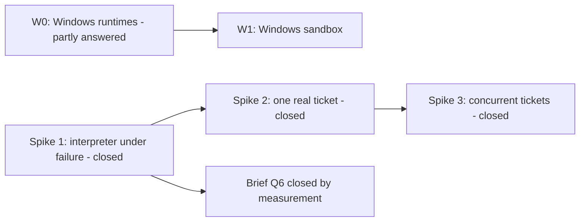

# Risks and spike plan

Status: updated 2026-10-31, after Spikes 1 to 3 and the merge and review design
decisions. First written 2026-10-26.

| Section | Contents |
|---|---|
| 1 | Risk register: twenty risks, R1 to R20, each with its mitigation and current status |
| 1.3 | Design requirements DR1 to DR13: what the spikes showed the design must do |
| 2 | Spike plan: Spikes 1, 2 and 3 are closed; Spike W0 (Windows agent runtimes) is partly answered |
| 3 to 5 | Spike order, what the spikes did not cover, open questions |

`docs/01` section 9 (principal risks) carries a short copy of the register. This
document is the full version.

**Two numbering schemes.** Risks are R1 to R20. The spike results documents also
used R1 to R6 for design requirements; those are now DR1 to DR6 and are not the
same as risks R1 to R6 (section 1.3 maps them).

---

## 1. Risk register

Status as of 2026-10-31:

- **Mitigated**: a spike exercised the mitigation and it held.
- **Handled by design**: a later design decision addresses the risk, but no spike
  has exercised that design yet.
- **Residual**: the mitigation reduces the risk but does not remove it.

| # | Risk | Mitigation | Status |
|---|---|---|---|
| R1 | Workflow history grows too large on a 27-hour run with hundreds of steps | Workflow state holds references only; findings summary is capped; continue-as-new (Temporal restarting the workflow with fresh history) at a measured threshold; replay tests | **Mitigated, measured in Spike 1.** 6.28 history events per step; carried state about 500 bytes per plan step, stable across continue-as-new. Threshold: 5,120 events or the 2 MB payload limit, whichever comes first. A plan size limit (`docs/12` section 2.4, check 32) keeps carried state under 1 MB, about 2,000 steps. Evidence: `docs/15` section 6.1 |
| R2 | Non-determinism leaks into the interpreter | Pure-function discipline; replay test suite in CI; code review rule | **Mitigated.** Nine recorded histories replay cleanly (`docs/15` section 7). In Spike 3 a fixture failed replay when an interpreter change lacked its version marker, so the tests catch this class (`docs/18` section 4) |
| R3 | A decision or steering request is lost during continue-as-new | Continue-as-new only between steps with no pending decision; the API retries against the new run | **Mitigated.** Spike 1: no update lost (`docs/15` section 3.6) |
| R4 | Review verdicts are unstable across passes | Findings ledger as source of truth, with "fixed" sticky while the code is unchanged; review design with evidence-backed bug findings, separate review angles and a different model from the author (DR4, section 1.3) | **Handled by design, not re-measured.** Spike 2 measured the instability: four passes on unchanged input gave 1, 1, 1 and 2 findings, and a fixed finding was re-raised (`docs/16` section 2). The ledger (`docs/17` section 6.5) and review design (`docs/19`) respond to it; no spike has run the new reviewer |
| R5 | Sandbox does not match CI | `feature-flow.yaml` declares test tiers; CI delegation (running a tier in the real CI system) is the default for Docker-dependent tiers | **Mitigated.** Spike 2: a Docker-dependent tier ran through CI delegation and passed (`docs/16` section 2) |
| R6 | Credentials exposed in sandboxes or payloads | Short-lived, least-privilege, per-step credentials; secrets by reference; encrypted payload codec available | **Partly mitigated.** Spike 2: tokens lasted 60 minutes, covered one repository, and wider requests were refused. Two gaps became requirements, neither built in the spikes: model credentials stay out of the agent's environment (DR1), and agents hold no push credential (DR13) |
| R7 | A re-plan removes or weakens protected steps | Protected flag enforced in `applyPatch`, the one function that applies re-plans and steering | **Mitigated.** Spike 1: the patch was rejected and recorded (`docs/15` section 4.1) |
| R8 | Runs stall on human latency | Unbounded durable waits with reminders, never activity timeouts; "stuck run" notification | **Mitigated in mechanism.** Spike 2: a gate open for 2 minutes did not time out and reminders fired (`docs/16` section 2). Hours were not tested; the wait holds no timer, so nothing can time out |
| R9 | An organisation's fork drifts from upstream | Organisation behaviour lives in configuration and providers; contract tests make drift visible; the default is a distribution repository (the organisation's own providers and host project), not a fork | **Residual.** Not spiked. Contract tests show drift; they do not prevent it |
| R10 | Concurrent tickets in one repository conflict | Epic integration branch plus per-ticket branches. Before merging, the ticket catches up (`scm.merge_base_forward` merges the integration branch into it) and re-tests if that changed anything. The engine performs the merge, and Git refuses a push onto a branch that moved. `max_concurrency` on the `parallel` step | **Handled by design** (`docs/20`, the merge design). Spike 3 ran three concurrent tickets correctly under a merge lock (`docs/18`). The lock is now dropped because a stuck ticket holding it blocked every merge. Spike 3's catch-up, re-test-only-on-change and conflict-to-agent results still apply; the lock-free merge has not been spiked |
| R11 | A long agent step loses its worker or sandbox and restarts from scratch | Resumable agent steps: work-in-progress commits pushed (by the engine, DR13); session reference in the artifact store; sandbox re-attached by idempotency key; resume as DR9 | **Mitigated, with a gap fixed in design.** Spike 1 resumed rather than restarted on every crash (`docs/15` section 3.1). In Spike 3 the real `claude-code` runtime restarted its session after a worker crash, because resume relied on the crashed worker's memory (`docs/18` section 4). DR9 removes that dependency |
| R12 | Non-determinism in .NET workflow code is not caught at runtime | Replay tests mandatory in CI from the first workflow; workflow-code review rule: no `Task.Run`, no wall clock, no unordered collections, no I/O | **Mitigated by process.** Replay tests work (R2). The review rule is a standing rule a spike cannot close |
| R13 | A run's cost is unknown after the fact | Tokens, model and compute time recorded per step | **Mitigated.** Spike 2 recorded cost per step; the Claude Code proof's run cost (USD 0.0168) was read from the record store (`docs/16` sections 2 and 12) |
| R14 | Pattern C (agent runtime inside the sandbox, its hooks calling the engine) does not hold on Windows | Spike W0 before committing to a Windows sandbox; fallback controls in section 2.5 | **Partly answered** (section 2.4). Claude Code's hooks fired on Windows. Copilot CLI's before- and after-tool-call hooks did not fire with a third-party model. Session resume on Windows is untested |
| R15 | A resumed agent step makes no progress and never exhausts its budget | Progress rule: a resume is free only with a new commit or session growth; after 3 progress-free resumes the next counts as a restart | **Mitigated.** Spike 1 (`docs/15` sections 3.2 and 6.5) |
| R16 | Repository settings go stale mid-run because they were copied into the plan | Each step reads `feature-flow.yaml` from its branch when it starts and records the manifest's hash | **Mitigated.** Spike 2: a mid-run edit was read by the next step (`docs/16` section 2) |
| R17 | A check appears for the first time after work is submitted, causing review round trips | Pre-submit checks: any validator can be run on demand from an interactive session | **Partly evidenced.** Spike 3 showed parity at spike level, close to by construction (`docs/18` section 5). Under the review design, parity means same brief, tools, model and commit (`docs/19`); not yet exercised |
| R18 | A long sandbox command is lost when the worker crashes, though the sandbox survives | Commands are started and polled: `StartCommandAsync` returns a handle; `AttachCommandAsync` re-attaches | **Mitigated.** Spike 1: the running command was re-attached by handle (`docs/15` section 3.1) |
| R19 | An unreachable hook endpoint is read as a denied tool call, so the agent gives up with a wrong outcome | The hook client retries and holds the tool call for a bounded time, then the session stops in a resumable state classified as infrastructure | **Mitigated.** Spike 1 (`docs/15` section 3.3) |
| R20 | Polling inflates history: one short activity per poll adds hundreds of events for one long step | Poll inside one long-running activity that loops and heartbeats | **Mitigated.** Spike 1: a 60-second step polled every 500 ms cost one activity and 11 events (`docs/15` section 6.2) |

### 1.1 The four that matter most

| # | Why | Status |
|---|---|---|
| R1 | History limits are a hard wall, not a gradual degradation, and a 27-hour run with hundreds of steps is the known hard case | Measured; threshold set (R1 row above) |
| R11 | Interruptions were the prototype's main operational pain | Mitigated; the real-runtime resume gap is covered by DR9 |
| R18 | The same failure in a new form: the sandbox survives but the command is lost | Mitigated |
| R19 | The same failure again: a network drop becomes a wrong outcome rather than a retry | Mitigated |

R11, R18 and R19 are one class: **an interruption becomes a wrong outcome instead
of a continuation**. That was the prototype's defining failure. The spikes found
it twice more: a failed merge that ended a run looking `completed`, and a loop
that dead-ended and did the same (DR6).

R20 is a mitigation's own risk. Start-and-poll fixed R18, but one short activity
per poll would add well over 1,000 history events to a 4-hour step. Polling
inside one long-running activity fixes it.

### 1.2 Residual risks

Risks still open after the spikes:

| Risk | Why it is still open |
|---|---|
| R4, review verdicts unstable | The response (findings ledger and review design, DR4) has not been run against a real model |
| R10, concurrent tickets conflict | The lock-free merge design (`docs/20`) has not been spiked |
| R14, pattern C on Windows | Partly answered; session resume and Copilot CLI hooks with a first-party model are untested (section 2.4) |
| R6, credential exposure | DR1 (model credentials kept out of the agent's environment) and DR13 (no push credential for agents) are not built |
| R9, distribution drift | Contract tests make drift visible; they do not prevent it |

R1 is no longer residual: Spike 1 measured the threshold.

### 1.3 Design requirements (DR1 to DR13)

Production concerns found in the spikes are recorded as design requirements, not
fixed in spike code. The spike results documents use older names; the "Was" column
maps them. R1 to R6 come from Spike 2 and the Claude Code proof (`docs/16`
sections 10 and 12); D1 to D7 come from Spike 3 (`docs/18` section 6). These
old R names are not risks R1 to R6.

"Where it is specified" names the design document section that now carries the
requirement.

| # | Was | Requirement | Where it is specified |
|---|---|---|---|
| DR1 | R1 | **Model credentials never enter the agent's environment.** Version 1 uses a proxy that adds the key, or per-run keys with a limit and expiry. Spike 2 and the Claude Code proof both left the model credential in the agent's environment | `docs/01` section 4.6 (credential broker) |
| DR2 | R2 | **Floor F1 (a human must approve any merge into the default branch) is enforced by the engine at merge time**, reading the base and default branch from the code host, and backed by code host protection on the default branch | `docs/06` section 6.5 (`scm.merge`); `docs/07` section 2 (safety floors) |
| DR3 | R3 | **Code host protection is configured by an identity the engine does not hold.** The engine only checks that the protection exists. Spike 2 found the GitHub App's `administration` permission could edit the ruleset protecting `main` | `docs/01` section 4.6 (credential broker) |
| DR4 | R4 | **Review verdicts are unstable with a real model.** Handled by the findings ledger positions below and the review design | `docs/19` (code review design); `docs/06` sections 8.2 (`review.run`) and 9 (findings steps) |
| DR5 | R5 | **Development on Windows or macOS; runtime on Windows, macOS or Linux containers.** Docker is used only for packaging and sandboxes. The spikes ran on macOS, with Claude Code hooks also shown on Windows | `docs/01` section 1.1 (components) |
| DR6 | R6 | **A run that ends without reaching an `end:` route never reports `completed`.** (`end:` is the plan's terminal directive.) Spike 3 returns `incomplete` instead | `docs/09` section 6.2 (terminal directives); `docs/01` section 3.1 (the loop) |
| DR7 | D1 | **The interpreter starts a ready step as soon as a concurrency slot frees**, not when a whole batch finishes. Interpreter changes are versioned for replay (Temporal `Workflow.Patched`) | `docs/01` sections 3.1 (the loop) and 3.3.1 (parallel branches and joins) |
| DR8 | D2 | **A provider maps every documented success response to an outcome**, including empty ones such as GitHub's 204 for a no-op merge. An unmapped success is a work error, not an infrastructure error, so it cannot be retried forever | `docs/05` section 1.3 (error codes); `docs/01` section 4.3 (error classification) |
| DR9 | D5 | **Resume after a crash.** The agent runs in its own sandbox, separate from the agent worker, so a worker restart (including every deploy) costs nothing: the new worker reconnects. Uncommitted files are kept if the sandbox survived, and the agent's conversation is reloaded; resume never depends on the crashed worker's memory. If the sandbox is lost, the step restarts from the last pushed commit. No snapshots of uncommitted work; revisit only if real runs show sandbox loss is common | `docs/01` section 3.6 (resumable agent steps) |
| DR10 | D6 | **Attempt ceilings are enforced on every execution of a step**, including when a loop re-enters it. Without this, a Spike 3 loop ran its fix step 213 times in 15 seconds | `docs/01` section 3.7 (attempt budgets); `docs/09` section 6.3 (loops are bounded by the engine) |
| DR11 | D7 | **The epic review's prior findings include the child tickets' findings ledgers** | `docs/06` section 8.2 (`review.run`) |
| DR12 | new | **Routing to a step that already has an outcome runs it again**, so loops work; its previous outcome is cleared. Found by the Claude Code proof (`docs/16` section 12) | `docs/09` section 6 (routing); `docs/01` section 3.1 (the loop) |
| DR13 | new | **Agents never hold a credential that can push.** The engine pushes ticket branches at the end of each step and at work-in-progress points, and performs every merge | `docs/20` (merge design); `docs/01` section 4.6 (credential broker); `docs/06` section 6.5 (`scm.merge`) |

**Findings ledger positions** (`docs/17` section 6.5, accepted 2026-10-30), which
DR4 and DR11 rely on:

| | Position |
|---|---|
| L1 | The ledger is the source of truth; a review pass is evidence |
| L2 | "Fixed" is sticky, enforced by the engine. When a fix is verified, the ledger records the location (path, enclosing symbol) and that symbol's code hash. A later finding there is recorded as a re-raise, not acted on, while the hash is unchanged |
| L3 | New findings on unchanged input are kept; no voting between passes in version 1 |
| L4 | At epic scope, prior findings include the children's ledgers (DR11) |

**Superseded, not requirements.** Two Spike 3 requirements were overtaken by
later design decisions:

- **D3**, a stalled ticket must lose the merge lock: superseded by the merge
  design (`docs/20`), which has no lock.
- **D4**, the reviewer sees the whole diff or fails visibly: superseded by the
  review design (`docs/19`). The reviewer reads the branch itself, so nothing is
  pre-loaded and there is no prompt size limit; the engine checks that it opened
  every changed file instead.

---

## 2. Spike plan

| Spike | Question | Risks tested | Status |
|---|---|---|---|
| 1 | Does the interpreter survive a worker crash and apply a mid-run re-plan? | R1, R2, R3, R7, R11, R15, R18, R19, R20 | **Closed** |
| 2 | Does one real ticket run end to end, with real providers? | R4, R5, R6, R8, R13, R16 | **Closed** 2026-10-30 |
| 3 | Do concurrent tickets in one repository stay correct? | R10, R17 | **Closed** 2026-10-31 |
| W0 | Do agent runtimes run on Windows with hook support? | R14 | **Partly answered** |

The full specifications and results are in the results documents. This section
keeps only the outcome of each.

### 2.1 Spike 1: the interpreter under failure

**Question.** Does the interpreter workflow survive a worker crash and apply a
mid-run re-plan?

**Outcome.** All nine exit criteria met. Crashed steps resumed rather than
restarted, re-plans left protected and in-flight steps alone, and continue-as-new
lost no decision. It measured the history budget (6.28 events per step; threshold
5,120 events or 2 MB) and closed brief question Q6 (`docs/03` Q6, plan-as-data
within Temporal limits). Cel.NET was kept as the expression library.

**Results:** `docs/15-spike-1-results.md`. Its section 2 restates the exit
criteria with their results.

**Left open:** the API must report platform status separately from run status
(section 4.1); worker pool sizing has two measurement repetitions where three were
asked (`docs/15` section 14).

### 2.2 Spike 2: one real ticket run

**Question.** Does one ticket run end to end against real providers, on a real
repository?

**Outcome.** Yes. A model-authored change reached a merged pull request through
the engine on a purpose-built fixture repository, with the run's cost read from
the record store; the Claude Code proof repeated it with every agent role on
`claude-code`. Nine of the ten checks held; the tenth showed review verdicts are
unstable with a real model (R4), and the spike produced DR1 to DR4 and DR6.

**Results:** `docs/16-spike-2-results.md`. The runtime comparison (hooks, custom
model endpoints) is in its section 4.

### 2.3 Spike 3: concurrent tickets

**Question.** Do several tickets of one epic in one repository stay correct?

**Outcome.** Yes. Three agent-authored tickets ran two at a time and merged
correctly, an agent resolved a real merge conflict, and the epic review caught a
seeded cross-ticket defect in 20 of 20 passes where ticket reviews caught it in 0
of 20. It produced DR7 to DR11; its merge lock and diff-only reviewer were then
replaced by the merge design (`docs/20`) and the review design (`docs/19`).

**Plan:** `docs/17-spike-3-plan.md`. **Results:** `docs/18-spike-3-results.md`.

### 2.4 Spike W0: Windows agent runtimes

**Question.** Do agent runtimes run on Windows with hook support?

Under pattern C the agent runtime runs inside the sandbox, so a Windows sandbox
needs a Windows runtime whose hooks call the engine. W0 gates W1, the Windows VM
sandbox provider (`docs/03` Q9, the Windows roadmap).

**Partly answered** by Spike 2 and the Claude Code proof (`docs/16` sections 4
and 12):

| Check | Result so far |
|---|---|
| The candidate runtimes (Claude Code, GitHub Copilot CLI) run on Windows | Claude Code: yes. Copilot CLI: not recorded by platform |
| Their hooks fire and reach the engine | Claude Code: all four hooks (session start, before and after each tool call, stop) fired on Windows and macOS. Copilot CLI: session start and stop fired; the before- and after-tool-call hooks did not fire with a third-party model. Untested with a first-party model |
| Session resume works on Windows | Not tested |
| If hooks do not work: what coarser control is available | Decided (section 2.5) |

**Still to do before W1:** session resume on Windows; Copilot CLI hooks with a
first-party model; research on image size, start time, and licensing of Windows
Server and build tools in VMs and containers.

**Runtime constraint found on the way:** Claude Code speaks only the Anthropic API,
so it cannot use an OpenAI-compatible model router; Copilot CLI can.

### 2.5 W0 fallback without hooks (decided)

Decided by the product owner, 2026-10-27. If an agent runtime has no working
before-tool-call hook, version 1 accepts this coarser control. It applies on any
platform, and today applies to Copilot CLI with a third-party model (section 2.4).

| Control | Mechanism |
|---|---|
| Write access | Enforced by the sandbox: a read-only checkout for roles with `write_access: none` |
| Push restriction | No agent holds a credential that can push (DR13); the engine pushes ticket branches |
| Post-step diff check | The engine compares the branch before and after, and fails a step that changed what its role may not change |
| Cost | Recorded from the runtime's own usage output instead of hook events |

Per-tool-call policy (deny before execution) is then unavailable, and the run
records the coarser control. This is the same rule as for any runtime without the
`Hooks` capability (`docs/01` section 1.4, pattern C): the engine records what
control it actually had.

---

## 3. Order and dependencies

- **Spike 1 first**: it tested the failure class that motivated the design and
  measured what closed brief Q6.
- **Spike 2 second**: it needed a working interpreter and first exercised real
  providers.
- **Spike 3 third**: it composed working ticket runs.
- **W0 is independent** and gates Windows work only.

---

## 4. What the spike plan deliberately does not cover

| Not covered | Why |
|---|---|
| Workflow content quality | Out of scope for the brief. The spikes use throwaway plans |
| Multi-tenancy | One organisation per installation in version 1 (`docs/02` Q15) |
| Cost budgets | Recording only in version 1 (`docs/02` Q16) |
| Disaster recovery | No custom mechanism; standard backups (`docs/02` Q18) |
| Performance at scale | One run at a time was enough to answer the spike questions |

### 4.1 Carried to later work

| Item | Where it lands |
|---|---|
| **The API must report platform status separately from run status** | An acceptance criterion for the API work. Spike 1 showed no step fails during a Temporal outage, but had no API layer to show the reporting half |
| Worker pool sizing | `docs/07`, once Spike 1's slot measurement is reproducible. The rule is arithmetic (slots at least equal to concurrent long steps, plus headroom); a third measurement repetition is still open (`docs/15` section 14) |
| The lock-free merge flow | `docs/20`; not yet exercised by a spike (R10) |
| The review design and its effect on verdict stability | `docs/19`; not yet exercised by a spike (R4). Its own undecided points are listed there |
| Copilot CLI hooks with a first-party model | Re-test before treating the missing hooks as a property of the runtime (section 2.4) |

---

## 5. Open questions

The five first-pass questions were answered by the product owner on 2026-10-27:

| # | Question | Answer |
|---|---|---|
| 1 | How long should the Spike 1 plan be? | Size by history events, not steps: fake providers generated plans of about 50 to 400 steps to find where continue-as-new triggers |
| 2 | Kill the worker for real or simulate? | Both: simulated for fast iteration, a real process kill as the exit criterion |
| 3 | Which repository for Spike 2? | A purpose-built fixture repository owned by the project: a small .NET API with a Postgres-backed integration tier and a GitHub Actions workflow |
| 4 | A real epic for Spike 3? | Synthetic tickets with a seeded cross-ticket defect, because an unseeded LLM result is inconclusive |
| 5 | Acceptable W0 fallback without hooks? | Section 2.5 |

### Still open

None in this document. Open points from the spikes are in the results documents
and in section 4.1.
