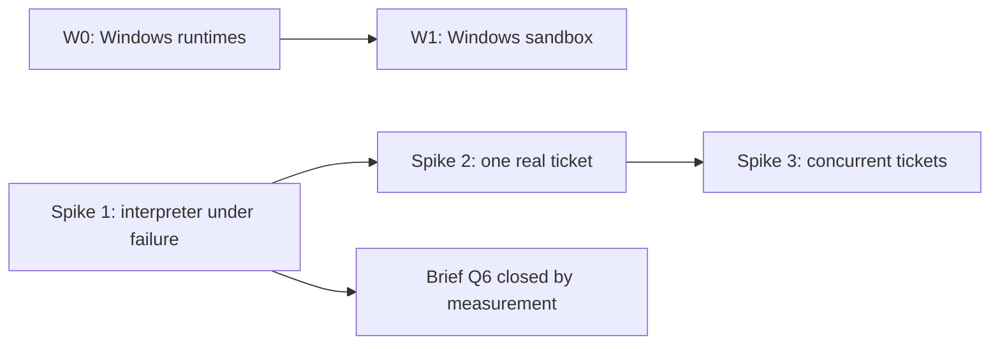

# Risks and spike plan

Status: first pass, revised for review 08. Date: 2026-10-26, updated 2026-10-27.
Deliverable 6 of `brief.md` section 11. Companion to
`docs/01-architecture-first-pass.md` section 9, which holds the risk register. This
document holds the register with mitigations, and the spike plan.

**Review 08 applied.** Adds **R20**, polling inflating history, with the mitigation
that polling happens inside one long-running activity. Adds three failure
injections to Spike 1 (Temporal unavailable, worker-to-sandbox network break, and
sizing by history events) and two to Spike 2 (fix verification and the decline
path, and the events-wake-reads-confirm path). Clarifies the Spike 2 exit criterion
against floor F1. Applies all five answers, including the W0 fallback decision.

---

## 1. Risk register

Twenty risks. Each has a first mitigation and, where it exists, a spike that tests
it.

| # | Risk | First mitigation | Tested by |
|---|---|---|---|
| R1 | History growth on a 27-hour, hundreds-of-steps run | References only, capped findings summary, measured continue-as-new threshold, replay tests | Spike 1 |
| R2 | Non-determinism leaks into the interpreter | Pure-function discipline, replay test suite in CI, code review rule | Spike 1, CI |
| R3 | Decision or steering lost during continue-as-new | Continue-as-new only at safe points; API retries when no gate is open | Spike 1 |
| R4 | LLM gates unstable across passes | Structured, fingerprinted findings carried between passes; prior findings passed to every review | Spike 2 |
| R5 | Sandbox does not match CI | `feature-flow.yaml` declares tiers; CI delegation is the default for Docker-dependent tiers | Spike 2 |
| R6 | Credential exposure in sandboxes or payloads | Short-lived, least-privilege, per-step credentials; secrets by reference; encrypted payload codec available | Spike 2 |
| R7 | Re-plan agent removes or weakens protected steps | Protected flag enforced in the single `applyPatch` path | Spike 1 |
| R8 | Runs stall on human latency | Unbounded durable waits with reminders, never activity timeouts; "stuck run" notification | Spike 2 |
| R9 | Organisation fork drifts from upstream | All organisation behaviour in configuration and providers; contract tests make drift visible. A distribution repository, not a fork, is the default customisation path | Contract tests |
| R10 | Concurrent tickets in one repository conflict | Epic integration branch plus per-ticket branches; `scm.merge_base_forward`; merge lock per target branch as a Temporal-native mutex; `max_concurrency` on the `parallel` step | Spike 3 |
| R11 | A long agent step loses its worker or sandbox and restarts from scratch | Resumable agent steps: WIP commits pushed to the branch, session reference in the artifact store, sandbox re-attachment by idempotency key | Spike 1 |
| R12 | Non-determinism in .NET workflow code is not caught at runtime | Replay tests in CI mandatory from the first workflow; workflow-code review rule: no `Task.Run`, no wall clock, no unordered collections, no I/O | CI, review |
| R13 | A run's cost is unknown after the fact | Tokens, model and compute time recorded per step from the first version | Spike 2 |
| R14 | Pattern C does not hold on Windows: the agent runtime may not run there with hook support | Spike W0 before committing to a Windows sandbox | Spike W0 |
| R15 | A resumed agent step makes no progress and never exhausts its budget | Progress rule: a resume is free only with a new commit or session growth; after 3 consecutive resumes with no progress the next counts as a restart | Spike 1 |
| R16 | Repository settings go stale mid-run because they were copied into the plan | Each step reads `feature-flow.yaml` from its branch when it starts and records the hash of the resolved manifest | Spike 2 |
| R17 | A check appears for the first time after work is submitted, causing review round trips | Pre-submit checks in interactive sessions: any validator is exposed as an on-demand action | Spike 3 |
| R18 | A long sandbox command is lost when the worker crashes, even though the sandbox survives | Commands are started and polled, not awaited: `StartCommandAsync` returns a handle and `AttachCommandAsync` re-attaches to a running command | Spike 1 |
| R19 | An unreachable hook endpoint denies every tool call, so the agent flails or gives up with a wrong outcome | Unreachable is distinguished from denied: the hook client retries and holds the tool call for a bounded time, then the session stops in a resumable state classified as infrastructure | Spike 1 |
| R20 | Polling inflates history: one short activity per poll adds hundreds of events for one long step | Poll **inside one long-running activity** that loops and heartbeats. History cost is one activity per step; after a worker crash the activity retry re-attaches by handle | Spike 1 |

### 1.1 The four that matter most

If the spike plan can only cover a little, cover these:

| # | Why |
|---|---|
| R1 | A 27-hour run with hundreds of steps is the known hard case, and history limits are a hard wall, not a degradation |
| R11 | Interruptions were the prototype's main operational pain |
| R18 | Same failure in a new form: the sandbox survives but the command is lost |
| R19 | Same failure again: a network drop becomes a wrong outcome rather than a retry |

R11, R18 and R19 are the same class — **an interruption becomes a wrong outcome
instead of a continuation**. That was the prototype's defining failure, and it is
worth treating as one theme rather than three risks.

**R20 is the mitigation's own risk.** Start-and-poll (review 06, C1) fixed R18, but
done naively — one short activity per poll — it would add about 480 activities and
well over 1,000 history events for a single 4-hour step, which alone can hit the
history limit. The fix is to poll inside one long-running activity. It is worth
noting because it is the second time a fix for one risk has introduced another.

### 1.2 Residual risks not yet mitigated

| Risk | Why it is residual |
|---|---|
| R14 | Windows support is deferred. The spike decides whether pattern C holds there at all |
| R4 | **Now measured, and the mitigation is not sufficient.** Spike 2 ran a real reviewer model four times on unchanged input: findings went 1, 1, 1, 2. A finding recorded `fixed=true` was re-raised on the next pass, and a new finding appeared on pass 4. Passing prior findings makes verdicts *more* stable, not stable. How the findings ledger should treat a re-raised finding is a Spike 3 or design question |
| R1 | The continue-as-new threshold is "measured", and the measurement does not exist yet |
| R9 | Contract tests make drift visible; they do not prevent it |

### 1.3 Design requirements recorded from Spike 2

Review 16 decided that production concerns found during a spike are recorded as
design requirements, not fixed in spike code. R1 to R4 came out of Spike 2, and R6
out of the Claude Code proof that followed it; R5 is a product owner direction.
All belong in the design, not the spike.

| # | Requirement |
|---|---|
| R1 | **Model credentials never enter the agent's environment.** Spike 2 passed the OpenRouter key as an environment variable with all tools allowed. Version 1 uses a proxy that adds the key, or per-run keys with a limit and expiry |
| R2 | **The F1 floor is enforced by the engine at merge time**, reading the base and default branch from the code host, and backed by code host protection on the default branch. Done in the spike; keep it in the design |
| R3 | **Code host protection is configured by an identity the engine does not hold.** The engine only checks that the protection exists. This is the parked review 15 A2: the App's `administration` permission lets it edit the very ruleset that protects `main` |
| R4 | **Review verdicts are unstable with a real model.** See the R4 row above. Add to the risk register; the findings ledger's handling of re-raised findings is a Spike 3 or design question |
| R5 | **Development on Windows or macOS; runtime on Windows, macOS or Linux containers** (product owner, 2026-10-30). .NET is cross-platform; Docker is used only for packaging and sandboxes. The spikes run on macOS only and do not evidence it |
| R6 | **A run that ends without reaching an `end:` route never reports `completed`.** Found by the Claude Code proof (`docs/16` 12): a fix loop that dead-ended in the interpreter ended the workflow `completed` with no PR. The same class as `docs/16` 5, bug 2. Recorded by the orchestrator, 2026-10-30, under the product owner's standing instruction; open to review |

---

## 2. Spike plan

Four spikes. Spike 1 is the one the brief names explicitly and is the gate on
everything else.

| Spike | Question it answers | Risks |
|---|---|---|
| 1 | Does the interpreter survive a worker crash and apply a mid-run re-plan? | R1, R2, R3, R7, R11, R15, R18, R19 |
| 2 | Does one real ticket run end to end, with real providers? | R4, R5, R6, R8, R13, R16 |
| 3 | Do concurrent tickets in one repository stay correct? | R10, R17 |
| W0 | Do agent runtimes run on Windows with hook support? | R14 |

### 2.1 Spike 1: the interpreter under failure

**The brief's spike.** An interpreter workflow that survives a worker crash and
applies a mid-run re-plan.

**Setup.** Sized by **history events, not steps** (review 08, answer 1). Use fake
providers — the dry-run mechanism from review 07 — to generate synthetic plans from
about 50 to 400 steps cheaply, and find where continue-as-new triggers. For
reference, the prototype's production run reached about 325 steps across an
initiative with 16 child ticket runs. Then one shorter run with real providers.

The plan includes:

- several `agent.run` steps with a long `start_to_close`;
- a `parallel` step with three branches and `join: all`;
- a protected step that a re-plan will try to remove;
- a `human.gate` mid-run;
- at least three re-plans, one of which arrives while a branch is in flight.

**Failure injection.** Kill the worker, not the sandbox:

| Injection | What must happen |
|---|---|
| Kill the worker mid-`agent.run` | The step resumes: WIP commits are on the branch, the session reference is in the artifact store, the sandbox is re-attached by idempotency key, and the **running command** is re-attached by handle (R11, R18) |
| Kill the worker repeatedly with no progress | After 3 consecutive resumes with no progress, the next counts as a restart and the attempt allowance is consumed (R15) |
| Make the hook endpoint unreachable mid-step | The agent pauses, the session stops in a resumable state, and the step classifies it as **infrastructure** — not as a denied tool call (R19) |
| **Stop the Temporal server (or block access) for several minutes mid-run** | Workers wait and resume; **no step fails**; the API reports platform status distinctly from run status (K2). **If the outage exceeds the heartbeat timeout the activity times out — the retry re-attaches by handle and the step does not fail** (H2). This is the case to prove: a timeout here must not become a work outcome |
| **Break the worker-to-sandbox connection mid-command** | The activity retries and re-attaches; the command keeps running (K3) |
| Send a re-plan that removes a protected step | `applyPatch` rejects it, and the rejection is recorded rather than silently dropped (R7) |
| Send a decision while the workflow is continuing-as-new | The update is rejected as stale and the API retries against the current run (R3) |
| Send a re-plan while a `parallel` branch is in flight | The patch applies to future steps; the in-flight branch is untouched |

**Measurements.** These are the deliverable, not the run:

| Measurement | Why |
|---|---|
| **History size and event count at each continue-as-new** | Discharges the brief Q6 condition. The threshold is "measured", and this is the measurement |
| **Events per step, especially for long polled steps** | Whether R20's mitigation holds: one activity per step, not one per poll |
| **Worker slot capacity: how many concurrent long polled steps before a queue starves** | H1. A poll loop inside one activity holds a worker slot for the whole step, possibly hours. `max_concurrency` on a `parallel` step bounds branches, but nothing bounds how many *runs* occupy slots. This decides worker pool sizing |
| Wall-clock time lost per crash | Whether resume is actually cheaper than restart |
| Attempts consumed versus resumes | Whether the progress rule behaves |
| Whether any step restarted that should have resumed | The failure mode the whole design exists to prevent |

**Exit criteria.**

1. A worker crash mid-`agent.run` resumes rather than restarts, at least once with
   the sandbox surviving.
2. A re-plan that removes a protected step is rejected and recorded.
3. A re-plan applied mid-run leaves completed and in-flight steps untouched.
4. Continue-as-new happens between steps only, and no decision is lost.
5. History size is recorded, and the continue-as-new threshold is set from it.
6. Replay tests pass against the recorded histories (R2, R12).
7. **Temporal unavailable for several minutes: no step fails, and the API reports
   platform status distinctly from run status** (K2). **Including an outage longer
   than the heartbeat timeout: the activity times out, the retry re-attaches by
   handle, and the step does not fail** (H2).
8. **A long polled step costs one activity, not one per poll** (R20).
9. **Worker slot capacity is measured**: how many concurrent long polled steps
   before a task queue starves, and what pool size the answer implies (H1).

Criterion 5 is what closes brief Q6. Until it is measured, that decision record
stays provisional.

**Simulated versus real** (review 08, answer 2): both. Simulated for fast
iteration; killing the real process — and a real sandbox and agent CLI — is the
exit criterion.

**Also in scope** (review 11 E): the Cel.NET checks from `docs/09` 8.1 — a
restricted checker, replay determinism, cost estimation, and an enforceable cost
limit. And, if the agent runtime part is ready, the `insert_after` measurement
below; otherwise that moves to Spike 2.

| Additional measurement | Why |
|---|---|
| **Cel.NET**: restricted checker, replay determinism, cost estimation, cost limit | Closes or changes the CEL choice (`docs/09` 8.1). The fallback is a hand-written subset with a published grammar, accepted by the product owner |
| **`insert_after` rewiring versus `add_step` plus `change_route`** (review 11 C2) | Have the planner agent author patches with both forms on the fixture plans and record **validation failure rates**. `docs/09` 15.3.1 argues for rewiring; this settles it. Cheap, and it moves to Spike 2 if the agent runtime is not ready |

### 2.2 Spike 2: one real ticket run

**Question.** Does one ticket run end to end against real providers, on a real
repository?

**Setup.** One real repository with a `feature-flow.yaml` declaring at least two
test tiers, one of them Docker-dependent. Real code host, real CI, real agent
runtime. Run it to a merged PR.

**Setup.** A **purpose-built fixture repository owned by the project** (review 08,
answer 3): a small .NET API with a Postgres-backed integration tier (Testcontainers)
and a GitHub Actions workflow. It doubles as the open-source example and an
end-to-end test. A production repository comes later, in the first enterprise
adopter's distribution.

**What it must show:**

| Check | Risk |
|---|---|
| A Docker-dependent tier runs through CI delegation and matches what CI would do | R5 |
| The agent's credentials are short-lived, scoped to one repository, and expire | R6 |
| Tokens, model and compute time are recorded per step | R13 |
| A review run twice on unchanged input gives the same verdict, with prior findings passed | R4 |
| Editing `feature-flow.yaml` mid-run is picked up by the next step, and the hash is recorded | R16 |
| A gate left open for hours does not time out, and a reminder fires | R8 |
| **Seed a finding, fix it, run `fix.verify`**: regression test required, checked on the full diff | K4 |
| **Record actual `outputs` sizes per step kind** (review 11 C1) | The cap of 16 entries and 256 bytes per value is a starting value. This is the measurement that replaces it |
| **The decline path**: decline reason posted on the PR, and the finding is not re-raised on the next review | K4 |
| **Approve a gate from chat** (inbound event path), then **drop one webhook deliberately** and show the polling fallback completes the step | K5 |

**Exit criteria.** One ticket runs to a merged PR, and the cost of the run is known
from the record store.

**On "without manual intervention"** (review 08, K6): that criterion conflicts with
floor F1 if the PR targets a default branch. Clarified — target an integration
branch, or count the default-branch approval as an **expected decision**, not an
intervention. The floor is not waived for the spike.

### 2.3 Spike 3: concurrent tickets

**Question.** Do several tickets of one epic in one repository stay correct?

**Plan:** `docs/17-spike-3-plan.md` (accepted 2026-10-30). **Results:** `docs/18-spike-3-results.md` (run 2026-10-30: E1 and E3 met; E2 met on a pre-registered replication, 2026-10-31, after the first series was inconclusive because the reviewer silently truncated the aggregate diff).

**Setup.** One epic, three tickets, one repository, `max_concurrency: 2`. At least
two tickets touching overlapping code areas.

**Synthetic tickets, but with a seeded cross-ticket defect** (review 08, answer 4) —
for example two tickets that each change one side of the same contract. LLM
behaviour makes an unseeded result inconclusive: without a known defect, an
epic-level review that finds nothing proves nothing.

**What it must show:**

| Check | Risk |
|---|---|
| Ticket branches merge into the integration branch serially, under the merge lock | R10 |
| `scm.merge_base_forward` runs before merge, and checks rerun only when the branch changed | R10 |
| A merge conflict routes to an agent step, not to a human | R10 |
| Epic-level review runs on the aggregate diff of the integration branch | R10 |
| An interactive session can run a pre-submit check and get the same findings the gated step would produce | R17 |

**Exit criteria.** Three tickets complete, the epic-level review sees cross-ticket
findings that per-ticket review missed, and no ticket is blocked by another's
failure.

### 2.4 Spike W0: Windows agent runtimes

**Question.** Do agent runtimes run on Windows with hook support?

This is the one place pattern C could fail on the adopter's actual repositories:
under pattern C the runtime runs *inside* the sandbox, so a Windows sandbox needs a
Windows runtime with hook support. It gates W1, the Windows VM sandbox provider.

**What it must show:**

| Check |
|---|
| The candidate runtimes (Claude Code, GitHub Copilot CLI) run on Windows |
| Their hooks fire and reach the engine endpoint |
| Session resume works on Windows |
| If hooks do not work: what coarser control is available, and is it acceptable |

**Exit criteria.** A documented answer, including the fallback if hooks are
unavailable. Also research before W1: image size and start time, and licensing of
Windows Server and build tools in VMs and containers.

### 2.5 W0 fallback without hooks (decided)

Decided by the product owner, 2026-10-27 (review 08, answer 5). If an agent runtime
has no working hooks on Windows, version-1-acceptable control is:

| Control | Mechanism |
|---|---|
| Write access | Enforced by the **sandbox itself**: read-only checkout for roles with `write_access: none`, and no push credential issued |
| Push restriction | The **credential broker**: per-step token, one repository, ticket branch only where the code host supports branch-scoped rules |
| Post-step diff check | The engine compares the branch before and after, and **fails a step that changed what its role may not change** |
| Cost | Recorded from the runtime's own usage output instead of hook events |

**Per-tool-call policy (deny before execution) is then unavailable on Windows**, and
the run records the coarser control. This is the same principle as a runtime without
the `Hooks` capability on any platform (section 1.4 of the architecture document):
the engine records what control it actually had.

---

## 3. Order and dependencies

- **Spike 1 first.** It is the brief's spike, it gates the Q6 decision record, and
  it tests the failure class that motivated the whole design.
- **Spike 2 second.** It needs a working interpreter, and it is the first time real
  providers are exercised.
- **Spike 3 third.** It needs a working ticket run to compose.
- **W0 is independent** and can run in parallel. It gates Windows work only.

---

## 4. What the spike plan deliberately does not cover

| Not covered | Why |
|---|---|
| Workflow content quality | Out of scope for the brief. The spikes use throwaway plans |
| Multi-tenancy | Q15: one organisation per installation in version 1 |
| Cost budgets | Q16: recording only in version 1 |
| Disaster recovery | Q18: no custom mechanism; standard backups |
| Performance at scale | One run at a time is enough to answer these questions |

### 4.1 Carried to later work

| Item | Where it lands |
|---|---|
| **The API must report platform status distinctly from run status** (K2, half of Spike 1 exit criterion 7) | Deferred to the API work (review 12, answer 1). Spike 1 proved the other half — no step fails during a platform outage — but the spike has no API layer, only a client. This is an **acceptance criterion the API must meet**, recorded here so it is not lost |
| Worker pool sizing | `docs/07`, once Spike 1's slot measurement is reproducible (review 12, answer 5) |

---

## 5. Open questions

All five questions from the first pass were answered in review 08 and are applied
above:

| # | Question | Answer |
|---|---|---|
| 1 | Spike 1 plan length | **Size by history events, not steps.** Fake providers generate synthetic plans from about 50 to 400 steps cheaply; find where continue-as-new triggers. Then one shorter run with real providers (section 2.1) |
| 2 | Kill the worker or simulate | **Both.** Simulated for fast iteration; killing the real process, sandbox and agent CLI is the exit criterion (section 2.1) |
| 3 | Spike 2 repository | **A purpose-built fixture repository owned by the project**: a small .NET API with a Postgres-backed integration tier and a GitHub Actions workflow. It doubles as the open-source example and an end-to-end test (section 2.2) |
| 4 | Real epic for Spike 3 | **Synthetic tickets with a seeded cross-ticket defect.** Unseeded LLM results are inconclusive (section 2.3) |
| 5 | Acceptable W0 fallback without hooks | **Decided, accepted.** Sandbox-enforced write access, broker-restricted push, post-step diff check, cost from runtime usage output. Per-tool-call policy unavailable and recorded (section 2.5) |

### Still open

None carried forward.
