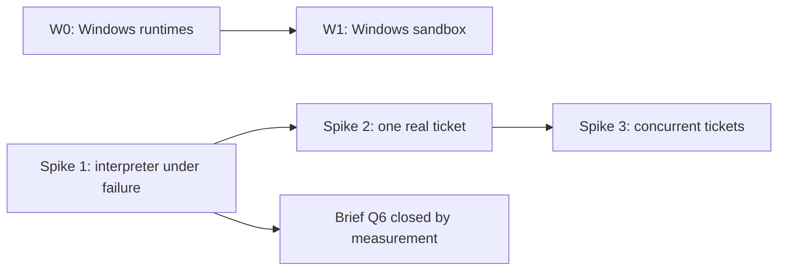

# Risks and spike plan

Status: first pass. Date: 2026-10-26. Deliverable 6 of `brief.md` section 11.
Companion to `docs/01-architecture-first-pass.md` section 9, which holds the risk
register. This document holds the register with mitigations, and the spike plan.

---

## 1. Risk register

Nineteen risks. Each has a first mitigation and, where it exists, a spike that
tests it.

| # | Risk | First mitigation | Tested by |
|---|---|---|---|
| R1 | History growth on a 27-hour, hundreds-of-steps run | References only, capped findings summary, measured continue-as-new threshold, replay tests | Spike 1 |
| R2 | Non-determinism leaks into the interpreter | Pure-function discipline, replay test suite in CI, code review rule | Spike 1, CI |
| R3 | Decision or steering lost during continue-as-new | Continue-as-new only at safe points; API retries when no gate is open | Spike 1 |
| R4 | LLM gates unstable across passes | Structured, fingerprinted findings carried between passes; prior findings passed to every review | Spike 2 |
| R5 | Sandbox does not match CI | `feature-flow.yaml` declares tiers; CI delegation is the default for Docker-dependent tiers | Spike 2 |
| R6 | Credential exposure in sandboxes or payloads | Short-lived, least-privilege, per-step credentials; secrets by reference; encrypted payload codec available | Spike 2 |
| R7 | Re-plan agent removes or weakens protected steps | Protected flag enforced in the single `applyPatch` path | Spike 1 |
| R8 | Runs stall on human latency | Unbounded durable waits with reminders, never activity timeouts; "stuck run" notification | Spike 2 |
| R9 | Organisation fork drifts from upstream | All organisation behaviour in configuration and providers; contract tests make drift visible. A distribution repository, not a fork, is the default customisation path | Contract tests |
| R10 | Concurrent tickets in one repository conflict | Epic integration branch plus per-ticket branches; `scm.merge_base_forward`; merge lock per target branch as a Temporal-native mutex; `max_concurrency` on the `parallel` step | Spike 3 |
| R11 | A long agent step loses its worker or sandbox and restarts from scratch | Resumable agent steps: WIP commits pushed to the branch, session reference in the artifact store, sandbox re-attachment by idempotency key | Spike 1 |
| R12 | Non-determinism in .NET workflow code is not caught at runtime | Replay tests in CI mandatory from the first workflow; workflow-code review rule: no `Task.Run`, no wall clock, no unordered collections, no I/O | CI, review |
| R13 | A run's cost is unknown after the fact | Tokens, model and compute time recorded per step from the first version | Spike 2 |
| R14 | Pattern C does not hold on Windows: the agent runtime may not run there with hook support | Spike W0 before committing to a Windows sandbox | Spike W0 |
| R15 | A resumed agent step makes no progress and never exhausts its budget | Progress rule: a resume is free only with a new commit or session growth; after 3 consecutive resumes with no progress the next counts as a restart | Spike 1 |
| R16 | Repository settings go stale mid-run because they were copied into the plan | Each step reads `feature-flow.yaml` from its branch when it starts and records the hash of the resolved manifest | Spike 2 |
| R17 | A check appears for the first time after work is submitted, causing review round trips | Pre-submit checks in interactive sessions: any validator is exposed as an on-demand action | Spike 3 |
| R18 | A long sandbox command is lost when the worker crashes, even though the sandbox survives | Commands are started and polled, not awaited: `StartCommandAsync` returns a handle and `AttachCommandAsync` re-attaches to a running command | Spike 1 |
| R19 | An unreachable hook endpoint denies every tool call, so the agent flails or gives up with a wrong outcome | Unreachable is distinguished from denied: the hook client retries and holds the tool call for a bounded time, then the session stops in a resumable state classified as infrastructure | Spike 1 |

### 1.1 The four that matter most

If the spike plan can only cover a little, cover these:

| # | Why |
|---|---|
| R1 | A 27-hour run with hundreds of steps is the known hard case, and history limits are a hard wall, not a degradation |
| R11 | Interruptions were the prototype's main operational pain |
| R18 | Same failure in a new form: the sandbox survives but the command is lost |
| R19 | Same failure again: a network drop becomes a wrong outcome rather than a retry |

R11, R18 and R19 are the same class — **an interruption becomes a wrong outcome
instead of a continuation**. That was the prototype's defining failure, and it is
worth treating as one theme rather than three risks.

### 1.2 Residual risks not yet mitigated

| Risk | Why it is residual |
|---|---|
| R14 | Windows support is deferred. The spike decides whether pattern C holds there at all |
| R4 | Passing prior findings makes verdicts *more* stable, not stable. Whether it is enough is unproven |
| R1 | The continue-as-new threshold is "measured", and the measurement does not exist yet |
| R9 | Contract tests make drift visible; they do not prevent it |

---

## 2. Spike plan

Four spikes. Spike 1 is the one the brief names explicitly and is the gate on
everything else.

| Spike | Question it answers | Risks |
|---|---|---|
| 1 | Does the interpreter survive a worker crash and apply a mid-run re-plan? | R1, R2, R3, R7, R11, R15, R18, R19 |
| 2 | Does one real ticket run end to end, with real providers? | R4, R5, R6, R8, R13, R16 |
| 3 | Do concurrent tickets in one repository stay correct? | R10, R17 |
| W0 | Do agent runtimes run on Windows with hook support? | R14 |

### 2.1 Spike 1: the interpreter under failure

**The brief's spike.** An interpreter workflow that survives a worker crash and
applies a mid-run re-plan.

**Setup.** A plan of 40 to 60 steps, deliberately longer than needed, with:

- several `agent.run` steps with a long `start_to_close`;
- a `parallel` step with three branches and `join: all`;
- a protected step that a re-plan will try to remove;
- a `human.gate` mid-run;
- at least three re-plans, one of which arrives while a branch is in flight.

**Failure injection.** Kill the worker, not the sandbox:

| Injection | What must happen |
|---|---|
| Kill the worker mid-`agent.run` | The step resumes: WIP commits are on the branch, the session reference is in the artifact store, the sandbox is re-attached by idempotency key, and the **running command** is re-attached by handle (R11, R18) |
| Kill the worker repeatedly with no progress | After 3 consecutive resumes with no progress, the next counts as a restart and the attempt allowance is consumed (R15) |
| Make the hook endpoint unreachable mid-step | The agent pauses, the session stops in a resumable state, and the step classifies it as **infrastructure** — not as a denied tool call (R19) |
| Send a re-plan that removes a protected step | `applyPatch` rejects it, and the rejection is recorded rather than silently dropped (R7) |
| Send a decision while the workflow is continuing-as-new | The update is rejected as stale and the API retries against the current run (R3) |
| Send a re-plan while a `parallel` branch is in flight | The patch applies to future steps; the in-flight branch is untouched |

**Measurements.** These are the deliverable, not the run:

| Measurement | Why |
|---|---|
| **History size and event count at each continue-as-new** | Discharges the brief Q6 condition. The threshold is "measured", and this is the measurement |
| Wall-clock time lost per crash | Whether resume is actually cheaper than restart |
| Attempts consumed versus resumes | Whether the progress rule behaves |
| Whether any step restarted that should have resumed | The failure mode the whole design exists to prevent |

**Exit criteria.**

1. A worker crash mid-`agent.run` resumes rather than restarts, at least once with
   the sandbox surviving.
2. A re-plan that removes a protected step is rejected and recorded.
3. A re-plan applied mid-run leaves completed and in-flight steps untouched.
4. Continue-as-new happens between steps only, and no decision is lost.
5. History size is recorded, and the continue-as-new threshold is set from it.
6. Replay tests pass against the recorded histories (R2, R12).

Criterion 5 is what closes brief Q6. Until it is measured, that decision record
stays provisional.

### 2.2 Spike 2: one real ticket run

**Question.** Does one ticket run end to end against real providers, on a real
repository?

**Setup.** One real repository with a `feature-flow.yaml` declaring at least two
test tiers, one of them Docker-dependent. Real code host, real CI, real agent
runtime. Run it to a merged PR.

**What it must show:**

| Check | Risk |
|---|---|
| A Docker-dependent tier runs through CI delegation and matches what CI would do | R5 |
| The agent's credentials are short-lived, scoped to one repository, and expire | R6 |
| Tokens, model and compute time are recorded per step | R13 |
| A review run twice on unchanged input gives the same verdict, with prior findings passed | R4 |
| Editing `feature-flow.yaml` mid-run is picked up by the next step, and the hash is recorded | R16 |
| A gate left open for hours does not time out, and a reminder fires | R8 |

**Exit criteria.** One ticket runs to a merged PR without manual intervention, and
the cost of the run is known from the record store.

### 2.3 Spike 3: concurrent tickets

**Question.** Do several tickets of one epic in one repository stay correct?

**Setup.** One epic, three tickets, one repository, `max_concurrency: 2`. At least
two tickets touching overlapping code areas.

**What it must show:**

| Check | Risk |
|---|---|
| Ticket branches merge into the integration branch serially, under the merge lock | R10 |
| `scm.merge_base_forward` runs before merge, and checks rerun only when the branch changed | R10 |
| A merge conflict routes to an agent step, not to a human | R10 |
| Epic-level review runs on the aggregate diff of the integration branch | R10 |
| An interactive session can run a pre-submit check and get the same findings the gated step would produce | R17 |

**Exit criteria.** Three tickets complete, the epic-level review sees cross-ticket
findings that per-ticket review missed, and no ticket is blocked by another's
failure.

### 2.4 Spike W0: Windows agent runtimes

**Question.** Do agent runtimes run on Windows with hook support?

This is the one place pattern C could fail on the adopter's actual repositories:
under pattern C the runtime runs *inside* the sandbox, so a Windows sandbox needs a
Windows runtime with hook support. It gates W1, the Windows VM sandbox provider.

**What it must show:**

| Check |
|---|
| The candidate runtimes (Claude Code, GitHub Copilot CLI) run on Windows |
| Their hooks fire and reach the engine endpoint |
| Session resume works on Windows |
| If hooks do not work: what coarser control is available, and is it acceptable |

**Exit criteria.** A documented answer, including the fallback if hooks are
unavailable. Also research before W1: image size and start time, and licensing of
Windows Server and build tools in VMs and containers.

---

## 3. Order and dependencies

- **Spike 1 first.** It is the brief's spike, it gates the Q6 decision record, and
  it tests the failure class that motivated the whole design.
- **Spike 2 second.** It needs a working interpreter, and it is the first time real
  providers are exercised.
- **Spike 3 third.** It needs a working ticket run to compose.
- **W0 is independent** and can run in parallel. It gates Windows work only.

---

## 4. What the spike plan deliberately does not cover

| Not covered | Why |
|---|---|
| Workflow content quality | Out of scope for the brief. The spikes use throwaway plans |
| Multi-tenancy | Q15: one organisation per installation in version 1 |
| Cost budgets | Q16: recording only in version 1 |
| Disaster recovery | Q18: no custom mechanism; standard backups |
| Performance at scale | One run at a time is enough to answer these questions |

---

## 5. Open questions

1. **How long the Spike 1 plan should be.** 40 to 60 steps is a proposal. It needs
   to be long enough to force continue-as-new and to make a restart visibly
   expensive, but not so long that each iteration costs hours.
2. **Whether to inject failure by killing the worker process or by simulating it.**
   Killing the process is more honest; simulating is faster to iterate on. Both are
   worth having, and the honest one is the exit criterion.
3. **Which repository Spike 2 uses.** It needs a real repository with a
   Docker-dependent tier. Whether that is this repository or a fixture is open.
4. **Whether Spike 3 needs a real epic.** Three synthetic tickets may not produce
   the cross-ticket findings that make epic-level review worth testing.
5. **What "acceptable" means for W0 if hooks are unavailable.** The spike will
   report what coarser control exists; whether that is acceptable is a product
   decision, not a technical one.
